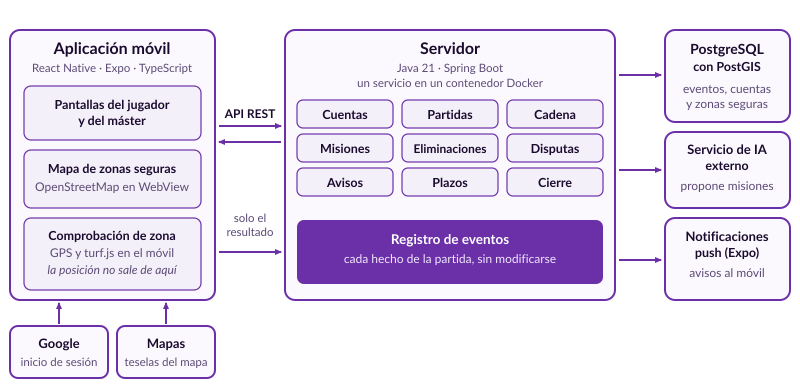

# Arquitectura

Documentación viva del diseño. Se actualiza en la misma *pull request* que cambia el diseño (definición de hecho). Diagramas nuevos en Mermaid dentro de este fichero o en ficheros hermanos.

## Planteamiento inicial (fase previa)

Todas las reglas del juego se ejecutan en un único servidor, dividido en módulos y desplegado en un contenedor Docker. Hay un solo despliegue y una sola base de datos, así que no hay llamadas de red entre servicios. El móvil muestra el estado y envía las acciones del jugador, y es el servidor quien decide si son válidas. Lo que depende del tiempo, como el arranque de la partida o el fin del plazo para disputar, lo lanza un planificador del propio servidor.

Cada partida se guarda como una lista de eventos: una eliminación, una disputa, un abandono o un reparto de objetivos es un evento que después no se modifica, y el estado actual se obtiene reproduciéndolos. Anular una eliminación consiste en dejar de contar ese evento y añadir el del nuevo reparto, y todas las anulaciones quedan a la vista de los jugadores. Los eventos identifican a cada jugador por su inscripción en la partida, no por su cuenta; al borrar una cuenta, la inscripción pierde el enlace con la persona y los eventos no se tocan. Al cerrar la partida se borran todos y se conserva únicamente el resumen agregado.

La posición del jugador nunca sale del móvil. Cuando se introduce un código de vida, el móvil comprueba con el GPS si el jugador está dentro de una zona segura y envía solo el resultado (dentro, fuera o no concluyente). El servidor no recibe ni guarda ninguna posición.

## Cambios por sprint

<!-- S1: módulos creados, modelo de datos, decisiones (PaaS, proveedor de IA, biblioteca del mapa)… Lo de cada sprint va a N.2 de la memoria. -->

### Sprint 1

- Convenciones comunes de tablas, migraciones y API: [`convenciones-modelo-datos.md`](convenciones-modelo-datos.md). Nombres en español sin tildes ni ñ, claves UUID, instantes en UTC y migraciones con Flyway.
- Modelo de datos de la cuenta y de la partida, con sus estados: [`modelo-datos.md`](modelo-datos.md).
- Contrato de la API, escrito antes que el código: [`api/openapi.yaml`](api/openapi.yaml).
- **Cuenta y sesión (PBI 1).** En el servidor, el módulo `sesion` registra la cuenta e inicia, renueva y cierra la sesión, y el módulo `cuenta` guarda el horario lectivo, las aceptaciones y el borrado.
  - La contraseña se guarda con bcrypt y ninguna respuesta la devuelve.
  - El token de acceso es un JWT de 15 minutos firmado con HMAC; la clave sale de la variable de entorno `JWT_SECRETO` (al menos 32 bytes) y el servidor no arranca sin ella. Las rutas protegidas lo exigen en la cabecera `Authorization`.
  - El token de refresco dura 30 días y sirve una sola vez: al usarlo se entrega uno nuevo. El servidor guarda solo su hash SHA-256, lo revoca al cerrar sesión o al borrar la cuenta, y una tarea programada borra una vez al día los que caducaron hace más de 30 días.
  - El permiso de ubicación y el aviso de disponibilidad guardan el instante de la primera aceptación; aceptarlos otra vez no cambia nada.
  - Borrar la cuenta es un borrado físico: la fila de `cuenta` y, en cascada, su horario y sus tokens.
  - En la app, el alta tiene cuatro pasos (alias y acceso, horario lectivo, permiso de ubicación y aviso de disponibilidad) y el token de refresco se guarda en el almacenamiento seguro del móvil (SecureStore).

## Decisiones técnicas abiertas

| Decisión | Cuándo se toma | Opciones | Decidido |
|--|--|--|--|
| PaaS del despliegue | Sprint 1 | Render, Railway, Fly.io (PostGIS, coste, continuidad) | Render (tarea 1.4, #37): servicio web con la imagen Docker del servidor y PostgreSQL gestionado con PostGIS (activado por migración), HTTPS automático y secretos en variables de entorno del servicio, todo descrito en `render.yaml`. Plan gratuito: el servicio se duerme tras un rato sin peticiones y la base de datos caduca a los 30 días (riesgo Ri19). |
| Proveedor de IA | Sprint 1 | Según coste y condiciones de uso | |
| Biblioteca del mapa | Primera PBI con mapa | OpenLayers, Leaflet | |
| Migración a la nube | Ensayo en el sprint 3 | Azure, AWS | |
