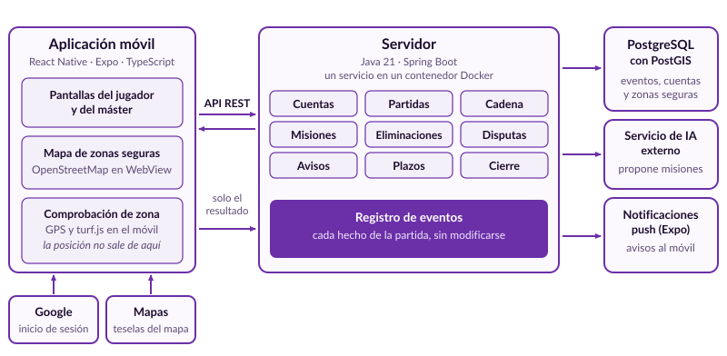

# Arquitectura

Documentación viva del diseño. Se actualiza en la misma *pull request* que cambia el diseño (definición de hecho). Diagramas nuevos en Mermaid dentro de este fichero o en ficheros hermanos.

## Planteamiento inicial (fase previa)

Todas las reglas del juego se ejecutan en un único servidor, dividido en módulos y desplegado en un contenedor Docker. Hay un solo despliegue y una sola base de datos, así que no hay llamadas de red entre servicios. El móvil muestra el estado y envía las acciones del jugador, y es el servidor quien decide si son válidas. Lo que depende del tiempo, como el arranque de la partida o el fin del plazo para disputar, lo lanza un planificador del propio servidor.

Cada partida se guarda como una lista de eventos: una eliminación, una disputa, un abandono o un reparto de objetivos es un evento que después no se modifica, y el estado actual se obtiene reproduciéndolos. Anular una eliminación consiste en dejar de contar ese evento y añadir el del nuevo reparto, y todas las anulaciones quedan a la vista de los jugadores. Los eventos identifican a cada jugador por su inscripción en la partida, no por su cuenta; al borrar una cuenta, la inscripción pierde el enlace con la persona y los eventos no se tocan. Al cerrar la partida se borran todos y se conserva únicamente el resumen agregado.

La posición del jugador nunca sale del móvil. Cuando se introduce un código de vida, el móvil comprueba con el GPS si el jugador está dentro de una zona segura y envía solo el resultado (dentro, fuera o no concluyente). El servidor no recibe ni guarda ninguna posición.

## Cambios por sprint

<!-- S1: módulos creados, modelo de datos, decisiones (PaaS, proveedor de IA, biblioteca del mapa)… Lo de cada sprint va al apartado N.2 del informe. -->

### Sprint 1

- Convenciones comunes de tablas, migraciones y API: [`convenciones-modelo-datos.md`](convenciones-modelo-datos.md). Nombres en español sin tildes ni ñ, claves UUID, instantes en UTC y migraciones con Flyway.
- Modelo de datos de la cuenta y de la partida, con sus estados: [`modelo-datos.md`](modelo-datos.md).
- Contrato de la API, escrito antes que el código: [`api/openapi.yaml`](api/openapi.yaml).
- **Cuenta y sesión (PBI 1).** En el servidor, el módulo `sesion` registra la cuenta e inicia, renueva y cierra la sesión, y el módulo `cuenta` guarda el horario lectivo, las aceptaciones y el borrado.
  - La contraseña se guarda con bcrypt y ninguna respuesta la devuelve.
  - El token de acceso es un JWT de 15 minutos firmado con HMAC; la clave sale de la variable de entorno `JWT_SECRETO` (al menos 32 bytes) y el servidor no arranca sin ella. Las rutas protegidas lo exigen en la cabecera `Authorization`.
  - El token de refresco dura 30 días y sirve una sola vez: al usarlo se entrega uno nuevo. El servidor guarda solo su hash SHA-256, lo revoca al cerrar sesión o al borrar la cuenta, y una tarea programada borra una vez al día los que caducaron hace más de 30 días.
  - El permiso de ubicación y el aviso de disponibilidad guardan el instante de la primera aceptación; aceptarlos otra vez no cambia nada.
  - Borrar la cuenta es un borrado físico: la fila de `cuenta` y, en cascada, su horario y sus tokens.
  - En la app, el alta tiene cuatro pasos (alias y acceso, horario lectivo, permiso de ubicación y aviso de disponibilidad) y el token de refresco se guarda en el almacenamiento seguro del móvil (SecureStore).
- **Lista de eventos.** El módulo `evento` guarda cada evento en la misma transacción que el cambio que registra, con la fila de la partida bloqueada (`select … for update`) y la secuencia siguiente de esa partida. Los eventos identifican al jugador por su inscripción y no se modifican. Tipos y datos de cada uno en «`evento`» de [`modelo-datos.md`](modelo-datos.md).
- **Crear y configurar una partida (PBI 2).** El módulo `partida` crea la partida con un código de invitación de 8 caracteres (sin 0, O, 1, I ni L), guarda `PARTIDA_CREADA` y deja editarla al máster solo mientras está en inscripción, con `CONFIGURACION_CAMBIADA` por cada cambio. La columna `estado` es una copia del estado que dan los eventos, para listar partidas sin reproducirlos.
  - Si el máster borra su cuenta, sus partidas en inscripción se cancelan en la misma transacción.
  - En la app, el asistente tiene tres pasos (datos, reglas y compartir); los de misiones y zonas seguras llegan con las PBI 6 y 10. «Compartir» enseña el QR (`react-native-qrcode-svg`) y el enlace `ghostmark://unirse/<código>`, que la app abre por su esquema `ghostmark`.
- **Inscribirse (PBI 3).** El módulo `inscripcion` inscribe al jugador con las normas aceptadas y le copia el horario de su cuenta en un horario propio de esa partida, que puede cambiar hasta el arranque sin tocar el de la cuenta ni el de sus otras partidas. Si el máster juega, tiene su inscripción como cualquier otro.
  - Al borrar la cuenta, la inscripción se borra si la partida no ha arrancado; si está en juego o cerrada se queda sin cuenta, porque la cadena y los eventos la siguen usando.
  - En la app, el escáner usa la cámara (`expo-camera`) y solo acepta enlaces de invitación válidos; un enlace recibido sin sesión espera al inicio de sesión y a los permisos. Después vienen las normas y la sala de espera con los inscritos.
- **Arrancar la partida y formar la cadena (PBI 4).** El módulo `juego` arranca la partida de tres maneras con el mismo método:
  - una tarea programada cada minuto (`TareaArranque`) revisa las partidas en inscripción con la hora de inicio pasada;
  - como el servidor de Render se duerme y entonces la tarea no corre, un interceptor (`InterceptorArranquePendiente`) aplica el arranque o la cancelación pendiente antes de atender cualquier petición sobre la partida;
  - el máster puede adelantarlo con «Arrancar ya» desde 3 jugadores.
  - Con 3 o más jugadores, en una sola transacción se guardan `PARTIDA_ARRANCADA`, `CICLO_FORMADO` y `MISIONES_REPARTIDAS`, y los horarios quedan congelados; con menos, `PARTIDA_CANCELADA`. Si dos arranques coinciden, el segundo ve que la partida ya no está en inscripción y no hace nada.
  - El ciclo de objetivos baraja las inscripciones con Fisher-Yates y `SecureRandom` (`GeneradorCiclo`): cada jugador persigue al siguiente y el último al primero. El orden solo se guarda en el evento; la API da a cada jugador su objetivo.
- **Carta de misión (PBI 5).** La biblioteca de misiones se carga con una migración, ya revisada (sin contacto físico ni objetos que simulen armas). Al arrancar, cada jugador recibe una misión activa al azar, sin repetir mientras queden. La API solo devuelve la carta propia; en la app la carta sale boca abajo y se ve mientras se mantiene pulsada.

## Decisiones técnicas abiertas

| Decisión | Cuándo se toma | Opciones | Decidido |
|--|--|--|--|
| PaaS del despliegue | Sprint 1 | Render, Railway, Fly.io (PostGIS, coste, continuidad) | Render (servidor, tarea 1.4, #37) y Neon (base de datos, tarea #218): servicio web con la imagen Docker del servidor, descrito en `render.yaml`, y PostgreSQL gratuito con PostGIS (activado por migración). HTTPS automático en el servicio y secretos en sus variables de entorno. El servicio se duerme tras un rato sin peticiones; la base de datos no caduca (Ri19 cerrado). |
| Proveedor de IA | Planificación del sprint 2 (R11-8) | Según coste y condiciones de uso | Gemini (modelo Flash) con la clave gratuita de Google AI Studio, sin coste, con salida JSON estructurada. Va detrás de la interfaz `GeneradorMisiones` del servidor, para poder cambiar de proveedor sin tocar el resto: `GeneradorGemini` en producción y `GeneradorSimulado` en los tests y la integración continua, sin llamadas reales. La clave (`GEMINI_CLAVE`) y el modelo (`GEMINI_MODELO`) van en variables de entorno de Render, nunca en el repositorio. Si la IA falla, tarda más de 15 s o no queda cuota, la partida sigue con la biblioteca (PBI 6b). Detalle en «Misiones generadas con IA» de [`modelo-datos.md`](modelo-datos.md). |
| Biblioteca del mapa | Primera PBI con mapa | OpenLayers, Leaflet | |
| Migración a la nube | Ensayo en el sprint 3 | Azure, AWS | |
