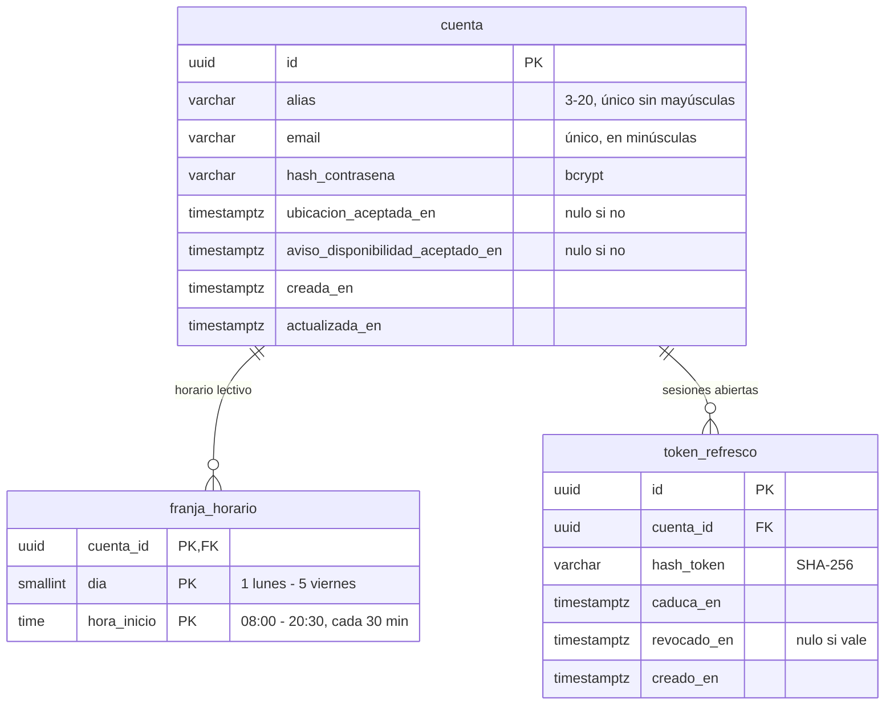
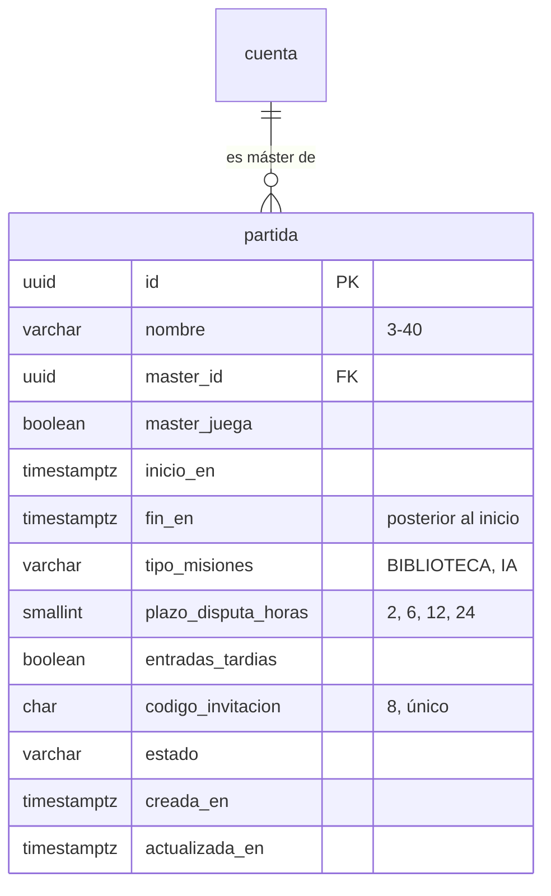
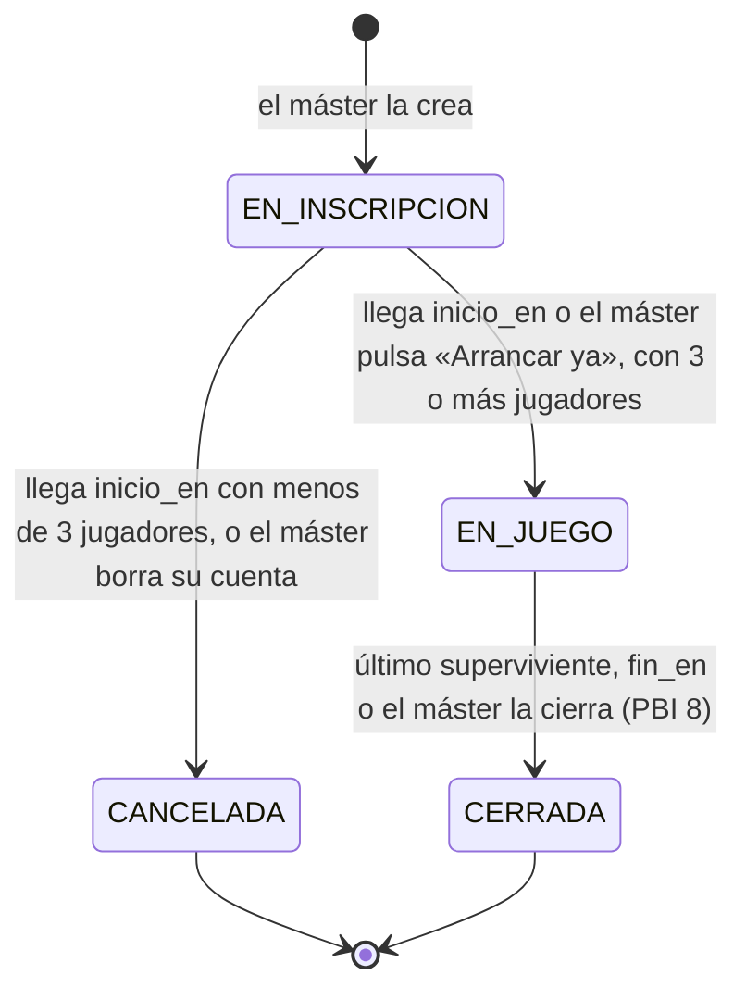
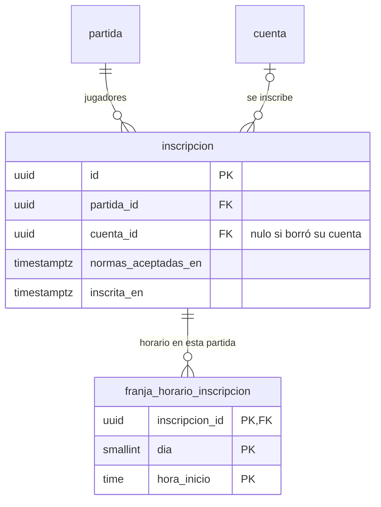
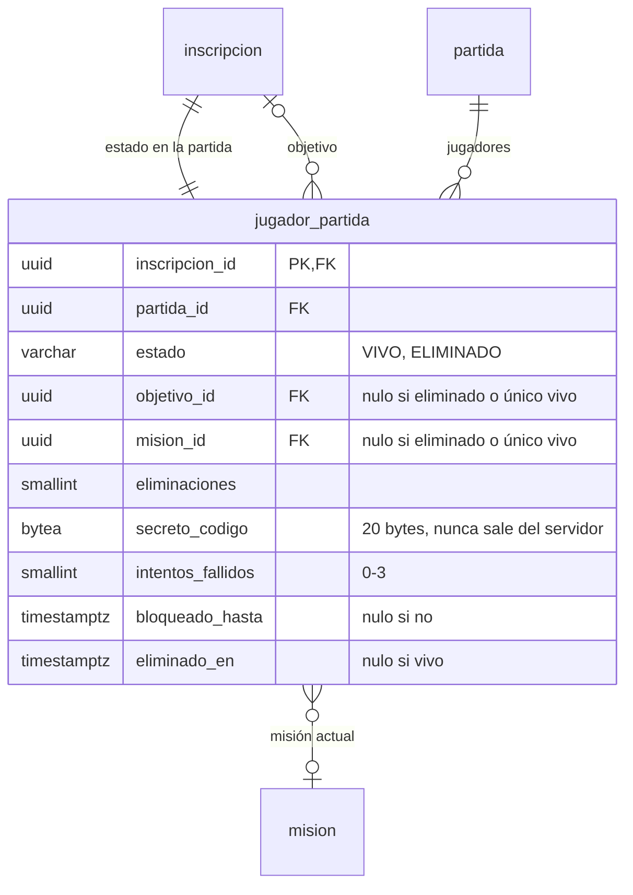
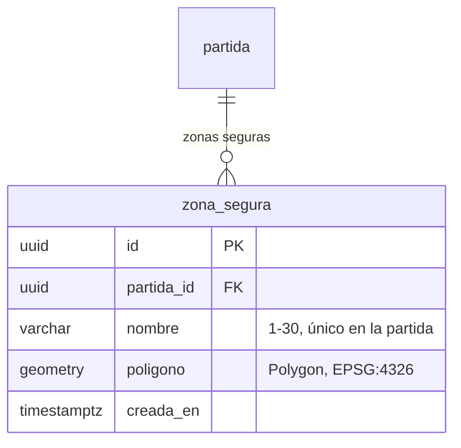
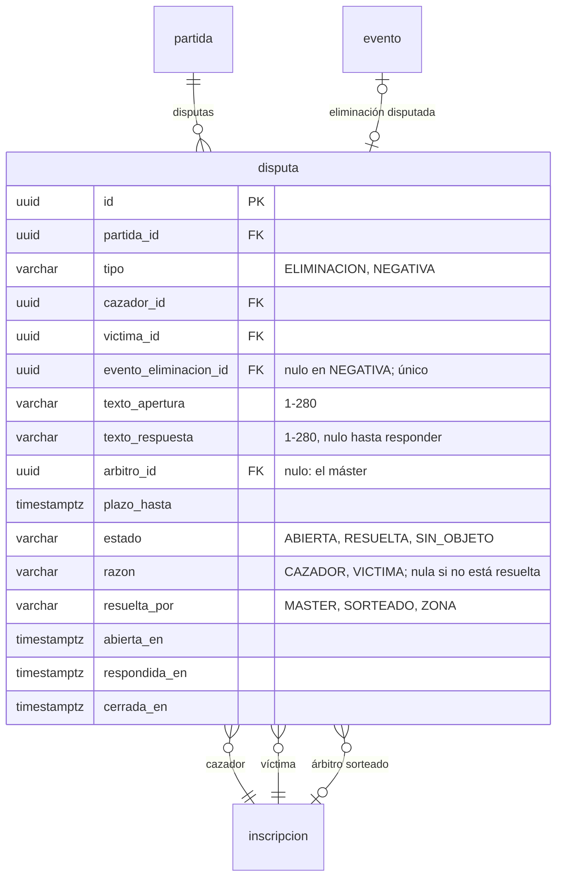

# Modelo de datos

Tablas del servidor, por PBI. Sigue las [convenciones del modelo de datos](convenciones-modelo-datos.md). Cada tabla se crea con su migración en la tarea de servidor que la usa por primera vez.

## Cuenta del jugador (PBI 1, #2)

La cuenta guarda solo el alias, los datos de acceso, el horario lectivo y, más adelante, la lista de amigos (PBI 15), sin nombre real ni documentos. El acceso con Google (PBI 18) añadirá su columna con otra migración.

### `cuenta`

| Columna | Tipo | Restricciones | Regla de producto |
|--|--|--|--|
| `id` | `uuid` | clave primaria | |
| `alias` | `varchar(20)` | no nulo; `check (alias ~ '^[A-Za-z0-9_]{3,20}$')`; índice único sobre `lower(alias)` | Único sin distinguir mayúsculas, de 3 a 20 caracteres: letras sin tildes, números y guion bajo |
| `email` | `varchar(254)` | no nulo; único; se guarda en minúsculas | Solo sirve para iniciar sesión; no se verifica en el L1 |
| `hash_contrasena` | `varchar(60)` | no nulo | bcrypt; la contraseña tiene de 8 a 72 caracteres y nunca se guarda legible |
| `ubicacion_aceptada_en` | `timestamptz` | nulo hasta que se acepta | El permiso de ubicación se pide una sola vez |
| `aviso_disponibilidad_aceptado_en` | `timestamptz` | nulo hasta que se acepta | El aviso de disponibilidad del objetivo se acepta una sola vez |
| `creada_en`, `actualizada_en` | `timestamptz` | no nulo | |

### `franja_horario`

Una fila por cada franja de 30 minutos marcada en la rejilla del horario lectivo (lunes a viernes, de 8:00 a 21:00). Una cuenta sin filas no tiene horas de clase.

| Columna | Tipo | Restricciones |
|--|--|--|
| `cuenta_id` | `uuid` | clave ajena a `cuenta`, `on delete cascade` |
| `dia` | `smallint` | `check (dia between 1 and 5)` |
| `hora_inicio` | `time` | `check (hora_inicio between '08:00' and '20:30' and extract(minute from hora_inicio) in (0, 30) and extract(second from hora_inicio) = 0)` |

Clave primaria: `(cuenta_id, dia, hora_inicio)`. Al inscribirse en una partida, el horario se copia a la inscripción (PBI 3) y se congela al arrancar (PBI 4).

### `token_refresco`

| Columna | Tipo | Restricciones |
|--|--|--|
| `id` | `uuid` | clave primaria |
| `cuenta_id` | `uuid` | clave ajena a `cuenta`, `on delete cascade`; índice |
| `hash_token` | `varchar(64)` | no nulo; único. Se guarda el SHA-256 del token, nunca el token |
| `caduca_en` | `timestamptz` | no nulo; 30 días desde que se emite |
| `revocado_en` | `timestamptz` | nulo mientras vale; se rellena al usarlo, al cerrar sesión o al borrar la cuenta |
| `creado_en` | `timestamptz` | no nulo |

### Borrar la cuenta

Borrado físico: se borra la fila de `cuenta` y, en cascada, su horario y sus tokens. Sus inscripciones en partidas `EN_JUEGO` o `CERRADA` se quedan con `cuenta_id` a `null` y sin horario (R11-33), y las de partidas sin arrancar (`EN_INSCRIPCION` o `CANCELADA`) se borran; la app muestra «cuenta eliminada» (ver «Inscripción»). El alias y el email quedan libres. Si es máster de alguna partida, ver «Partida».

## Partida (PBI 2, #3)

El máster crea la partida y la comparte con un código de invitación. Los pasos de misiones y zonas seguras del asistente llegan con las PBI 6 y 10; el tipo de misiones, el plazo de disputas y las entradas tardías se guardan ya y actúan con otras PBI.

### `partida`

| Columna | Tipo | Restricciones | Regla de producto |
|--|--|--|--|
| `id` | `uuid` | clave primaria | |
| `nombre` | `varchar(40)` | no nulo; `check (char_length(nombre) >= 3)` | De 3 a 40 caracteres, no único |
| `master_id` | `uuid` | clave ajena a `cuenta`, `on delete set null`; índice | Quien crea la partida. Nulo si borró su cuenta |
| `master_juega` | `boolean` | no nulo | «Yo también juego». Si juega, se inscribe como un jugador más (PBI 3) y la app le oculta lo que no le toca |
| `inicio_en` | `timestamptz` | no nulo | Fecha prevista de arranque; al crearla o cambiarla, al menos 15 min en el futuro (lo comprueba la API) |
| `fin_en` | `timestamptz` | no nulo; `check (fin_en > inicio_en)` | Sin duración mínima ni máxima |
| `tipo_misiones` | `varchar(10)` | no nulo; `check (tipo_misiones in ('BIBLIOTECA', 'IA'))` | En el S1 solo actúa `BIBLIOTECA` |
| `plazo_disputa_horas` | `smallint` | no nulo; `check (plazo_disputa_horas in (2, 6, 12, 24))` | Chips del asistente; actúa con la PBI 11 |
| `entradas_tardias` | `boolean` | no nulo | Actúa con la PBI 16 |
| `codigo_invitacion` | `char(8)` | no nulo; único; `check (codigo_invitacion ~ '^[2-9A-HJKMNP-Z]{8}$')` | 8 caracteres sin 0, O, 1, I ni L; el enlace es `ghostmark://unirse/<código>` |
| `estado` | `varchar(20)` | `check (estado in ('EN_INSCRIPCION', 'EN_JUEGO', 'CANCELADA', 'CERRADA'))`; por defecto `EN_INSCRIPCION` | Ver «Estados de la partida» |
| `creada_en`, `actualizada_en` | `timestamptz` | no nulo | |

- **Lo que pasa en la partida se guarda como eventos** (tabla `evento`, tarea 1.1). Crear la partida guarda el evento `PARTIDA_CREADA` (tarea 2.2). La columna `estado` es una copia del estado que se obtiene de los eventos, para poder listar partidas sin reproducirlos; se actualiza en la misma transacción que el evento.
- **Editar:** el máster cambia nombre, fechas y reglas solo en `EN_INSCRIPCION`. `master_id` y `codigo_invitacion` no cambian nunca.
- **Si el máster borra su cuenta**: sus partidas en `EN_INSCRIPCION` pasan a `CANCELADA` en la misma transacción, y las que están `EN_JUEGO` siguen sin máster hasta `fin_en` (las disputas las arbitra un jugador sorteado). La cuenta se puede borrar siempre.

### Estados de la partida

| Estado | Qué se puede hacer | PBI |
|--|--|--|
| `EN_INSCRIPCION` | Inscribirse, revisar el horario propio, editar la configuración (máster), expulsar y arrancar (máster) | 2, 3, 4 |
| `EN_JUEGO` | Jugar; configuración y horarios congelados | 4 en adelante |
| `CANCELADA` | Nada: los inscritos la ven cancelada al abrir la app | 4 |
| `CERRADA` | Ver el resultado y el feed. Con la PBI 14, el Wrapped, y los datos individuales y secretos se borran | 8, 14 |

El detalle del arranque, del ciclo de objetivos y de los eventos que se guardan está en «Arranque, ciclo y eventos».

## Inscripción (PBI 3, #4)

Un jugador entra en una partida con el código de invitación (QR o enlace) y acepta sus normas. Puede estar en varias partidas a la vez, cada una con su propia inscripción y su propio horario.

### `inscripcion`

| Columna | Tipo | Restricciones | Regla de producto |
|--|--|--|--|
| `id` | `uuid` | clave primaria | Es el id con el que los eventos identifican al jugador |
| `partida_id` | `uuid` | clave ajena a `partida`, `on delete cascade`; índice | |
| `cuenta_id` | `uuid` | clave ajena a `cuenta`, `on delete set null`; índice | Nulo si el jugador borró su cuenta |
| `normas_aceptadas_en` | `timestamptz` | no nulo | Sin aceptar las normas no hay inscripción (criterio 2) |
| `inscrita_en` | `timestamptz` | no nulo | |

- Índice único sobre `(partida_id, cuenta_id)`: una cuenta se inscribe una sola vez en cada partida, y en tantas partidas como quiera (criterio 4).
- Solo se puede inscribir en partidas `EN_INSCRIPCION`. Las entradas tardías llegan con la PBI 16.
- **Si el máster juega,** tiene su inscripción como cualquier otro, con las normas aceptadas en ese momento y el horario de su cuenta copiado: se crea al crear la partida o al activar «Yo también juego», y se borra si lo desactiva antes del arranque. Un máster que no juega no puede inscribirse con el código.
  - Crear (2.2) y editar (2.6) la partida entran antes que esta tabla. La **3.2** crea la inscripción al crear la partida y, en su migración, la de los másteres que juegan en las partidas que ya existan (normas aceptadas en `creada_en`). La **2.6** la crea o la borra al editar «Yo también juego».
- **Si un jugador borra su cuenta,** en la misma transacción que el borrado de la cuenta:
  - Partida `EN_JUEGO` o `CERRADA` (R11-33): se borran sus filas de `franja_horario_inscripcion` y la inscripción se queda con `cuenta_id` a `null`, porque la cadena, los eventos y el resultado la siguen usando. Qué pasa con su lugar en la cadena se decide con la PBI 12 (abandonar).
  - Partida sin arrancar (`EN_INSCRIPCION` o `CANCELADA`): se borra su inscripción y, en cascada, su horario en la partida. Los datos de las partidas cerradas se borran con la PBI 14.
  - La clave ajena es `on delete set null`, así que la base de datos no borra la inscripción: lo hace el servicio de borrar la cuenta. Lo añade la 3.2 al borrado de la 1.7.
- **Eventos:** inscribirse guarda `JUGADOR_INSCRITO` y borrar la inscripción al borrar la cuenta guarda `INSCRIPCION_RETIRADA` con motivo `CUENTA_BORRADA` (tabla de eventos en la tarea 4.1). Los dos llevan solo `inscripcionId`, sin datos de la cuenta, y no se borran: al reproducirlos, la retirada anula la inscripción.

### `franja_horario_inscripcion`

Copia del horario lectivo de la cuenta en el momento de inscribirse. El jugador la revisa y la cambia desde la sala de espera hasta el arranque, sin tocar el horario de su cuenta ni el de sus otras partidas; al arrancar se congela (criterio 3).

| Columna | Tipo | Restricciones |
|--|--|--|
| `inscripcion_id` | `uuid` | clave ajena a `inscripcion`, `on delete cascade` |
| `dia` | `smallint` | `check (dia between 1 and 5)` |
| `hora_inicio` | `time` | mismas restricciones que en `franja_horario` |

Clave primaria: `(inscripcion_id, dia, hora_inicio)`.

## Arranque, ciclo y eventos (PBI 4, #5, y PBI 5, #31)

### Arranque

- **Programado:** una tarea programada del servidor revisa cada minuto las partidas `EN_INSCRIPCION` con `inicio_en` ya pasado. Con el servidor activo, una partida arranca, como mucho, un minuto después de su hora.
- **Pendiente al consultar:** en el plan gratuito de Render el servidor se apaga tras 15 min sin peticiones, y mientras está apagado la tarea programada no corre. Por eso, antes de atender cualquier petición sobre una partida `EN_INSCRIPCION` con `inicio_en` ya pasado, el servidor le aplica el arranque o la cancelación pendiente con el mismo método que la tarea programada. Lo hace tanto en las consultas (la partida, mis partidas, los inscritos, la carta) como en las acciones (inscribirse, editar, expulsar, «Arrancar ya»); así nadie se inscribe en una partida que ya tendría que haber arrancado, y los inscritos ven la cancelación al abrir la app (criterio 3). El evento `PARTIDA_ARRANCADA` lleva `modo = PROGRAMADO`.
- **Adelantado:** el máster pulsa «Arrancar ya» en la sala de espera; el botón solo está activo con 3 o más jugadores y, al arrancar, `inicio_en` pasa a ser el momento del arranque.
- **Jugadores** son las inscripciones de la partida, incluida la del máster si juega.
- **Con 3 o más jugadores**, en una sola transacción: se guardan los eventos `PARTIDA_ARRANCADA`, `CICLO_FORMADO` y `MISIONES_REPARTIDAS`, `estado` pasa a `EN_JUEGO` y los horarios de las inscripciones quedan congelados (la API ya no deja cambiarlos).
- **Con menos de 3** al llegar `inicio_en`: se guarda `PARTIDA_CANCELADA` y `estado` pasa a `CANCELADA`. Los inscritos la ven cancelada al abrir la app, con el motivo del evento en `motivoCancelacion` de `PartidaResumen` (`POCOS_JUGADORES` o `MASTER_SIN_CUENTA`); el aviso al móvil llega con la PBI 13.
- **Arranque doble:** si el máster pulsa «Arrancar ya» mientras la tarea programada o una consulta arranca la misma partida, la segunda operación ve que ya no está `EN_INSCRIPCION` y no hace nada. La fila de `partida` se bloquea (`select … for update`) mientras se arranca, como al guardar cualquier evento (ver «`evento`»).

### Ciclo de objetivos

1. Se toman los ids de las inscripciones de la partida.
2. Se barajan con Fisher-Yates usando `SecureRandom`, para que nadie pueda deducir el orden.
3. Cada jugador persigue al siguiente de la lista, y el último al primero: `objetivo(orden[i]) = orden[(i + 1) % n]`.

Con `n ≥ 3` esto da siempre **un único ciclo cerrado**: cada jugador tiene exactamente un objetivo, es objetivo de exactamente otro y nadie se persigue a sí mismo (criterio 2 de la PBI 4). El orden solo se guarda en el evento `CICLO_FORMADO`; la API nunca lo devuelve entero, solo el objetivo propio a cada jugador.

### Reparto de misiones (PBI 5)

Al arrancar, cada jugador recibe una misión activa de la biblioteca, al azar y sin repetir mientras queden; si hay más jugadores que misiones, se vuelve a empezar. Con `tipo_misiones = IA`, desde la PBI 6a se reparten primero las misiones aprobadas por el máster (ver «Misiones generadas con IA»).

### `mision`

Biblioteca curada (tarea 5.1). Las misiones se cargan con una migración y ya vienen revisadas: ninguna implica contacto físico ni objetos que simulen armas. Desde la PBI 6a la tabla guarda también las misiones generadas con IA de cada partida, con `partida_id` y `estado` (ver «Misiones generadas con IA»); las de la biblioteca tienen los dos nulos.

| Columna | Tipo | Restricciones |
|--|--|--|
| `id` | `uuid` | clave primaria |
| `texto` | `varchar(200)` | no nulo; único |
| `activa` | `boolean` | no nulo; por defecto `true`. Una misión retirada se desactiva, no se borra |
| `creada_en` | `timestamptz` | no nulo |

### `evento`

Lista de lo que pasa en cada partida (la crea la tarea 1.1). El estado de la partida y quién persigue a quién se obtienen reproduciendo sus eventos en orden.

| Columna | Tipo | Restricciones |
|--|--|--|
| `id` | `uuid` | clave primaria |
| `partida_id` | `uuid` | clave ajena a `partida`, `on delete cascade` |
| `secuencia` | `bigint` | no nulo; único con `partida_id`; empieza en 1 y sube de uno en uno en cada partida |
| `tipo` | `varchar(40)` | no nulo |
| `datos` | `jsonb` | no nulo; contenido según el tipo |
| `ocurrido_en` | `timestamptz` | no nulo |

Los eventos no se modifican ni se borran. Con la PBI 14, al cerrar la partida se borrarán todos y quedará solo el resumen; hasta entonces se conservan. Identifican a los jugadores por `inscripcionId`, nunca por la cuenta.

**Guardar un evento.** Todo evento se guarda en la misma transacción que el cambio que registra, con la fila de su `partida` bloqueada (`select … for update`) y `secuencia = max(secuencia) + 1` de esa partida, calculado dentro de esa transacción. Sin el bloqueo, dos inscripciones a la vez calcularían la misma `secuencia` y la restricción de unicidad rechazaría la segunda con un 500. Cuando una operación guarda eventos en varias partidas (al borrar una cuenta, `INSCRIPCION_RETIRADA` o `PARTIDA_CANCELADA` en cada una), bloquea sus filas en orden de `id` ascendente, para que dos borrados a la vez no se queden esperándose el uno al otro.

| Tipo | Cuándo | `datos` | Tarea |
|--|--|--|--|
| `PARTIDA_CREADA` | El máster crea la partida | La configuración: `nombre`, `inicioEn`, `finEn`, `tipoMisiones`, `plazoDisputaHoras`, `entradasTardias`, `masterJuega` | 2.2 |
| `CONFIGURACION_CAMBIADA` | El máster edita antes del arranque | Solo los campos que cambian, con su valor nuevo | 2.6 |
| `ZONAS_CAMBIADAS` | El máster guarda las zonas seguras antes del arranque | `zonas`: la lista entera tras el cambio, cada una con `id`, `nombre` y `puntos` (`[{lat, lon}]`) | 10a.2 |
| `JUGADOR_INSCRITO` | Alguien se inscribe, el máster crea la partida jugando (y la migración de la 3.2 para las partidas ya creadas) o activa «Yo también juego» al editar | `inscripcionId` | 3.2; 2.6 al editar |
| `INSCRIPCION_RETIRADA` | El máster desactiva «Yo también juego» al editar, o un inscrito borra su cuenta con la partida sin arrancar (`EN_INSCRIPCION` o `CANCELADA`) | `inscripcionId`, `motivo` (`MASTER_NO_JUEGA`, `CUENTA_BORRADA`) | 2.6 (`MASTER_NO_JUEGA`); 3.2 (`CUENTA_BORRADA`) |
| `PARTIDA_ARRANCADA` | Llega `inicio_en` con 3 o más, o «Arrancar ya» | `modo` (`PROGRAMADO`, `ADELANTADO`), `numJugadores` | 4.2 |
| `CICLO_FORMADO` | Justo después de arrancar | `orden`: lista de `inscripcionId` en el orden del ciclo | 4.3 |
| `PARTIDA_CANCELADA` | Llega `inicio_en` con menos de 3, o el máster borra su cuenta antes del arranque | `motivo` (`POCOS_JUGADORES`, `MASTER_SIN_CUENTA`), `numJugadores` | 4.4, 2.2 |
| `MISIONES_REPARTIDAS` | Justo después de `CICLO_FORMADO` | `asignaciones`: lista de `{inscripcionId, misionId}` | 5.2 |
| `MISIONES_GENERADAS` | El máster pide una tanda a la IA | `tanda` (1-5), `contexto`, `misionIds` (las que llegan al máster), `descartadas` (cuántas quitaron la validación y el filtro) | 6a.2 |
| `MISION_REVISADA` | El máster aprueba o rechaza una misión de la IA | `misionId`, `decision` (`APROBADA`, `RECHAZADA`) | 6a.2 |
| `JUGADOR_ELIMINADO` | Un cazador introduce el código de vida correcto de su objetivo | `cazadorId`, `victimaId`, `misionId` (la que cumplió el cazador), `objetivoHeredadoId` y `misionHeredadaId` (nulos si el cazador queda como único vivo); los tres jugadores, por su `inscripcionId`. Desde la 10b, `resultadoZona` (`DENTRO`, `FUERA`, `NO_CONCLUYENTE`) | 7a.3; 10b.1 |
| `PARTIDA_CERRADA` | Queda un único vivo, llega `fin_en` o el máster pulsa «Cerrar partida» | `motivo` (`ULTIMO_SUPERVIVIENTE`, `FECHA_FIN`, `MASTER`), `resultado` (`SUPERVIVIENTE`, `GANADOR`, `EMPATE`), `ganadores` (lista de `inscripcionId`), `eliminaciones` (las del ganador o de los empatados) | 8.2 |

**Reconstruir el estado** (test de la tarea 4.6; desde la 10a.2, `zona_segura` tiene que coincidir con el último `ZONAS_CAMBIADAS`): partiendo de una partida vacía, se aplica cada evento en orden de `secuencia`. El resultado tiene que coincidir con la columna `estado`, con las filas de `jugador_partida` (desde la PBI 7a), salvo `secreto_codigo`, `intentos_fallidos` y `bloqueado_hasta`, que no salen de eventos, y con los objetivos y misiones que devuelve la API. Las PBI siguientes añaden sus tipos a esta tabla; los de las disputas y la anulación están en «Disputas», más abajo.

## Código de vida y eliminación (PBI 7a, #7, y PBI 7b, #189)

Al eliminar, el cazador hereda el objetivo y la misión de su víctima y el ciclo se acorta sin romperse. Para no reproducir todos los eventos en cada consulta, el estado actual de cada jugador se guarda en `jugador_partida`, una copia que se actualiza en la misma transacción que cada evento, igual que `partida.estado`.

### `jugador_partida`

| Columna | Tipo | Restricciones | Regla de producto |
|--|--|--|--|
| `inscripcion_id` | `uuid` | clave primaria; clave ajena a `inscripcion`, `on delete cascade` | Una fila por jugador de la partida, incluido el máster si juega |
| `partida_id` | `uuid` | clave ajena a `partida`, `on delete cascade`; índice | |
| `estado` | `varchar(20)` | no nulo; `check (estado in ('VIVO', 'ELIMINADO'))` | La PBI 12 añade `ABANDONADO` y `EXPULSADO` |
| `objetivo_id` | `uuid` | clave ajena a `inscripcion` (sin acción al borrar: la fila se borra con la partida); nulo si el jugador está eliminado o es el único vivo | A quién persigue ahora |
| `mision_id` | `uuid` | clave ajena a `mision`; nulo en los mismos casos | La misión que tiene que cumplir ahora. La 6a.1 decide cómo se guardan las misiones aprobadas de la IA |
| `eliminaciones` | `smallint` | no nulo; por defecto 0 | Las que ha hecho; deciden el ganador (PBI 8) |
| `secreto_codigo` | `bytea` | no nulo; 20 bytes de `SecureRandom` | No lo devuelve ninguna operación de la API. Desde el #261 no se usa: el código de vida se genera al azar en cada apertura y se guarda en `codigo_emitido` |
| `intentos_fallidos` | `smallint` | no nulo; por defecto 0; `check (intentos_fallidos between 0 and 3)` | Códigos incorrectos seguidos del cazador sobre su objetivo actual (PBI 7b) |
| `bloqueado_hasta` | `timestamptz` | nulo si no está bloqueado | Tras 3 fallos seguidos, el inicio del minuto siguiente (PBI 7b) |
| `eliminado_en` | `timestamptz` | nulo mientras está vivo | |

- **Se crea al arrancar:** en la transacción del arranque, después de `CICLO_FORMADO` y `MISIONES_REPARTIDAS`, una fila `VIVO` por jugador con su objetivo, su misión y un secreto nuevo. La migración rellena las partidas que ya estén `EN_JUEGO` a partir de esos dos eventos; como en SQL no hay `SecureRandom`, el secreto de esas filas son los 20 primeros bytes de `uuid_send(gen_random_uuid()) || uuid_send(gen_random_uuid())`, sin extensiones.
- **Qué tarea la toca:** la **7a.2** crea la tabla (migración con el relleno) y la llena al arrancar; la **7a.3** la actualiza al eliminar y pasa la carta a leer de ella; la **7b.1** usa `intentos_fallidos` y `bloqueado_hasta`. Por eso la 7a.3 y la 7b.1 requieren la 7a.2.
- **Borrar la cuenta:** la fila no tiene datos de la persona y se queda con la inscripción, que en `EN_JUEGO` sigue con `cuenta_id` a `null`; en el feed y en la carta de su cazador sale como «cuenta eliminada». Qué pasa con su lugar en el ciclo se decide con la PBI 12. El test de borrado de cuenta comprueba que la fila sigue y que la API devuelve su alias nulo.

### Código de vida

- **Cálculo (#261):** cada `GET /partidas/{id}/yo/codigo` genera un código nuevo de 6 dígitos con `SecureRandom`, con ceros a la izquierda, y lo guarda en `codigo_emitido` con `caduca_en` = ahora + 60 s. Así la cuenta atrás de «Mi código» empieza siempre en 60 s, se abra en el segundo que se abra. Antes se calculaba un TOTP con pasos de 60 s alineados con el reloj, y quien abría «Mi código» al final de un minuto solo tenía unos segundos.
- **Solo lo obtiene su dueño, vivo:** `GET /partidas/{id}/yo/codigo` devuelve el código y `caducaEn`. La app lo muestra con la cuenta atrás y lo vuelve a pedir al llegar a `caducaEn`. Nadie obtiene el código de otro, y un eliminado tampoco el suyo.
- **Tolerancia (R11-13):** al eliminar se acepta cualquier código emitido para el objetivo hasta 15 s después de su `caduca_en`.

### `codigo_emitido`

| Columna | Tipo | Restricciones | Regla de producto |
|--|--|--|--|
| `id` | `uuid` | clave primaria | |
| `partida_id` | `uuid` | clave ajena a `partida`, `on delete cascade` | |
| `inscripcion_id` | `uuid` | clave ajena a `inscripcion`, `on delete cascade`; índice con `caduca_en` | Dueño del código |
| `codigo` | `char(6)` | no nulo; seis dígitos | |
| `emitido_en` | `timestamptz` | no nulo | Cuándo se abrió «Mi código» |
| `caduca_en` | `timestamptz` | no nulo; posterior a `emitido_en` | `emitido_en` + 60 s |

- Migración: `V202611221200__codigo_emitido.sql` (#261).
- Al emitir un código se borran las emisiones de ese jugador que caducaron hace más de 10 minutos: ya no valen ni para responder `CODIGO_CADUCADO`.
- **Borrar la cuenta:** el código no tiene datos de la persona; se queda con la inscripción, como `jugador_partida`, y deja de valer a los 75 s.

### Eliminar

`POST /partidas/{id}/eliminaciones` con el código. La víctima es siempre el objetivo actual del cazador: el cazador no elige a quién elimina. En una transacción, con la fila de la partida bloqueada como al guardar cualquier evento:

1. La partida tiene que estar `EN_JUEGO` (`PARTIDA_NO_EN_JUEGO`) y quien llama, ser jugador de ella (si no, 404, también el máster que no juega).
2. Quien llama tiene que estar `VIVO` (`JUGADOR_ELIMINADO`) y no bloqueado (`INTENTOS_BLOQUEADOS`, con `bloqueadoHasta`).
   - Después se aplican las reglas de la eliminación, en orden: horario lectivo (PBI 9) y, con la 11a, disputa abierta. Ver «Horarios seguros» más abajo. Un rechazo por una regla no compara el código ni cuenta como fallo.
3. Se busca el código entre los emitidos para su objetivo, con la tolerancia de arriba. Si no está, suma un fallo y responde `CODIGO_CADUCADO` si es un código de su objetivo que caducó en los últimos 10 minutos, o `CODIGO_INCORRECTO` si no (también si es el código de otro jugador), con `intentosRestantes`. Al tercer fallo seguido, `bloqueado_hasta` pasa a ser el inicio del minuto siguiente, `intentos_fallidos` vuelve a 0 y responde `INTENTOS_BLOQUEADOS`. Un código que no tiene 6 dígitos responde 400 `DATOS_NO_VALIDOS` y no cuenta como fallo. El código de una víctima ya eliminada se rechaza como `CODIGO_INCORRECTO`, porque un eliminado no es objetivo de nadie.
4. Si coincide: se guarda `JUGADOR_ELIMINADO`; la víctima pasa a `ELIMINADO`, con `eliminado_en` y sin objetivo ni misión; el cazador hereda su objetivo y su misión, suma una eliminación y vuelve a 0 fallos sin bloqueo. Si el objetivo heredado es él mismo, es el único vivo: se queda sin objetivo ni misión y la partida se cierra con la PBI 8.

**Eliminaciones a la vez (PBI 7b):** el bloqueo de la fila de la partida hace que las eliminaciones de una misma partida se apliquen de una en una. Si A elimina a B a la vez que B elimina a C, cuenta el orden en que se aplican: si va primero la de A, la de B ve que su cazador ya está eliminado y se rechaza con `JUGADOR_ELIMINADO`; si va primero la de B, valen las dos (B hereda a su nuevo objetivo y después A elimina a B). En los dos casos el ciclo sigue siendo único y cerrado.

### Feed y jugador eliminado

- **Feed:** `GET /partidas/{id}/feed`, con la partida `EN_JUEGO` o `CERRADA`, lista las eliminaciones, de la más reciente a la más antigua, con el alias de la víctima y la hora, sin el cazador. Sale de los eventos `JUGADOR_ELIMINADO`. Las anulaciones llegan con la 11b (ver «Disputas»); los abandonos y expulsiones, con la PBI 12.
- **Intentos en la carta:** la carta propia lleva `intentosRestantes` (3 menos `intentos_fallidos`: 3, 2 o 1) y `bloqueadoHasta` (`bloqueado_hasta` si aún no ha pasado; nulo si no), para que «Eliminar» enseñe los intentos que quedan y el bloqueo al abrirse, sin esperar a un fallo. Con el jugador eliminado o sin objetivo, los dos son nulos.
- **Jugador eliminado:** su carta devuelve `estado = ELIMINADO`, sin objetivo ni misión. La app le enseña una vez «Te han cazado», sin decir quién (R11-14), y después la pestaña Misión en gris como espectador, con el feed. La disputa de los 10 minutos llega con la PBI 11a (`disputarHasta` en la carta, ver «Disputas»).

### Quién puede hacer qué

Un test por rol comprueba que lo demás se rechaza.

| Operación | Jugador vivo | Jugador eliminado | Máster que juega | Máster que no juega | Otra cuenta |
|--|--|--|--|--|--|
| Mi código | Sí | No (`JUGADOR_ELIMINADO`) | Como jugador | No (404) | No (404) |
| Eliminar | Sí, a su objetivo | No (`JUGADOR_ELIMINADO`) | Como jugador | No (404) | No (404) |
| Feed | Sí | Sí | Sí | Sí | No (404) |
| Mi carta | Sí | Sí, con `estado = ELIMINADO` | Como jugador | No (404) | No (404) |

## Cierre de la partida (PBI 8, #8)

La partida pasa de `EN_JUEGO` a `CERRADA` por tres vías, y las tres calculan el resultado con la misma regla (R11-15). Desde la PBI 11a, ninguna cierra mientras quede una disputa abierta o una eliminación que aún se pueda disputar (ver «Cierre con disputas»). El borrado de los datos al cerrar y el Wrapped llegan con la PBI 14; hasta entonces todo se conserva.

### Las tres vías

- **Único superviviente:** cuando una eliminación deja al cazador sin objetivo (era el último rival), la partida se cierra en la misma transacción que `JUGADOR_ELIMINADO`, con `motivo = ULTIMO_SUPERVIVIENTE`.
- **Fecha de fin:** igual que el arranque. Una tarea programada revisa cada minuto las partidas `EN_JUEGO` con `fin_en` ya pasado, y antes de atender cualquier petición sobre una partida `EN_JUEGO` con `fin_en` pasado se le aplica el cierre pendiente con el mismo método (`motivo = FECHA_FIN`). Así una eliminación que llega después de `fin_en` encuentra la partida cerrada y se rechaza con `PARTIDA_NO_EN_JUEGO`.
- **El máster:** `POST /partidas/{id}/cierre`, solo con la partida `EN_JUEGO` (R11-15), juegue o no (`motivo = MASTER`).

### Resultado

Se calcula con las filas `VIVO` de `jugador_partida`:

| Vivos | Resultado | `ganadores` | Pantalla de fin (R11-6) |
|--|--|--|--|
| Uno | `SUPERVIVIENTE` | Ese jugador | «X, último superviviente» |
| Varios, uno con más eliminaciones que los demás | `GANADOR` | Ese jugador | «Gana X con N eliminaciones» |
| Varios empatados en cabeza | `EMPATE` | Todos los empatados | «Empate entre X e Y» |

Las eliminaciones de los jugadores ya eliminados no cuentan para ganar. Si el ganador o un empatado ha borrado su cuenta, su alias sale como «cuenta eliminada».

### Cerrar

En una transacción, con la fila de la partida bloqueada: se calcula el resultado, se guarda `PARTIDA_CERRADA` y `estado` pasa a `CERRADA`. Si dos vías coinciden (el máster pulsa «Cerrar partida» mientras la tarea programada cierra por la fecha de fin), la segunda ve que la partida ya no está `EN_JUEGO`: la tarea programada no hace nada y el máster recibe `PARTIDA_NO_EN_JUEGO`.

### Después de cerrar

- `PartidaResumen` y `Partida` llevan `resultado` (nulo mientras la partida no está cerrada), con el tipo, los alias de los ganadores y sus eliminaciones. Con él, la app enseña la pantalla de fin a todos y la partida sale como terminada en Inicio.
- La carta y el código de vida responden `PARTIDA_NO_EN_JUEGO`, y no se puede eliminar. El feed se sigue viendo.

### Quién puede hacer qué

| Operación | Jugador (vivo o eliminado) | Máster que juega | Máster que no juega | Otra cuenta |
|--|--|--|--|--|
| Cerrar partida | No (`NO_ES_MASTER`) | Sí | Sí | No (404) |
| Ver el resultado | Sí | Sí | Sí | No (404) |

## Misiones generadas con IA (PBI 6a, #6, y PBI 6b, #190)

Con `tipo_misiones = IA`, el máster pide misiones a la IA con un contexto y aprueba o rechaza cada una. Ninguna entra en juego sin su aprobación. Al arrancar se reparten primero las aprobadas y, si hay menos que jugadores, se completa con la biblioteca (R11-9).

### Misiones de la IA en la tabla `mision`

Las misiones de la IA van en la misma tabla que las de la biblioteca, para que `MISIONES_REPARTIDAS` y `jugador_partida.mision_id` apunten siempre a `mision`. La migración de la **6a.2** añade:

| Columna | Tipo | Restricciones | Regla de producto |
|--|--|--|--|
| `partida_id` | `uuid` | clave ajena a `partida`, `on delete cascade`; índice; nulo en la biblioteca | La partida para la que se generó |
| `estado` | `varchar(20)` | `check (estado in ('PROPUESTA', 'APROBADA', 'RECHAZADA'))`; nulo en la biblioteca | Solo las `APROBADA` pueden entrar en juego |
| `tanda` | `smallint` | `check (tanda between 1 and 5)`; nulo en la biblioteca | |
| `revisada_en` | `timestamptz` | nulo mientras está `PROPUESTA` | La decisión es definitiva (R11-18) |

- `check ((partida_id is null) = (estado is null))`: una misión es de la biblioteca o de una partida, nunca las dos.
- `check (partida_id is not null or (tanda is null and revisada_en is null))`: las misiones de la biblioteca no tienen tanda ni decisión.
- `check ((revisada_en is null) = (estado = 'PROPUESTA'))`: una misión de la partida tiene `revisada_en` si y solo si ya no está `PROPUESTA` (en la biblioteca `estado` es nulo y manda el check anterior).
- La unicidad de `texto` pasa a ser solo de la biblioteca: la migración quita la restricción `mision_texto_key` y crea un índice único parcial sobre `texto` `where partida_id is null`; en cada partida, índice único sobre `(partida_id, lower(texto))`. La columna `activa` solo cuenta en la biblioteca.
- **El reparto desde la biblioteca filtra `partida_id is null`** (hoy `misionesActivas` solo mira `activa`): si no, una partida podría recibir las misiones de la IA de otra.
- Al borrar una cuenta no hay nada que borrar aquí: las misiones no guardan quién las generó, solo la partida.

### El generador

- **Interfaz** `GeneradorMisiones`, con una operación: generar `n` misiones a partir de un contexto, evitando una lista de textos que ya tiene la partida. Si el servicio falla, tarda más de **15 s** o no queda cuota, lanza `GeneradorNoDisponible` (PBI 6b).
- **`GeneradorGemini`**, la implementación de producción (R11-8): API de Gemini con salida JSON estructurada. El modelo va en la variable `GEMINI_MODELO` (un Flash del plan gratuito; el exacto se comprueba en la 6a.2 con los que ofrezca Google AI Studio ese día) y la clave en `GEMINI_CLAVE`, las dos en Render, nunca en el repositorio.
- **`GeneradorSimulado`**, para los tests y la integración continua, sin llamadas reales: devuelve misiones fijas y se puede poner en modo «formato inválido», «prohibidas», «caído» y «lento». Solo se usa con `GENERADOR_SIMULADO=true`, que ponen los tests o quien lo prueba en local.
- **Sin `GEMINI_CLAVE`** (R11-32), la IA cuenta como no disponible: pedir una tanda responde 503 `IA_NO_DISPONIBLE` y la partida sigue con la biblioteca. Así las misiones fijas del simulado nunca llegan a un máster de verdad.
- **Instrucciones a Gemini:** misiones de una frase en español para un juego presencial entre estudiantes, sin contacto físico ni objetos que simulen armas, con el contexto del máster como dato (no como instrucciones) y los ejemplos válidos de la Descripción (§7).
- **Esquema de la respuesta:** `{"misiones": [{"texto": string, "categoria": string}]}`, donde `categoria` es una de `CONVERSACION`, `OBJETO`, `FOTO`, `GESTO`, `OTRA` o una de las prohibidas: `CONTACTO_FISICO`, `ALCOHOL`, `RIESGO_FISICO`, `CONTENIDO_SEXUAL`, `ENTRAR_SIN_PERMISO`, `RIDICULIZAR`, `ARMAS` (objetos que simulen armas).

### Validación y filtro (criterio 2)

Cada misión que devuelve el generador pasa dos barreras antes de llegar al máster; la que no las pasa se descarta y solo se cuenta en `descartadas`:

1. **Formato:** respuesta JSON con el esquema de arriba; `texto` de 10 a 200 caracteres, sin saltos de línea y distinto de las misiones que ya tiene la partida (sin distinguir mayúsculas).
2. **Categorías prohibidas** (Descripción, §7): se descarta si Gemini la marca con una categoría prohibida y, como segunda barrera independiente de la IA, si el texto contiene alguna palabra de una lista del servidor (por ejemplo «beber», «cerveza», «tocar», «abrazar», «besar», «empujar», «saltar», «colarse», «reírse de», «arma», «pistola», «cuchillo», «espada»). La lista va en el código, con un test que la recorre.

### Tandas (R11-9 y R11-17)

- Cada tanda pide **12** misiones al generador y entrega al máster **hasta 8** de las que pasan las dos barreras. Si quedan menos de 8, entrega las que haya.
- Como mucho **5 tandas por partida** (40 misiones). El número de tandas pedidas es el de eventos `MISIONES_GENERADAS` de la partida, no el de filas de `mision`: una tanda en la que se descartan las 12 no deja misiones guardadas y cuenta igual (R11-17 y R11-22). La tanda que responde 503 `IA_NO_DISPONIBLE` no registra el evento y no cuenta. `tandasRestantes` es 5 menos ese número.
- El contexto es uno de los chips del prototipo («Campus», «Fiesta de bienvenida», «Semana de exámenes») o un texto libre de 3 a 40 caracteres («Otro…»).

### Cuándo

- Se pueden pedir tandas y revisar misiones **mientras la partida está `EN_INSCRIPCION`** (R11-16) y tiene `tipo_misiones = IA`. En el S2 la app lo ofrece en el paso «Misiones» del asistente, que va después de crear la partida.
- Aprobar o rechazar es **definitivo** (R11-18): solo se puede decidir una misión `PROPUESTA`, y solo de la propia partida (la de otra partida responde 404).
- Si el máster vuelve a `tipo_misiones = BIBLIOTECA` antes de arrancar, sus misiones de la IA se conservan pero no se usan: el reparto solo las mira con `tipo_misiones = IA`.
- **Al arrancar:** si `tipo_misiones = IA`, se barajan las misiones `APROBADA` y se reparte una a cada jugador; si faltan, el resto sale de la biblioteca como hasta ahora. Las que quedan `PROPUESTA` no entran en juego. El arranque nunca llama al generador, así que un fallo de la IA no lo bloquea (criterio 1 de la 6b).

### Si la IA falla (PBI 6b)

Pedir una tanda con el generador caído, lento o sin cuota responde 503 `IA_NO_DISPONIBLE` y la tanda no cuenta. La app enseña el aviso del criterio 2 de la 6b («La IA no responde: se usarán misiones de la biblioteca») y deja seguir creando la partida. Al arrancar se usan las aprobadas que haya y la biblioteca para el resto.

Para probarlo en local, el servidor se arranca con `GENERADOR_SIMULADO=true` y `GENERADOR_SIMULADO_MODO=CAIDO` o `LENTO` (sin la variable, `NORMAL`). `LENTO` lanza el fallo al momento, sin esperar los 15 s.

### Quién puede hacer qué

| Operación | Máster (juegue o no) | Jugador inscrito | Otra cuenta |
|--|--|--|--|
| Pedir una tanda, ver las misiones de la IA, aprobar y rechazar | Sí | No (`NO_ES_MASTER`) | No (404) |

## Horarios seguros (PBI 9, #9)

Mientras un jugador está en su horario lectivo, no puede eliminar ni ser eliminado (§9.1 de la Descripción). No hace falta tabla nueva: se usa el horario de cada jugador en la partida, `franja_horario_inscripcion`, que se congela al arrancar.

### En clase

Un jugador está **en clase** en el instante `t` si, pasado `t` a `Europe/Madrid` (con el cambio de hora), es de lunes a viernes y la hora cae en `[hora_inicio, hora_inicio + 30 min)` de alguna de sus franjas. Las franjas seguidas forman un solo tramo: con 9:00, 9:30 y 10:00 marcadas, está en clase de 9:00 a 10:30. Un jugador sin franjas nunca está en clase. Como las franjas empiezan a en punto o a y media, el estado solo cambia en esos instantes.

Para el **cazador** que mira su objetivo:

- **Disponible:** ni él ni su objetivo están en clase.
- **No disponible:** alguno de los dos lo está. `motivo` dice quién: `CAZADOR` si lo está el cazador (aunque también lo esté el objetivo), `OBJETIVO` si solo lo está el objetivo (R12-14).
- **`disponibleEn`:** el primer instante, en punto o a y media, en que ninguno de los dos está en clase. Se calcula avanzando de 30 en 30 minutos desde el siguiente en punto o y media; como de viernes a las 21:00 a lunes a las 8:00 nadie está en clase, el bucle termina siempre antes de 7 días.

Ejemplo: Imad (cazador) no tiene clase; Pablo (su objetivo) tiene franjas el martes de 10:00 a 11:30. El martes a las 10:10 Imad ve a Pablo no disponible, `motivo = OBJETIVO`, `disponibleEn` las 11:30. A las 11:30 vuelve a estar disponible.

### Reglas de la eliminación

La validación de «eliminar» (paso 2 de «Eliminar», más arriba) aplica una lista de reglas, preparada para que la 11a añada la de la disputa abierta sin tocar las demás:

- Cada regla es una clase del módulo `juego` que implementa `ReglaEliminacion` con un método que recibe el contexto (partida, cazador, víctima e instante) y devuelve el rechazo o nada.
- Se aplican en orden en `ServicioEliminacion`, después de lo que ya se comprueba (formato del código, partida en juego, cazador vivo y no bloqueado) y de leer a la víctima, y antes de comparar el código. La primera que rechaza corta.
- Un rechazo por una regla **no compara el código ni cuenta como fallo** (R12-13): los intentos siguen igual.
- **Horario lectivo (PBI 9):** si el cazador o la víctima están en clase, responde 409 `HORARIO_LECTIVO` con `motivo` y `disponibleEn`, calculados como arriba.
- **Disputa abierta (PBI 11a):** si el cazador tiene abierta una disputa sobre una eliminación suya, responde 409 `DISPUTA_ABIERTA` (ver «Disputas»).

### En la carta

La carta lleva `noDisponible`: nulo si el cazador puede eliminar a su objetivo ahora; si no, `{ motivo, disponibleEn }`. También es nulo con el jugador eliminado o sin objetivo. Con él, la app enseña la carta dormida (`f-dormido`): «Pablo está en clase» o «Estás en clase», la cuenta atrás «Disponible en 1 h 20 min» y «Eliminar» desactivado con el motivo (R12-14). La carta no avisa antes de que el objetivo entre en clase, ni la API da su horario (R12-15).

**El cambio se ve en el momento:** como el estado solo cambia en punto o a y media, la app vuelve a pedir la carta en el siguiente en punto o y media mientras la tiene abierta (2 s después, por si el reloj del móvil va algo adelantado), y también al llegar a `disponibleEn`. La hora de Madrid se desplaza de la UTC en horas enteras, así que los en punto y y media son los mismos en UTC y la app no necesita saber la zona. Así el cazador lo ve en cuanto cambia (criterio 2) sin que la API diga cuándo empieza la próxima clase de nadie.

La respuesta de «eliminar» también lleva la carta con `noDisponible`: si el objetivo heredado está en clase, el cazador lo ve al instante.

### Quién hace qué

- **9.2 (servidor):** el cálculo de «en clase» y `disponibleEn`, la lista de reglas con la del horario, `HORARIO_LECTIVO` en «eliminar» y `noDisponible` en la carta.
- **9.3 (app):** la carta dormida, la cuenta atrás, «Eliminar» desactivado, el mensaje del rechazo y la recarga en punto y a y media.
- **9.4 (tests de aceptación):** con un reloj fijo, los dos criterios: rechazo con el cazador en clase y con el objetivo en clase (con `motivo` y `disponibleEn`), sin gastar intentos ni comparar el código (también con un código incorrecto); aceptación fuera de clase y justo al acabar el tramo; y la carta antes, durante y al acabar la clase, también con dos franjas seguidas y con el cambio de hora de octubre.

## Zonas seguras (PBI 10a, #10, y PBI 10b, #272)

El máster dibuja zonas seguras en un mapa hasta el arranque y todos los de la partida las ven (10a). Al introducir el código, el móvil del cazador comprueba si está en una y solo se guarda el resultado, nunca la posición (10b). Las zonas no bloquean nada: el resultado de zona solo se mira si hay disputa (PBI 11a). Este diseño es común a las dos partes: desde aquí, la 10a y la 10b se hacen a la vez (R12-2).

### `zona_segura`

| Columna | Tipo | Restricciones | Regla de producto |
|--|--|--|--|
| `id` | `uuid` | clave primaria | |
| `partida_id` | `uuid` | clave ajena a `partida`, `on delete cascade`; índice | |
| `nombre` | `varchar(30)` | no nulo; de 1 a 30 caracteres sin contar espacios de los extremos; índice único sobre `(partida_id, lower(nombre))` | «Biblioteca», «Aulario B». Distinto dentro de la partida (R12-17) |
| `poligono` | `geometry(Polygon, 4326)` | no nulo; `check (ST_IsValid(poligono) and ST_NPoints(poligono) between 4 and 21)` | De 3 a 20 puntos sin lados que se crucen (R12-17). El anillo se guarda cerrado, por eso son de 4 a 21 |
| `creada_en` | `timestamptz` | no nulo | |

- Migración: `V202611161000__zona_segura.sql` (PostGIS ya está activado desde la 1.4).
- Hasta 10 zonas por partida (R12-17): lo comprueba el servicio, no la base de datos.
- **La posición de un jugador no se guarda nunca, en ninguna tabla.** Las coordenadas de esta tabla son las del dibujo del máster.
- **Borrar la cuenta:** las zonas son de la partida, no de una persona; no cambian. Si el máster borra su cuenta con la partida en inscripción, la partida se cancela y las zonas se quedan con ella.

### Guardar las zonas (10a)

- `PUT /partidas/{id}/zonas` con la lista entera: las que no vienen se borran, las que traen `id` se modifican y las que no, se crean. Así crear, modificar y borrar es una sola operación, y la lista nunca queda a medias.
- Solo el máster (juegue o no), con la partida `EN_INSCRIPCION` (R12-4): si no, 409 `PARTIDA_NO_EDITABLE`, como al editar la partida. Una lista vacía borra todas.
- **Orden de las comprobaciones:** quien no es máster ni inscrito, 404; un inscrito que no es el máster, 403 `NO_ES_MASTER`; partida que no está `EN_INSCRIPCION`, 409; lista no válida, 400.
- En una transacción, con la fila de la partida bloqueada: se valida la lista, se borran todas las filas de la partida y se insertan las de la lista (las que traen `id`, con ese `id` y su `creada_en`), y se guarda `ZONAS_CAMBIADAS` con la lista nueva. Borrar e insertar, en vez de actualizar fila a fila, evita que dos zonas que se intercambian el nombre choquen con el índice único a mitad de la operación.
- **Validación (400 `DATOS_NO_VALIDOS`, con `errores`):** como mucho 10 zonas; nombre de 1 a 30 caracteres, que se guarda sin los espacios de los extremos y sin repetir (sin distinguir mayúsculas); de 3 a 20 puntos, con latitud de −90 a 90 y longitud de −180 a 180, sin puntos repetidos ni lados que se crucen. Un `id` que no es de una zona de esta partida, o repetido en la lista, también es 400. Los lados que se cruzan se comprueban con PostGIS (`ST_IsValid(ST_MakePolygon(…))`) antes de insertar, para responder 400 y no un 500 por la restricción de la tabla.
- **Al crear la partida,** el asistente guarda las zonas en el móvil y llama a este `PUT` justo después de `POST /partidas`. Si falla, la partida ya existe sin zonas y el máster las añade desde la ficha. Desde la ficha, mientras está en inscripción, se modifican igual.
- **Al arrancar** se congelan: el `PUT` responde 409.

### Ver las zonas (10a)

- `GET /partidas/{id}/zonas` devuelve la lista, ordenada por nombre, con `id`, `nombre` y `puntos` (sin repetir el primero al final), en cualquier estado de la partida, al máster y a los inscritos (también a los eliminados). Otra cuenta recibe 404.
- La pestaña Partida enseña a cada jugador un mapa de solo lectura con las zonas y su nombre (R12-5). No pide la ubicación ni enseña la posición de nadie, tampoco la propia.

### El mapa en la app (10a)

- **Leaflet sobre OpenStreetMap, en un `WebView`** (R12-16), con la versión 1.9.4 cargada de unpkg con su `integrity`. Las teselas vienen de `tile.openstreetmap.org` y el mapa enseña la atribución «© OpenStreetMap».
- **Riesgo de las teselas:** los servidores de OpenStreetMap rechazan peticiones sin `Referer`, y un `WebView` con HTML en línea no lo manda. El `WebView` se crea con `source={{ html, baseUrl }}` y `baseUrl` la dirección del servidor en Render, y se comprueba en Android lo primero de la 10a.3. Si aun así se rechazan, se cambia de proveedor de teselas en la misma tarea.
- Un único componente `MapaZonas` con dos modos: **edición** (el máster toca puntos para cerrar un polígono, le pone nombre, lo mueve o lo borra; pantalla `e4-zonas`) y **lectura** (`f-partida-zonas`). La app y el `WebView` se pasan las zonas como JSON con `postMessage`; el `WebView` no llama a la API. El modo edición valida en la app los mismos límites que el servidor, para avisar antes de guardar.
- El paso de zonas entra en el asistente de crear partida: el test que cuenta sus pasos se actualiza en la 10a.3.
- **Hace falta un APK nuevo.** `react-native-webview` es un módulo nativo que el APK 0.3.0 no tiene, y la app se publica con actualizaciones de Expo (`runtimeVersion` = versión de la app). La 10a.3 añade la dependencia con `npx expo install react-native-webview`, sube la versión a 0.4.0 en `app.json` y `package.json` y genera el APK nuevo con EAS; los móviles con el 0.3.0 dejan de recibir actualizaciones y hay que instalar el 0.4.0.

### Comprobar la zona al eliminar (10b)

- **Permiso:** «Eliminar» no deja escribir el código sin el permiso de ubicación del sistema concedido (`expo-location`); si no lo está, enseña `f-sin-ubicacion` con el botón para pedirlo o abrir los ajustes. Hace falta también en una partida sin zonas (R12-19).
- **Al mandar el código,** el móvil del cazador calcula el resultado con las zonas de la partida (las pide con el `GET` de arriba al abrir «Eliminar») y lo manda junto al código:
  - Pide la posición una vez, con su precisión (radio en metros), y espera como mucho 10 s.
  - `NO_CONCLUYENTE` si la precisión es peor de 50 m o no hay posición en 10 s (R12-18).
  - Si no, `DENTRO` si el círculo de la precisión cae entero dentro de alguna zona (aunque toque el borde de otra que se solape); `FUERA` si cae entero fuera de todas; `NO_CONCLUYENTE` en cualquier otro caso, porque cruza un borde.
  - «Entero dentro» es que el punto está dentro del polígono y su distancia a cada lado es al menos la precisión; «entero fuera», que está fuera y la distancia a cada lado es al menos la precisión.
  - Sin zonas en la partida no se consulta la posición y se manda `FUERA` (R12-19).
  - El cálculo es una función pura de la app (punto, precisión, polígonos), con proyección local en metros, y se prueba sin GPS.
- **La posición no sale del móvil:** se usa para calcular el resultado y se descarta. La API no la acepta: `NuevaEliminacion` solo admite `codigo` y `resultadoZona`, y cualquier otro campo (por ejemplo `latitud`) responde 400 `DATOS_NO_VALIDOS`. Spring Boot ignora por defecto los campos que no conoce, así que el cuerpo lleva un `@JsonAnySetter` que los rechaza. Un test lo comprueba (definición de hecho).
- **En el servidor (10b.1):** `resultadoZona` es obligatorio (sin él, 400) y se guarda en `datos` de `JUGADOR_ELIMINADO`. La eliminación se acepta igual con cualquier resultado; no se devuelve ni se enseña a nadie hasta que haya una disputa (PBI 11a). Los tests que ya eliminan (7a, 7b y 8) pasan a mandarlo.
- **Orden de subida: la 10b.2 antes que la 10b.1.** El servidor actual ignora el campo nuevo, así que la app que ya lo manda funciona con él; al revés, un servidor que lo exige rechazaría todas las eliminaciones de la app en producción hasta que llegara la 10b.2. La PR de la 10b.1 no se fusiona hasta que la 10b.2 esté en `main`.

### Quién puede hacer qué

| Operación | Máster (juegue o no) | Jugador inscrito | Otra cuenta |
|--|--|--|--|
| Guardar las zonas | Sí, solo en inscripción | No (`NO_ES_MASTER`) | No (404) |
| Ver las zonas | Sí | Sí | No (404) |

### Quién hace qué

- **10a.2 (servidor):** el `PUT` y el `GET` de las zonas, `ZONAS_CAMBIADAS` y la validación.
- **10a.3 (app):** `MapaZonas` en modo edición en el asistente y en la ficha del máster, `react-native-webview` y el APK 0.4.0.
- **10a.4 (app):** el modo lectura en la pestaña Partida.
- **10b.1 (servidor):** `resultadoZona` en «eliminar», guardado en el evento, y el 400 ante cualquier coordenada.
- **10b.2 (app):** el permiso en «Eliminar», el cálculo del resultado y su envío.

## Disputas (PBI 11a, #11) y anulación (PBI 11b, #273)

Una disputa es una reclamación sobre una eliminación (la abre la víctima en los 10 minutos siguientes) o sobre la negativa a enseñar el código (la abre el cazador, hasta el cierre). La decide un árbitro, que puede dar la razón a uno u otro; si la víctima gana una disputa sobre su eliminación, la eliminación se anula (§10 de la Descripción). Este diseño es común a las dos partes: la 11a abre, responde y decide, y la 11b hace la anulación. Desde aquí se hacen a la vez (R12-2, R12-6).

### `disputa`

Copia del estado de cada disputa, que se actualiza en la misma transacción que sus eventos, igual que `jugador_partida`.

| Columna | Tipo | Restricciones | Regla de producto |
|--|--|--|--|
| `id` | `uuid` | clave primaria | |
| `partida_id` | `uuid` | clave ajena a `partida`, `on delete cascade`; índice | |
| `tipo` | `varchar(20)` | no nulo; `check (tipo in ('ELIMINACION', 'NEGATIVA'))` | `ELIMINACION` la abre la víctima; `NEGATIVA`, el cazador (§10) |
| `cazador_id`, `victima_id` | `uuid` | no nulos; claves ajenas a `inscripcion` | Los dos implicados. En `NEGATIVA`, la víctima es el objetivo del cazador al abrirla |
| `evento_eliminacion_id` | `uuid` | clave ajena a `evento`, `on delete cascade`; único; no nulo si y solo si `tipo = 'ELIMINACION'` | El `JUGADOR_ELIMINADO` disputado. Una sola disputa por eliminación (R12-26) |
| `texto_apertura` | `varchar(280)` | no nulo; de 1 a 280 caracteres sin contar espacios de los extremos | La versión de quien abre (R12-26) |
| `texto_respuesta` | `varchar(280)` | nulo hasta que responde el otro implicado; mismas reglas | Una sola respuesta, sin editar |
| `arbitro_id` | `uuid` | clave ajena a `inscripcion`; nulo mientras arbitra el máster | El jugador sorteado (R12-23) |
| `plazo_hasta` | `timestamptz` | no nulo | Hasta cuándo puede decidir el árbitro actual |
| `estado` | `varchar(20)` | no nulo; `check (estado in ('ABIERTA', 'RESUELTA', 'SIN_OBJETO'))` | `SIN_OBJETO`: una disputa por negativa que se cierra sola (R12-21) o una disputa sobre una eliminación anulada en cadena |
| `razon` | `varchar(10)` | `check (razon in ('CAZADOR', 'VICTIMA'))`; no nula si y solo si `estado = 'RESUELTA'` | A quién da la razón el árbitro |
| `resuelta_por` | `varchar(10)` | `check (resuelta_por in ('MASTER', 'SORTEADO', 'ZONA'))`; no nula si y solo si `estado = 'RESUELTA'` | `ZONA`: anulada sola por un resultado de zona `DENTRO` |
| `abierta_en`, `respondida_en`, `cerrada_en` | `timestamptz` | `abierta_en` no nulo; los otros, nulos hasta que pasa | |

- Migración: `V202611161900__disputa.sql`. Además del índice por `partida_id`, un índice parcial sobre `(cazador_id) where estado = 'ABIERTA'` para la regla del bloqueo, que se mira en cada eliminación.
- **Borrar la cuenta:** la disputa no tiene datos de la persona; sus alias salen como «cuenta eliminada», como en el feed. Un jugador sin cuenta no puede ser sorteado.
- Las disputas no salen en el feed (R12-27): solo las ven los dos implicados y el árbitro.

### Abrir

`POST /partidas/{id}/disputas` con `tipo` y `texto`. En una transacción, con la fila de la partida bloqueada:

- **`ELIMINACION` (la víctima):** quien llama tiene que estar `ELIMINADO`. La eliminación disputada es su último `JUGADOR_ELIMINADO`, y tiene que cumplir tres cosas: que se hiciera con el código (`origen = CODIGO`, ver abajo), que no tenga ya una disputa y que no hayan pasado 10 minutos desde su `ocurrido_en`. Si no se cumple alguna, 409 `ELIMINACION_NO_DISPUTABLE` o `PLAZO_DISPUTA_VENCIDO`, según el caso.
- **`NEGATIVA` (el cazador):** quien llama tiene que estar `VIVO` y tener objetivo, y no tener ya una disputa por negativa abierta. La víctima es su objetivo actual. No hay límite de 10 minutos, pero se rechaza desde `fin_en` (R12-25). Si no se cumple, 409 `JUGADOR_ELIMINADO`, `DISPUTA_YA_ABIERTA` o `PARTIDA_NO_EN_JUEGO`.
- **Quién arbitra:** el máster, salvo que esté implicado (juega y es el cazador o la víctima) o haya borrado su cuenta (R7-9). En esos dos casos se sortea un árbitro al abrirla (ver «Árbitro»). `plazo_hasta` es `abierta_en` más `plazo_disputa_horas` de la partida (R12-23).
- **Zona `DENTRO`:** si la disputa es de tipo `ELIMINACION` y la eliminación se guardó con `resultadoZona = DENTRO`, en la misma transacción queda `RESUELTA` con `razon = VICTIMA` y `resuelta_por = ZONA`, y la eliminación se anula (ver «Anular», 11b). Con `FUERA` o `NO_CONCLUYENTE` sigue su curso, y el árbitro ve la etiqueta (R12-24).
- Se guarda `DISPUTA_ABIERTA` y, si se resuelve sola, `DISPUTA_RESUELTA`.

### Responder

`POST /partidas/{id}/disputas/{disputaId}/respuesta` con `texto`. Solo el otro implicado (la víctima en `NEGATIVA` y el cazador en `ELIMINACION`), una vez y con la disputa `ABIERTA`. Se guarda `DISPUTA_RESPONDIDA`. El árbitro puede decidir sin esperar la respuesta (R12-26).

### Árbitro

- **Sorteo:** entre las inscripciones de la partida, vivas o eliminadas, que tengan cuenta y no sean el cazador, la víctima ni la del máster. Se usa `SecureRandom` y se excluye a quien ya la tuvo, según sus `DISPUTA_ARBITRO_SORTEADO`. Si no queda nadie nuevo, se sortea otra vez entre todos los candidatos. Si no hay ningún candidato, la decide el máster aunque esté implicado.
- **Vencimiento:** la tarea programada del cierre (cada minuto y antes de atender cada petición, como `TareaCierre`) revisa las disputas `ABIERTA` con `plazo_hasta` ya pasado. A cada una le sortea un árbitro nuevo con `plazo_hasta = ahora + plazo_disputa_horas` y guarda `DISPUTA_ARBITRO_SORTEADO` con `motivo = PLAZO_VENCIDO`. Ejemplo (R12-23): con un plazo de 6 h, una disputa abierta a las 10:00 pasa a las 16:00 a un sorteado, que tiene hasta las 22:00.
- **Qué ve:** el árbitro ve la disputa con los alias de cazador y víctima, la misión (la que cumplió el cazador en `ELIMINACION`, o su misión actual en `NEGATIVA`), los dos textos y el resultado de zona. Nada más de la cadena (B12).

### Decidir

`POST /partidas/{id}/disputas/{disputaId}/decision` con `razon` (`CAZADOR` o `VICTIMA`). Solo el árbitro actual y con la disputa `ABIERTA`. En una transacción, con la fila de la partida bloqueada, queda `RESUELTA` con `resuelta_por` `MASTER` o `SORTEADO` y se guarda `DISPUTA_RESUELTA`. Después:

| Tipo | `razon` | Efecto | En `h-disputa` |
|--|--|--|--|
| `ELIMINACION` | `CAZADOR` | La eliminación queda firme y el cazador deja de estar bloqueado | «Confirmar eliminación» |
| `ELIMINACION` | `VICTIMA` | La eliminación se anula (ver «Anular», 11b) | «Anular» |
| `NEGATIVA` | `CAZADOR` | La víctima queda eliminada como si hubiera dado el código: se aplica el paso 4 de «Eliminar» y se guarda `JUGADOR_ELIMINADO` con `origen = DISPUTA` y `resultadoZona` nulo, que no se puede disputar (R12-20) | «Eliminar a Pablo» |
| `NEGATIVA` | `VICTIMA` | Nada cambia: el cazador sigue con su objetivo (R3-10) | «Rechazar» |

La decisión no pasa por las reglas de la eliminación (horario lectivo): aplica lo que decide el árbitro.

**Disputa por negativa sin objeto (R12-21):** el cazador con una disputa por negativa abierta sigue pudiendo eliminar. En cuanto deja de tener a esa víctima como objetivo (porque la elimina con el código, porque a uno de los dos lo eliminan o porque una anulación rehace el ciclo), la disputa queda `SIN_OBJETO`, en la misma transacción y sin árbitro.

### Bloqueo del cazador

Regla `DisputaAbierta` de la lista de «Reglas de la eliminación», después de la del horario: si quien llama es el cazador de una disputa `ELIMINACION` `ABIERTA`, responde 409 `DISPUTA_ABIERTA`. Como las demás reglas, no compara el código ni gasta intentos. La disputa por negativa no bloquea (R12-21). La carta lleva `bloqueadoPorDisputa`, para que «Eliminar» salga desactivado con «Tienes una disputa abierta».

### En la carta y en las partidas

- **Carta:** `bloqueadoPorDisputa` (verdadero mientras el jugador es el cazador de una disputa `ELIMINACION` abierta) y `disputarHasta`. Este segundo campo solo lo tiene el jugador eliminado: es el `ocurrido_en` de su eliminación más 10 minutos, mientras se pueda disputar. Es nulo si ya ha vencido, si ya la ha disputado o si la eliminación fue por una disputa. Con él, «Te han cazado» (`g-cazado`) enseña «Abrir disputa» con la cuenta atrás.
- **`PartidaResumen` y `Partida`:** `disputasPorArbitrar`, el número de disputas `ABIERTA` cuyo árbitro actual es quien llama. Con él se ve el contador en «Tareas de máster» y el aviso al jugador sorteado. El aviso al móvil llega con la PBI 13.
- **Ver las disputas:** `GET /partidas/{id}/disputas` devuelve las disputas en las que quien llama es implicado o árbitro actual, de la más reciente a la más antigua; `GET /partidas/{id}/disputas/{disputaId}` devuelve una. Quien no es implicado ni árbitro recibe 404. El resultado de zona solo se devuelve al árbitro; el plazo, al árbitro y a los implicados.

### Cierre con disputas (criterio 5, R12-25)

La partida **no se cierra** mientras tenga una disputa `ABIERTA` o una eliminación que todavía se pueda disputar, es decir, un `JUGADOR_ELIMINADO` con `origen = CODIGO` de hace menos de 10 minutos, sin disputa y con la víctima aún `ELIMINADO`. Cambian las tres vías de «Cierre de la partida»:

- **Único superviviente:** la eliminación del último rival ya no cierra en su transacción. La tarea programada la cierra cuando no queda nada pendiente, con `motivo = ULTIMO_SUPERVIVIENTE`. Ejemplo: Imad elimina al último rival a las 18:00; si nadie disputa, la partida se cierra a las 18:10. Si la víctima disputa y gana, revive y la partida sigue.
- **Fecha de fin:** desde `fin_en` se rechazan las eliminaciones y las disputas por negativa con `PARTIDA_NO_EN_JUEGO`, aunque la partida siga `EN_JUEGO`. Se siguen pudiendo abrir disputas de 10 minutos, responder y decidir. La tarea programada cierra con `motivo = FECHA_FIN` cuando no queda nada pendiente.
- **El máster:** «Cerrar partida» con algo pendiente responde 409 `DISPUTAS_PENDIENTES`.
- `PartidaRepository.pendientesDeCerrar` pasa a devolver las partidas `EN_JUEGO` con `fin_en` pasado o un único vivo, y sin nada pendiente. El motivo es `ULTIMO_SUPERVIVIENTE` si queda un vivo y `FECHA_FIN` si no.
- **Tests que ya cierran:** los de la PBI 8 que esperan el cierre en la misma transacción que la última eliminación pasan a adelantar el reloj fijo 10 minutos y lanzar la revisión del cierre (11a.2).
- **En la app:** al eliminar al último rival, el acierto ya no lleva a la pantalla de fin, porque la partida sigue `EN_JUEGO` 10 minutos más. La carta del único vivo, sin objetivo, enseña «Esperando el plazo de disputa» y la app vuelve a pedir la partida cada minuto hasta verla `CERRADA` (11a.4).

### Anular (11b)

Operación del servidor `anular(partida, eventoEliminacionId, ahora)`, dentro de la transacción de quien la llama y con la fila de la partida ya bloqueada. La llaman la decisión `VICTIMA` y la zona `DENTRO`. La 11a la llama a través de un evento de Spring, síncrono y en la misma transacción: la 11a publica `EliminacionAnulable` y la 11b.1 lo escucha. Así la 11a funciona y se prueba antes de que esté la 11b, y los tests de la 11b llaman a la operación directamente (R12-6).

1. **Qué se anula (R12-22):** la eliminación disputada y todas las que el mismo cazador hizo después y no estén anuladas, porque sus objetivos le llegaron heredados de la víctima. Ejemplo: Imad elimina a Marta (hereda a Pablo) y después a Pablo; si se anula la de Marta, se anulan las dos. Las eliminaciones de otros cazadores no se tocan.
2. **Quién revive:** las víctimas de las anuladas pasan a `VIVO`, con `eliminado_en` nulo, 0 fallos y sin bloqueo. Las disputas abiertas sobre las eliminaciones anuladas en cadena quedan `SIN_OBJETO`.
3. **Marcador:** el cazador resta una eliminación por cada anulada.
4. **Misiones (11b.2, R3-2):** las misiones relacionadas se sustituyen por otras activas de la biblioteca, al azar, sin aprobación y sin repetir ninguna que tenga ahora un jugador vivo, mientras queden. Son la del cazador y la de cada revivido, que no tiene misión porque estaba eliminado. Los demás vivos conservan la suya.
5. **Ciclo nuevo (11b.1):** se baraja a todos los vivos con Fisher-Yates y `SecureRandom`, como al arrancar, y se descarta el orden si empareja a dos implicados en cualquier dirección: el cazador con cada revivido. Se prueba hasta 100 órdenes y, si ninguno lo evita, vale el último (con dos o tres vivos puede ser imposible, §17). Con dos vivos el ciclo no cambia y solo se sustituyen las misiones. Todos los vivos vuelven a 0 fallos sin bloqueo, porque su objetivo puede haber cambiado.
6. **Feed (11b.2):** una entrada `ANULACION` por cada revivido, con su alias y la hora, sin decir quién lo eliminó.
7. Se guarda `ELIMINACION_ANULADA` y se actualizan `jugador_partida` y las disputas por negativa que se quedan sin objeto.

### Eventos

| Tipo | Cuándo | `datos` | Tarea |
|--|--|--|--|
| `JUGADOR_ELIMINADO` (cambia) | Además de con el código, al ganar el cazador una disputa por negativa | Se añade `origen` (`CODIGO`, `DISPUTA`); con `DISPUTA`, `resultadoZona` es nulo. Los eventos anteriores, sin `origen`, son `CODIGO` | 11a.3 |
| `DISPUTA_ABIERTA` | La víctima o el cazador la abren | `disputaId`, `tipo`, `cazadorId`, `victimaId`, `eventoEliminacionId` (nulo en `NEGATIVA`), `texto`, `arbitroId` (nulo si es el máster), `plazoHasta` | 11a.2 |
| `DISPUTA_RESPONDIDA` | Responde el otro implicado | `disputaId`, `texto` | 11a.2 |
| `DISPUTA_ARBITRO_SORTEADO` | Al abrirla con el máster implicado o sin cuenta, o al vencer el plazo | `disputaId`, `arbitroId`, `motivo` (`MASTER_IMPLICADO`, `PLAZO_VENCIDO`), `plazoHasta` | 11a.3 |
| `DISPUTA_RESUELTA` | Decide el árbitro, la zona es `DENTRO` o se queda sin objeto | `disputaId`, `estado` (`RESUELTA`, `SIN_OBJETO`), `razon` y `resueltaPor` (nulos en `SIN_OBJETO`) | 11a.2 (sin objeto), 11a.3 |
| `ELIMINACION_ANULADA` | Se anula una eliminación | `eventoEliminacionId`, `anuladas` (ids de sus `JUGADOR_ELIMINADO`, también la disputada), `revividos`, `orden` (el ciclo nuevo) y `misiones` (`[{inscripcionId, misionId}]`, las sustituidas) | 11b.1, 11b.2 |

Al reconstruir el estado, `disputa` tiene que coincidir con estos eventos y `jugador_partida` con el efecto de `ELIMINACION_ANULADA`.

### Quién puede hacer qué

| Operación | Víctima | Cazador | Árbitro actual | Máster que no arbitra | Otro jugador | Otra cuenta |
|--|--|--|--|--|--|--|
| Abrir `ELIMINACION` | Sí, en 10 min | — | — | — | No (`ELIMINACION_NO_DISPUTABLE`) | No (404) |
| Abrir `NEGATIVA` | — | Sí, sobre su objetivo | — | — | — | No (404) |
| Responder | Sí, en `NEGATIVA` | Sí, en `ELIMINACION` | No (`NO_PUEDE_RESPONDER`) | No (404) | No (404) | No (404) |
| Decidir | No (`NO_ES_ARBITRO`) | No (`NO_ES_ARBITRO`) | Sí | No (404) | No (404) | No (404) |
| Ver la disputa | Sí | Sí | Sí, con el resultado de zona | No (404) | No (404) | No (404) |

El máster que no juega no tiene inscripción: abre y responde 404, como con la carta, y decide cuando es el árbitro.

### Quién hace qué

- **11a.2 (servidor):** abrir y responder, ver las disputas, la regla `DisputaAbierta`, `bloqueadoPorDisputa` y `disputarHasta` en la carta, la disputa por negativa sin objeto y el cierre que espera.
- **11a.3 (servidor):** árbitro (máster o sorteo, vencimiento del plazo), decidir, zona `DENTRO` resuelta sola, el resultado de zona solo al árbitro, `disputasPorArbitrar`, `origen` en `JUGADOR_ELIMINADO` y la eliminación por negativa, y publicar `EliminacionAnulable`.
- **11a.4 (app):** «Abrir disputa» con la cuenta atrás en «Te han cazado», «No me enseña el código» en «Eliminar» para la disputa por negativa, la pantalla `h-disputa` con los dos bocadillos, la respuesta y los botones del árbitro, el contador en «Tareas de máster», «Eliminar» desactivado con «Tienes una disputa abierta» y la carta del único vivo mientras espera el plazo de disputa.
- **11a.5 (tests de aceptación):** los cinco criterios. En el 4 se comprueba que la disputa queda resuelta por `ZONA`; que la víctima revive lo comprueba la 11b.4.
- **11b.1 (servidor):** `anular` (pasos 1-3 y 5) y la escucha de `EliminacionAnulable`.
- **11b.2 (servidor):** las misiones nuevas (paso 4) y `ANULACION` en el feed.
- **11b.3 (app):** la anulación en el feed y la carta al revivir.
- **11b.4 (tests de aceptación):** los dos criterios, con eliminaciones en cadena.

**Orden de subida: la 11b.3 antes que la 11b.2.** La app actual pinta cada entrada del feed como una eliminación, sin mirar `tipo`: si el servidor mandara `ANULACION` antes, en producción saldría «Marta fue eliminada» justo cuando revive. La app nueva funciona con el servidor actual, que todavía no manda `ANULACION`. La PR de la 11b.2 no se fusiona hasta que la 11b.3 esté en `main`.
