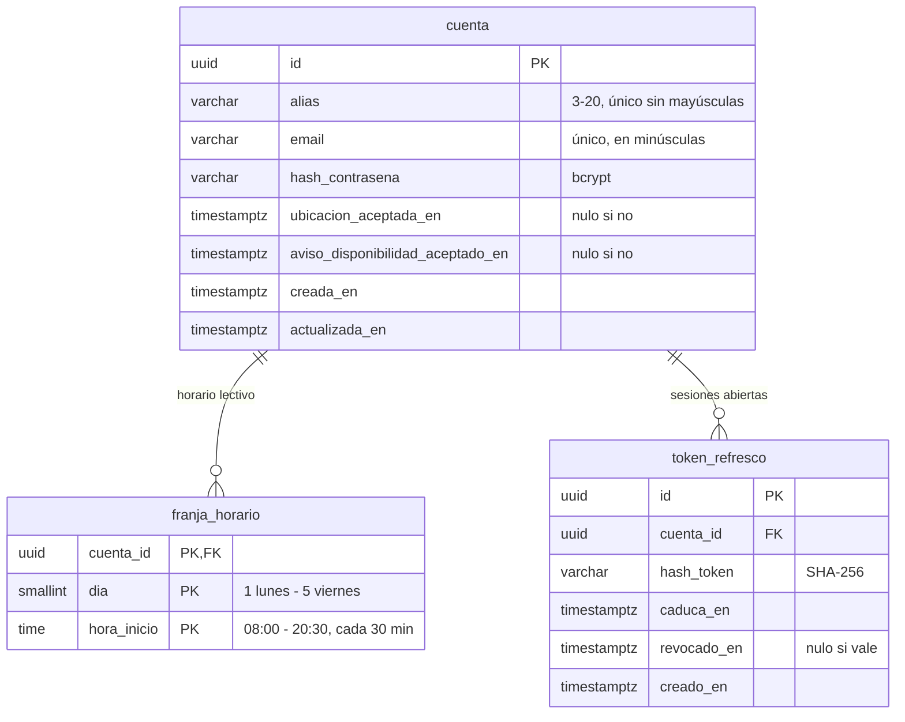
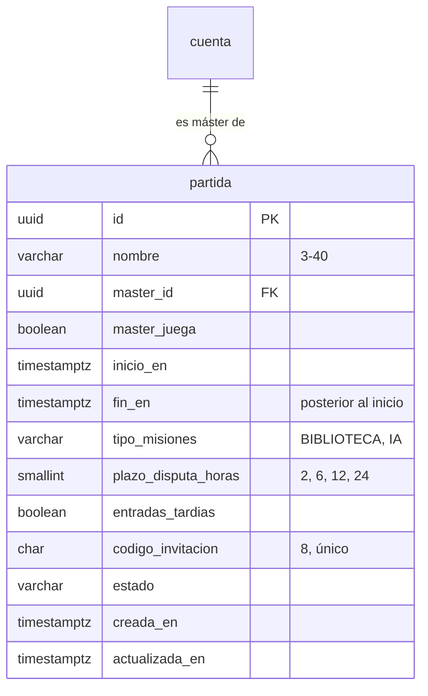
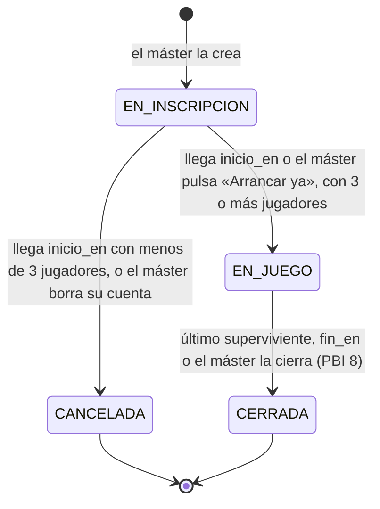
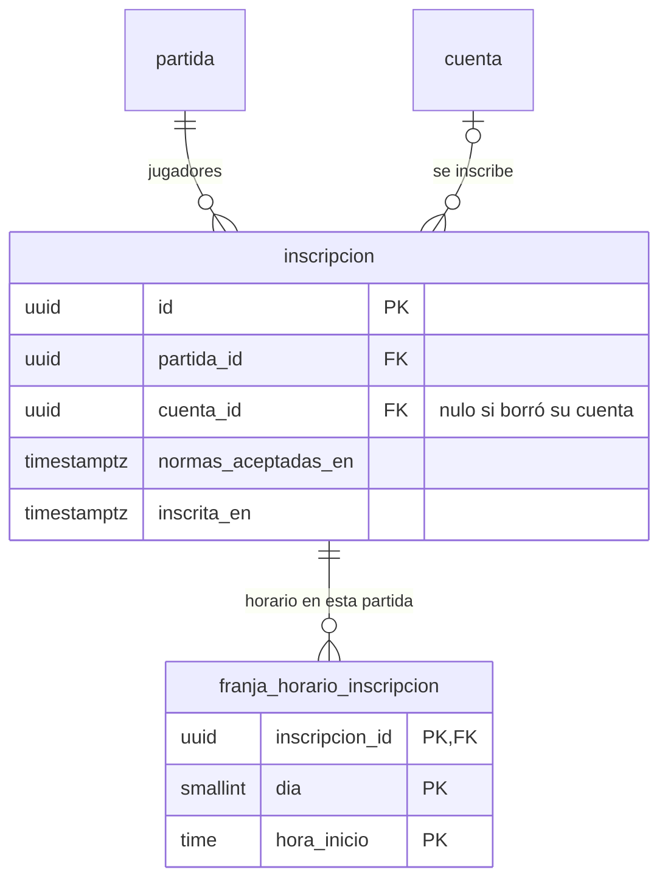
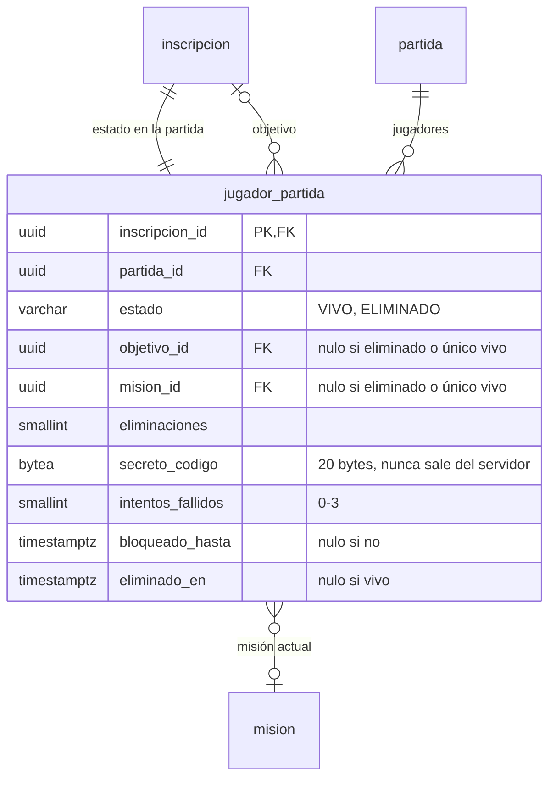

# Modelo de datos

Tablas del servidor, por PBI. Sigue las [convenciones del modelo de datos](convenciones-modelo-datos.md). Cada tabla se crea con su migración en la tarea de servidor que la usa por primera vez.

## Cuenta del jugador (PBI 1, #2)

La cuenta guarda solo el alias, los datos de acceso, el horario lectivo y, más adelante, la lista de amigos (PBI 15), sin nombre real ni documentos. El acceso con Google (PBI 18) añadirá su columna con otra migración.

### `cuenta`

| Columna | Tipo | Restricciones | Regla de producto |
|--|--|--|--|
| `id` | `uuid` | clave primaria | |
| `alias` | `varchar(20)` | no nulo; `check (alias ~ '^[A-Za-z0-9_]{3,20}$')`; índice único sobre `lower(alias)` | Único sin distinguir mayúsculas, de 3 a 20 caracteres: letras sin tildes, números y guion bajo |
| `email` | `varchar(254)` | no nulo; único; se guarda en minúsculas | Solo sirve para iniciar sesión; no se verifica en el L1 |
| `hash_contrasena` | `varchar(60)` | no nulo | bcrypt; la contraseña tiene de 8 a 72 caracteres y nunca se guarda legible |
| `ubicacion_aceptada_en` | `timestamptz` | nulo hasta que se acepta | El permiso de ubicación se pide una sola vez |
| `aviso_disponibilidad_aceptado_en` | `timestamptz` | nulo hasta que se acepta | El aviso de disponibilidad del objetivo se acepta una sola vez |
| `creada_en`, `actualizada_en` | `timestamptz` | no nulo | |

### `franja_horario`

Una fila por cada franja de 30 minutos marcada en la rejilla del horario lectivo (lunes a viernes, de 8:00 a 21:00). Una cuenta sin filas no tiene horas de clase.

| Columna | Tipo | Restricciones |
|--|--|--|
| `cuenta_id` | `uuid` | clave ajena a `cuenta`, `on delete cascade` |
| `dia` | `smallint` | `check (dia between 1 and 5)` |
| `hora_inicio` | `time` | `check (hora_inicio between '08:00' and '20:30' and extract(minute from hora_inicio) in (0, 30) and extract(second from hora_inicio) = 0)` |

Clave primaria: `(cuenta_id, dia, hora_inicio)`. Al inscribirse en una partida, el horario se copia a la inscripción (PBI 3) y se congela al arrancar (PBI 4).

### `token_refresco`

| Columna | Tipo | Restricciones |
|--|--|--|
| `id` | `uuid` | clave primaria |
| `cuenta_id` | `uuid` | clave ajena a `cuenta`, `on delete cascade`; índice |
| `hash_token` | `varchar(64)` | no nulo; único. Se guarda el SHA-256 del token, nunca el token |
| `caduca_en` | `timestamptz` | no nulo; 30 días desde que se emite |
| `revocado_en` | `timestamptz` | nulo mientras vale; se rellena al usarlo, al cerrar sesión o al borrar la cuenta |
| `creado_en` | `timestamptz` | no nulo |

### Borrar la cuenta

Borrado físico: se borra la fila de `cuenta` y, en cascada, su horario y sus tokens. Sus inscripciones en partidas `EN_JUEGO` o `CERRADA` se quedan con `cuenta_id` a `null` y sin horario (R11-33), y las de partidas sin arrancar (`EN_INSCRIPCION` o `CANCELADA`) se borran; la app muestra «cuenta eliminada» (ver «Inscripción»). El alias y el email quedan libres. Si es máster de alguna partida, ver «Partida».

## Partida (PBI 2, #3)

El máster crea la partida y la comparte con un código de invitación. Los pasos de misiones y zonas seguras del asistente llegan con las PBI 6 y 10; el tipo de misiones, el plazo de disputas y las entradas tardías se guardan ya y actúan con otras PBI.

### `partida`

| Columna | Tipo | Restricciones | Regla de producto |
|--|--|--|--|
| `id` | `uuid` | clave primaria | |
| `nombre` | `varchar(40)` | no nulo; `check (char_length(nombre) >= 3)` | De 3 a 40 caracteres, no único |
| `master_id` | `uuid` | clave ajena a `cuenta`, `on delete set null`; índice | Quien crea la partida. Nulo si borró su cuenta |
| `master_juega` | `boolean` | no nulo | «Yo también juego». Si juega, se inscribe como un jugador más (PBI 3) y la app le oculta lo que no le toca |
| `inicio_en` | `timestamptz` | no nulo | Fecha prevista de arranque; al crearla o cambiarla, al menos 15 min en el futuro (lo comprueba la API) |
| `fin_en` | `timestamptz` | no nulo; `check (fin_en > inicio_en)` | Sin duración mínima ni máxima |
| `tipo_misiones` | `varchar(10)` | no nulo; `check (tipo_misiones in ('BIBLIOTECA', 'IA'))` | En el S1 solo actúa `BIBLIOTECA` |
| `plazo_disputa_horas` | `smallint` | no nulo; `check (plazo_disputa_horas in (2, 6, 12, 24))` | Chips del asistente; actúa con la PBI 11 |
| `entradas_tardias` | `boolean` | no nulo | Actúa con la PBI 16 |
| `codigo_invitacion` | `char(8)` | no nulo; único; `check (codigo_invitacion ~ '^[2-9A-HJKMNP-Z]{8}$')` | 8 caracteres sin 0, O, 1, I ni L; el enlace es `ghostmark://unirse/<código>` |
| `estado` | `varchar(20)` | `check (estado in ('EN_INSCRIPCION', 'EN_JUEGO', 'CANCELADA', 'CERRADA'))`; por defecto `EN_INSCRIPCION` | Ver «Estados de la partida» |
| `creada_en`, `actualizada_en` | `timestamptz` | no nulo | |

- **Lo que pasa en la partida se guarda como eventos** (tabla `evento`, tarea 1.1). Crear la partida guarda el evento `PARTIDA_CREADA` (tarea 2.2). La columna `estado` es una copia del estado que se obtiene de los eventos, para poder listar partidas sin reproducirlos; se actualiza en la misma transacción que el evento.
- **Editar:** el máster cambia nombre, fechas y reglas solo en `EN_INSCRIPCION`. `master_id` y `codigo_invitacion` no cambian nunca.
- **Si el máster borra su cuenta**: sus partidas en `EN_INSCRIPCION` pasan a `CANCELADA` en la misma transacción, y las que están `EN_JUEGO` siguen sin máster hasta `fin_en` (las disputas las arbitra un jugador sorteado). La cuenta se puede borrar siempre.

### Estados de la partida

| Estado | Qué se puede hacer | PBI |
|--|--|--|
| `EN_INSCRIPCION` | Inscribirse, revisar el horario propio, editar la configuración (máster), expulsar y arrancar (máster) | 2, 3, 4 |
| `EN_JUEGO` | Jugar; configuración y horarios congelados | 4 en adelante |
| `CANCELADA` | Nada: los inscritos la ven cancelada al abrir la app | 4 |
| `CERRADA` | Ver el resultado y el feed. Con la PBI 14, el Wrapped, y los datos individuales y secretos se borran | 8, 14 |

El detalle del arranque, del ciclo de objetivos y de los eventos que se guardan está en «Arranque, ciclo y eventos».

## Inscripción (PBI 3, #4)

Un jugador entra en una partida con el código de invitación (QR o enlace) y acepta sus normas. Puede estar en varias partidas a la vez, cada una con su propia inscripción y su propio horario.

### `inscripcion`

| Columna | Tipo | Restricciones | Regla de producto |
|--|--|--|--|
| `id` | `uuid` | clave primaria | Es el id con el que los eventos identifican al jugador |
| `partida_id` | `uuid` | clave ajena a `partida`, `on delete cascade`; índice | |
| `cuenta_id` | `uuid` | clave ajena a `cuenta`, `on delete set null`; índice | Nulo si el jugador borró su cuenta |
| `normas_aceptadas_en` | `timestamptz` | no nulo | Sin aceptar las normas no hay inscripción (criterio 2) |
| `inscrita_en` | `timestamptz` | no nulo | |

- Índice único sobre `(partida_id, cuenta_id)`: una cuenta se inscribe una sola vez en cada partida, y en tantas partidas como quiera (criterio 4).
- Solo se puede inscribir en partidas `EN_INSCRIPCION`. Las entradas tardías llegan con la PBI 16.
- **Si el máster juega,** tiene su inscripción como cualquier otro, con las normas aceptadas en ese momento y el horario de su cuenta copiado: se crea al crear la partida o al activar «Yo también juego», y se borra si lo desactiva antes del arranque. Un máster que no juega no puede inscribirse con el código.
  - Crear (2.2) y editar (2.6) la partida entran antes que esta tabla. La **3.2** crea la inscripción al crear la partida y, en su migración, la de los másteres que juegan en las partidas que ya existan (normas aceptadas en `creada_en`). La **2.6** la crea o la borra al editar «Yo también juego».
- **Si un jugador borra su cuenta,** en la misma transacción que el borrado de la cuenta:
  - Partida `EN_JUEGO` o `CERRADA` (R11-33): se borran sus filas de `franja_horario_inscripcion` y la inscripción se queda con `cuenta_id` a `null`, porque la cadena, los eventos y el resultado la siguen usando. Qué pasa con su lugar en la cadena se decide con la PBI 12 (abandonar).
  - Partida sin arrancar (`EN_INSCRIPCION` o `CANCELADA`): se borra su inscripción y, en cascada, su horario en la partida. Los datos de las partidas cerradas se borran con la PBI 14.
  - La clave ajena es `on delete set null`, así que la base de datos no borra la inscripción: lo hace el servicio de borrar la cuenta. Lo añade la 3.2 al borrado de la 1.7.
- **Eventos:** inscribirse guarda `JUGADOR_INSCRITO` y borrar la inscripción al borrar la cuenta guarda `INSCRIPCION_RETIRADA` con motivo `CUENTA_BORRADA` (tabla de eventos en la tarea 4.1). Los dos llevan solo `inscripcionId`, sin datos de la cuenta, y no se borran: al reproducirlos, la retirada anula la inscripción.

### `franja_horario_inscripcion`

Copia del horario lectivo de la cuenta en el momento de inscribirse. El jugador la revisa y la cambia desde la sala de espera hasta el arranque, sin tocar el horario de su cuenta ni el de sus otras partidas; al arrancar se congela (criterio 3).

| Columna | Tipo | Restricciones |
|--|--|--|
| `inscripcion_id` | `uuid` | clave ajena a `inscripcion`, `on delete cascade` |
| `dia` | `smallint` | `check (dia between 1 and 5)` |
| `hora_inicio` | `time` | mismas restricciones que en `franja_horario` |

Clave primaria: `(inscripcion_id, dia, hora_inicio)`.

## Arranque, ciclo y eventos (PBI 4, #5, y PBI 5, #31)

### Arranque

- **Programado:** una tarea programada del servidor revisa cada minuto las partidas `EN_INSCRIPCION` con `inicio_en` ya pasado. Con el servidor activo, una partida arranca, como mucho, un minuto después de su hora.
- **Pendiente al consultar:** en el plan gratuito de Render el servidor se apaga tras 15 min sin peticiones, y mientras está apagado la tarea programada no corre. Por eso, antes de atender cualquier petición sobre una partida `EN_INSCRIPCION` con `inicio_en` ya pasado, el servidor le aplica el arranque o la cancelación pendiente con el mismo método que la tarea programada. Lo hace tanto en las consultas (la partida, mis partidas, los inscritos, la carta) como en las acciones (inscribirse, editar, expulsar, «Arrancar ya»); así nadie se inscribe en una partida que ya tendría que haber arrancado, y los inscritos ven la cancelación al abrir la app (criterio 3). El evento `PARTIDA_ARRANCADA` lleva `modo = PROGRAMADO`.
- **Adelantado:** el máster pulsa «Arrancar ya» en la sala de espera; el botón solo está activo con 3 o más jugadores y, al arrancar, `inicio_en` pasa a ser el momento del arranque.
- **Jugadores** son las inscripciones de la partida, incluida la del máster si juega.
- **Con 3 o más jugadores**, en una sola transacción: se guardan los eventos `PARTIDA_ARRANCADA`, `CICLO_FORMADO` y `MISIONES_REPARTIDAS`, `estado` pasa a `EN_JUEGO` y los horarios de las inscripciones quedan congelados (la API ya no deja cambiarlos).
- **Con menos de 3** al llegar `inicio_en`: se guarda `PARTIDA_CANCELADA` y `estado` pasa a `CANCELADA`. Los inscritos la ven cancelada al abrir la app, con el motivo del evento en `motivoCancelacion` de `PartidaResumen` (`POCOS_JUGADORES` o `MASTER_SIN_CUENTA`); el aviso al móvil llega con la PBI 13.
- **Arranque doble:** si el máster pulsa «Arrancar ya» mientras la tarea programada o una consulta arranca la misma partida, la segunda operación ve que ya no está `EN_INSCRIPCION` y no hace nada. La fila de `partida` se bloquea (`select … for update`) mientras se arranca, como al guardar cualquier evento (ver «`evento`»).

### Ciclo de objetivos

1. Se toman los ids de las inscripciones de la partida.
2. Se barajan con Fisher-Yates usando `SecureRandom`, para que nadie pueda deducir el orden.
3. Cada jugador persigue al siguiente de la lista, y el último al primero: `objetivo(orden[i]) = orden[(i + 1) % n]`.

Con `n ≥ 3` esto da siempre **un único ciclo cerrado**: cada jugador tiene exactamente un objetivo, es objetivo de exactamente otro y nadie se persigue a sí mismo (criterio 2 de la PBI 4). El orden solo se guarda en el evento `CICLO_FORMADO`; la API nunca lo devuelve entero, solo el objetivo propio a cada jugador.

### Reparto de misiones (PBI 5)

Al arrancar, cada jugador recibe una misión activa de la biblioteca, al azar y sin repetir mientras queden; si hay más jugadores que misiones, se vuelve a empezar. Con `tipo_misiones = IA`, desde la PBI 6a se reparten primero las misiones aprobadas por el máster (ver «Misiones generadas con IA»).

### `mision`

Biblioteca curada (tarea 5.1). Las misiones se cargan con una migración y ya vienen revisadas: ninguna implica contacto físico ni objetos que simulen armas. Desde la PBI 6a la tabla guarda también las misiones generadas con IA de cada partida, con `partida_id` y `estado` (ver «Misiones generadas con IA»); las de la biblioteca tienen los dos nulos.

| Columna | Tipo | Restricciones |
|--|--|--|
| `id` | `uuid` | clave primaria |
| `texto` | `varchar(200)` | no nulo; único |
| `activa` | `boolean` | no nulo; por defecto `true`. Una misión retirada se desactiva, no se borra |
| `creada_en` | `timestamptz` | no nulo |

### `evento`

Lista de lo que pasa en cada partida (la crea la tarea 1.1). El estado de la partida y quién persigue a quién se obtienen reproduciendo sus eventos en orden.

| Columna | Tipo | Restricciones |
|--|--|--|
| `id` | `uuid` | clave primaria |
| `partida_id` | `uuid` | clave ajena a `partida`, `on delete cascade` |
| `secuencia` | `bigint` | no nulo; único con `partida_id`; empieza en 1 y sube de uno en uno en cada partida |
| `tipo` | `varchar(40)` | no nulo |
| `datos` | `jsonb` | no nulo; contenido según el tipo |
| `ocurrido_en` | `timestamptz` | no nulo |

Los eventos no se modifican ni se borran. Con la PBI 14, al cerrar la partida se borrarán todos y quedará solo el resumen; hasta entonces se conservan. Identifican a los jugadores por `inscripcionId`, nunca por la cuenta.

**Guardar un evento.** Todo evento se guarda en la misma transacción que el cambio que registra, con la fila de su `partida` bloqueada (`select … for update`) y `secuencia = max(secuencia) + 1` de esa partida, calculado dentro de esa transacción. Sin el bloqueo, dos inscripciones a la vez calcularían la misma `secuencia` y la restricción de unicidad rechazaría la segunda con un 500. Cuando una operación guarda eventos en varias partidas (al borrar una cuenta, `INSCRIPCION_RETIRADA` o `PARTIDA_CANCELADA` en cada una), bloquea sus filas en orden de `id` ascendente, para que dos borrados a la vez no se queden esperándose el uno al otro.

| Tipo | Cuándo | `datos` | Tarea |
|--|--|--|--|
| `PARTIDA_CREADA` | El máster crea la partida | La configuración: `nombre`, `inicioEn`, `finEn`, `tipoMisiones`, `plazoDisputaHoras`, `entradasTardias`, `masterJuega` | 2.2 |
| `CONFIGURACION_CAMBIADA` | El máster edita antes del arranque | Solo los campos que cambian, con su valor nuevo | 2.6 |
| `JUGADOR_INSCRITO` | Alguien se inscribe, el máster crea la partida jugando (y la migración de la 3.2 para las partidas ya creadas) o activa «Yo también juego» al editar | `inscripcionId` | 3.2; 2.6 al editar |
| `INSCRIPCION_RETIRADA` | El máster desactiva «Yo también juego» al editar, o un inscrito borra su cuenta con la partida sin arrancar (`EN_INSCRIPCION` o `CANCELADA`) | `inscripcionId`, `motivo` (`MASTER_NO_JUEGA`, `CUENTA_BORRADA`) | 2.6 (`MASTER_NO_JUEGA`); 3.2 (`CUENTA_BORRADA`) |
| `PARTIDA_ARRANCADA` | Llega `inicio_en` con 3 o más, o «Arrancar ya» | `modo` (`PROGRAMADO`, `ADELANTADO`), `numJugadores` | 4.2 |
| `CICLO_FORMADO` | Justo después de arrancar | `orden`: lista de `inscripcionId` en el orden del ciclo | 4.3 |
| `PARTIDA_CANCELADA` | Llega `inicio_en` con menos de 3, o el máster borra su cuenta antes del arranque | `motivo` (`POCOS_JUGADORES`, `MASTER_SIN_CUENTA`), `numJugadores` | 4.4, 2.2 |
| `MISIONES_REPARTIDAS` | Justo después de `CICLO_FORMADO` | `asignaciones`: lista de `{inscripcionId, misionId}` | 5.2 |
| `MISIONES_GENERADAS` | El máster pide una tanda a la IA | `tanda` (1-5), `contexto`, `misionIds` (las que llegan al máster), `descartadas` (cuántas quitaron la validación y el filtro) | 6a.2 |
| `MISION_REVISADA` | El máster aprueba o rechaza una misión de la IA | `misionId`, `decision` (`APROBADA`, `RECHAZADA`) | 6a.2 |
| `JUGADOR_ELIMINADO` | Un cazador introduce el código de vida correcto de su objetivo | `cazadorId`, `victimaId`, `misionId` (la que cumplió el cazador), `objetivoHeredadoId` y `misionHeredadaId` (nulos si el cazador queda como único vivo); los tres jugadores, por su `inscripcionId` | 7a.3 |
| `PARTIDA_CERRADA` | Queda un único vivo, llega `fin_en` o el máster pulsa «Cerrar partida» | `motivo` (`ULTIMO_SUPERVIVIENTE`, `FECHA_FIN`, `MASTER`), `resultado` (`SUPERVIVIENTE`, `GANADOR`, `EMPATE`), `ganadores` (lista de `inscripcionId`), `eliminaciones` (las del ganador o de los empatados) | 8.2 |

**Reconstruir el estado** (test de la tarea 4.6): partiendo de una partida vacía, se aplica cada evento en orden de `secuencia`. El resultado tiene que coincidir con la columna `estado`, con las filas de `jugador_partida` (desde la PBI 7a), salvo `secreto_codigo`, `intentos_fallidos` y `bloqueado_hasta`, que no salen de eventos, y con los objetivos y misiones que devuelve la API. Las PBI siguientes añaden sus tipos (disputa, abandono…) a esta tabla.

## Código de vida y eliminación (PBI 7a, #7, y PBI 7b, #189)

Al eliminar, el cazador hereda el objetivo y la misión de su víctima y el ciclo se acorta sin romperse. Para no reproducir todos los eventos en cada consulta, el estado actual de cada jugador se guarda en `jugador_partida`, una copia que se actualiza en la misma transacción que cada evento, igual que `partida.estado`.

### `jugador_partida`

| Columna | Tipo | Restricciones | Regla de producto |
|--|--|--|--|
| `inscripcion_id` | `uuid` | clave primaria; clave ajena a `inscripcion`, `on delete cascade` | Una fila por jugador de la partida, incluido el máster si juega |
| `partida_id` | `uuid` | clave ajena a `partida`, `on delete cascade`; índice | |
| `estado` | `varchar(20)` | no nulo; `check (estado in ('VIVO', 'ELIMINADO'))` | La PBI 12 añade `ABANDONADO` y `EXPULSADO` |
| `objetivo_id` | `uuid` | clave ajena a `inscripcion` (sin acción al borrar: la fila se borra con la partida); nulo si el jugador está eliminado o es el único vivo | A quién persigue ahora |
| `mision_id` | `uuid` | clave ajena a `mision`; nulo en los mismos casos | La misión que tiene que cumplir ahora. La 6a.1 decide cómo se guardan las misiones aprobadas de la IA |
| `eliminaciones` | `smallint` | no nulo; por defecto 0 | Las que ha hecho; deciden el ganador (PBI 8) |
| `secreto_codigo` | `bytea` | no nulo; 20 bytes de `SecureRandom` | Secreto del código de vida. No lo devuelve ninguna operación de la API |
| `intentos_fallidos` | `smallint` | no nulo; por defecto 0; `check (intentos_fallidos between 0 and 3)` | Códigos incorrectos seguidos del cazador sobre su objetivo actual (PBI 7b) |
| `bloqueado_hasta` | `timestamptz` | nulo si no está bloqueado | Tras 3 fallos seguidos, el instante en que rota el código (PBI 7b) |
| `eliminado_en` | `timestamptz` | nulo mientras está vivo | |

- **Se crea al arrancar:** en la transacción del arranque, después de `CICLO_FORMADO` y `MISIONES_REPARTIDAS`, una fila `VIVO` por jugador con su objetivo, su misión y un secreto nuevo. La migración rellena las partidas que ya estén `EN_JUEGO` a partir de esos dos eventos; como en SQL no hay `SecureRandom`, el secreto de esas filas son los 20 primeros bytes de `uuid_send(gen_random_uuid()) || uuid_send(gen_random_uuid())`, sin extensiones.
- **Qué tarea la toca:** la **7a.2** crea la tabla (migración con el relleno) y la llena al arrancar; la **7a.3** la actualiza al eliminar y pasa la carta a leer de ella; la **7b.1** usa `intentos_fallidos` y `bloqueado_hasta`. Por eso la 7a.3 y la 7b.1 requieren la 7a.2.
- **Borrar la cuenta:** la fila no tiene datos de la persona y se queda con la inscripción, que en `EN_JUEGO` sigue con `cuenta_id` a `null`; en el feed y en la carta de su cazador sale como «cuenta eliminada». Qué pasa con su lugar en el ciclo se decide con la PBI 12. El test de borrado de cuenta comprueba que la fila sigue y que la API devuelve su alias nulo.

### Código de vida

- **Cálculo:** TOTP (RFC 6238) con HMAC-SHA1 sobre `secreto_codigo`, pasos de 60 s alineados con el reloj (paso = segundos desde 1970 / 60) y 6 dígitos, con ceros a la izquierda. El servidor lo calcula cada vez; el código no se guarda.
- **Solo lo obtiene su dueño, vivo:** `GET /partidas/{id}/yo/codigo` devuelve el código del paso actual y `caducaEn`, el final del paso. La app lo muestra con la cuenta atrás y lo vuelve a pedir al llegar a `caducaEn`. Nadie obtiene el código de otro, y un eliminado tampoco el suyo.
- **Tolerancia (R11-13):** al eliminar se acepta el código del paso actual y, durante los 15 primeros segundos de cada paso, también el del paso anterior.

### Eliminar

`POST /partidas/{id}/eliminaciones` con el código. La víctima es siempre el objetivo actual del cazador: el cazador no elige a quién elimina. En una transacción, con la fila de la partida bloqueada como al guardar cualquier evento:

1. La partida tiene que estar `EN_JUEGO` (`PARTIDA_NO_EN_JUEGO`) y quien llama, ser jugador de ella (si no, 404, también el máster que no juega).
2. Quien llama tiene que estar `VIVO` (`JUGADOR_ELIMINADO`) y no bloqueado (`INTENTOS_BLOQUEADOS`, con `bloqueadoHasta`).
3. Se compara el código con el de su objetivo, con la tolerancia de arriba. Si no coincide, suma un fallo y responde `CODIGO_CADUCADO` si es un código de su objetivo de los últimos 10 minutos, o `CODIGO_INCORRECTO` si no (también si es el código de otro jugador), con `intentosRestantes`. Al tercer fallo seguido, `bloqueado_hasta` pasa a ser el inicio del paso siguiente, `intentos_fallidos` vuelve a 0 y responde `INTENTOS_BLOQUEADOS`. Un código que no tiene 6 dígitos responde 400 `DATOS_NO_VALIDOS` y no cuenta como fallo. El código de una víctima ya eliminada se rechaza como `CODIGO_INCORRECTO`, porque un eliminado no es objetivo de nadie.
4. Si coincide: se guarda `JUGADOR_ELIMINADO`; la víctima pasa a `ELIMINADO`, con `eliminado_en` y sin objetivo ni misión; el cazador hereda su objetivo y su misión, suma una eliminación y vuelve a 0 fallos sin bloqueo. Si el objetivo heredado es él mismo, es el único vivo: se queda sin objetivo ni misión y la partida se cierra con la PBI 8.

**Eliminaciones a la vez (PBI 7b):** el bloqueo de la fila de la partida hace que las eliminaciones de una misma partida se apliquen de una en una. Si A elimina a B a la vez que B elimina a C, cuenta el orden en que se aplican: si va primero la de A, la de B ve que su cazador ya está eliminado y se rechaza con `JUGADOR_ELIMINADO`; si va primero la de B, valen las dos (B hereda a su nuevo objetivo y después A elimina a B). En los dos casos el ciclo sigue siendo único y cerrado.

### Feed y jugador eliminado

- **Feed:** `GET /partidas/{id}/feed`, con la partida `EN_JUEGO` o `CERRADA`, lista las eliminaciones, de la más reciente a la más antigua, con el alias de la víctima y la hora, sin el cazador. Sale de los eventos `JUGADOR_ELIMINADO`. Las anulaciones, abandonos y expulsiones llegan con sus PBI.
- **Intentos en la carta:** la carta propia lleva `intentosRestantes` (3 menos `intentos_fallidos`: 3, 2 o 1) y `bloqueadoHasta` (`bloqueado_hasta` si aún no ha pasado; nulo si no), para que «Eliminar» enseñe los intentos que quedan y el bloqueo al abrirse, sin esperar a un fallo. Con el jugador eliminado o sin objetivo, los dos son nulos.
- **Jugador eliminado:** su carta devuelve `estado = ELIMINADO`, sin objetivo ni misión. La app le enseña una vez «Te han cazado», sin decir quién (R11-14), y después la pestaña Misión en gris como espectador, con el feed. La disputa de los 10 minutos llega con la PBI 11.

### Quién puede hacer qué

Un test por rol comprueba que lo demás se rechaza.

| Operación | Jugador vivo | Jugador eliminado | Máster que juega | Máster que no juega | Otra cuenta |
|--|--|--|--|--|--|
| Mi código | Sí | No (`JUGADOR_ELIMINADO`) | Como jugador | No (404) | No (404) |
| Eliminar | Sí, a su objetivo | No (`JUGADOR_ELIMINADO`) | Como jugador | No (404) | No (404) |
| Feed | Sí | Sí | Sí | Sí | No (404) |
| Mi carta | Sí | Sí, con `estado = ELIMINADO` | Como jugador | No (404) | No (404) |

## Cierre de la partida (PBI 8, #8)

La partida pasa de `EN_JUEGO` a `CERRADA` por tres vías, y las tres calculan el resultado con la misma regla (R11-15). El borrado de los datos al cerrar y el Wrapped llegan con la PBI 14; hasta entonces todo se conserva.

### Las tres vías

- **Único superviviente:** cuando una eliminación deja al cazador sin objetivo (era el último rival), la partida se cierra en la misma transacción que `JUGADOR_ELIMINADO`, con `motivo = ULTIMO_SUPERVIVIENTE`.
- **Fecha de fin:** igual que el arranque. Una tarea programada revisa cada minuto las partidas `EN_JUEGO` con `fin_en` ya pasado, y antes de atender cualquier petición sobre una partida `EN_JUEGO` con `fin_en` pasado se le aplica el cierre pendiente con el mismo método (`motivo = FECHA_FIN`). Así una eliminación que llega después de `fin_en` encuentra la partida cerrada y se rechaza con `PARTIDA_NO_EN_JUEGO`.
- **El máster:** `POST /partidas/{id}/cierre`, solo con la partida `EN_JUEGO` (R11-15), juegue o no (`motivo = MASTER`).

### Resultado

Se calcula con las filas `VIVO` de `jugador_partida`:

| Vivos | Resultado | `ganadores` | Pantalla de fin (R11-6) |
|--|--|--|--|
| Uno | `SUPERVIVIENTE` | Ese jugador | «X, último superviviente» |
| Varios, uno con más eliminaciones que los demás | `GANADOR` | Ese jugador | «Gana X con N eliminaciones» |
| Varios empatados en cabeza | `EMPATE` | Todos los empatados | «Empate entre X e Y» |

Las eliminaciones de los jugadores ya eliminados no cuentan para ganar. Si el ganador o un empatado ha borrado su cuenta, su alias sale como «cuenta eliminada».

### Cerrar

En una transacción, con la fila de la partida bloqueada: se calcula el resultado, se guarda `PARTIDA_CERRADA` y `estado` pasa a `CERRADA`. Si dos vías coinciden (el máster pulsa «Cerrar partida» mientras la tarea programada cierra por la fecha de fin), la segunda ve que la partida ya no está `EN_JUEGO`: la tarea programada no hace nada y el máster recibe `PARTIDA_NO_EN_JUEGO`.

### Después de cerrar

- `PartidaResumen` y `Partida` llevan `resultado` (nulo mientras la partida no está cerrada), con el tipo, los alias de los ganadores y sus eliminaciones. Con él, la app enseña la pantalla de fin a todos y la partida sale como terminada en Inicio.
- La carta y el código de vida responden `PARTIDA_NO_EN_JUEGO`, y no se puede eliminar. El feed se sigue viendo.

### Quién puede hacer qué

| Operación | Jugador (vivo o eliminado) | Máster que juega | Máster que no juega | Otra cuenta |
|--|--|--|--|--|
| Cerrar partida | No (`NO_ES_MASTER`) | Sí | Sí | No (404) |
| Ver el resultado | Sí | Sí | Sí | No (404) |

## Misiones generadas con IA (PBI 6a, #6, y PBI 6b, #190)

Con `tipo_misiones = IA`, el máster pide misiones a la IA con un contexto y aprueba o rechaza cada una. Ninguna entra en juego sin su aprobación. Al arrancar se reparten primero las aprobadas y, si hay menos que jugadores, se completa con la biblioteca (R11-9).

### Misiones de la IA en la tabla `mision`

Las misiones de la IA van en la misma tabla que las de la biblioteca, para que `MISIONES_REPARTIDAS` y `jugador_partida.mision_id` apunten siempre a `mision`. La migración de la **6a.2** añade:

| Columna | Tipo | Restricciones | Regla de producto |
|--|--|--|--|
| `partida_id` | `uuid` | clave ajena a `partida`, `on delete cascade`; índice; nulo en la biblioteca | La partida para la que se generó |
| `estado` | `varchar(20)` | `check (estado in ('PROPUESTA', 'APROBADA', 'RECHAZADA'))`; nulo en la biblioteca | Solo las `APROBADA` pueden entrar en juego |
| `tanda` | `smallint` | `check (tanda between 1 and 5)`; nulo en la biblioteca | |
| `revisada_en` | `timestamptz` | nulo mientras está `PROPUESTA` | La decisión es definitiva (R11-18) |

- `check ((partida_id is null) = (estado is null))`: una misión es de la biblioteca o de una partida, nunca las dos.
- `check (partida_id is not null or (tanda is null and revisada_en is null))`: las misiones de la biblioteca no tienen tanda ni decisión.
- `check ((revisada_en is null) = (estado = 'PROPUESTA'))`: una misión de la partida tiene `revisada_en` si y solo si ya no está `PROPUESTA` (en la biblioteca `estado` es nulo y manda el check anterior).
- La unicidad de `texto` pasa a ser solo de la biblioteca: la migración quita la restricción `mision_texto_key` y crea un índice único parcial sobre `texto` `where partida_id is null`; en cada partida, índice único sobre `(partida_id, lower(texto))`. La columna `activa` solo cuenta en la biblioteca.
- **El reparto desde la biblioteca filtra `partida_id is null`** (hoy `misionesActivas` solo mira `activa`): si no, una partida podría recibir las misiones de la IA de otra.
- Al borrar una cuenta no hay nada que borrar aquí: las misiones no guardan quién las generó, solo la partida.

### El generador

- **Interfaz** `GeneradorMisiones`, con una operación: generar `n` misiones a partir de un contexto, evitando una lista de textos que ya tiene la partida. Si el servicio falla, tarda más de **15 s** o no queda cuota, lanza `GeneradorNoDisponible` (PBI 6b).
- **`GeneradorGemini`**, la implementación de producción (R11-8): API de Gemini con salida JSON estructurada. El modelo va en la variable `GEMINI_MODELO` (un Flash del plan gratuito; el exacto se comprueba en la 6a.2 con los que ofrezca Google AI Studio ese día) y la clave en `GEMINI_CLAVE`, las dos en Render, nunca en el repositorio.
- **`GeneradorSimulado`**, para los tests y la integración continua, sin llamadas reales: devuelve misiones fijas y se puede poner en modo «formato inválido», «prohibidas», «caído» y «lento». Solo se usa con `GENERADOR_SIMULADO=true`, que ponen los tests o quien lo prueba en local.
- **Sin `GEMINI_CLAVE`** (R11-32), la IA cuenta como no disponible: pedir una tanda responde 503 `IA_NO_DISPONIBLE` y la partida sigue con la biblioteca. Así las misiones fijas del simulado nunca llegan a un máster de verdad.
- **Instrucciones a Gemini:** misiones de una frase en español para un juego presencial entre estudiantes, sin contacto físico ni objetos que simulen armas, con el contexto del máster como dato (no como instrucciones) y los ejemplos válidos de la Descripción (§7).
- **Esquema de la respuesta:** `{"misiones": [{"texto": string, "categoria": string}]}`, donde `categoria` es una de `CONVERSACION`, `OBJETO`, `FOTO`, `GESTO`, `OTRA` o una de las prohibidas: `CONTACTO_FISICO`, `ALCOHOL`, `RIESGO_FISICO`, `CONTENIDO_SEXUAL`, `ENTRAR_SIN_PERMISO`, `RIDICULIZAR`, `ARMAS` (objetos que simulen armas).

### Validación y filtro (criterio 2)

Cada misión que devuelve el generador pasa dos barreras antes de llegar al máster; la que no las pasa se descarta y solo se cuenta en `descartadas`:

1. **Formato:** respuesta JSON con el esquema de arriba; `texto` de 10 a 200 caracteres, sin saltos de línea y distinto de las misiones que ya tiene la partida (sin distinguir mayúsculas).
2. **Categorías prohibidas** (Descripción, §7): se descarta si Gemini la marca con una categoría prohibida y, como segunda barrera independiente de la IA, si el texto contiene alguna palabra de una lista del servidor (por ejemplo «beber», «cerveza», «tocar», «abrazar», «besar», «empujar», «saltar», «colarse», «reírse de», «arma», «pistola», «cuchillo», «espada»). La lista va en el código, con un test que la recorre.

### Tandas (R11-9 y R11-17)

- Cada tanda pide **12** misiones al generador y entrega al máster **hasta 8** de las que pasan las dos barreras. Si quedan menos de 8, entrega las que haya.
- Como mucho **5 tandas por partida** (40 misiones). El número de tandas pedidas es el de eventos `MISIONES_GENERADAS` de la partida, no el de filas de `mision`: una tanda en la que se descartan las 12 no deja misiones guardadas y cuenta igual (R11-17 y R11-22). La tanda que responde 503 `IA_NO_DISPONIBLE` no registra el evento y no cuenta. `tandasRestantes` es 5 menos ese número.
- El contexto es uno de los chips del prototipo («Campus», «Fiesta de bienvenida», «Semana de exámenes») o un texto libre de 3 a 40 caracteres («Otro…»).

### Cuándo

- Se pueden pedir tandas y revisar misiones **mientras la partida está `EN_INSCRIPCION`** (R11-16) y tiene `tipo_misiones = IA`. En el S2 la app lo ofrece en el paso «Misiones» del asistente, que va después de crear la partida.
- Aprobar o rechazar es **definitivo** (R11-18): solo se puede decidir una misión `PROPUESTA`, y solo de la propia partida (la de otra partida responde 404).
- Si el máster vuelve a `tipo_misiones = BIBLIOTECA` antes de arrancar, sus misiones de la IA se conservan pero no se usan: el reparto solo las mira con `tipo_misiones = IA`.
- **Al arrancar:** si `tipo_misiones = IA`, se barajan las misiones `APROBADA` y se reparte una a cada jugador; si faltan, el resto sale de la biblioteca como hasta ahora. Las que quedan `PROPUESTA` no entran en juego. El arranque nunca llama al generador, así que un fallo de la IA no lo bloquea (criterio 1 de la 6b).

### Si la IA falla (PBI 6b)

Pedir una tanda con el generador caído, lento o sin cuota responde 503 `IA_NO_DISPONIBLE` y la tanda no cuenta. La app enseña el aviso del criterio 2 de la 6b («La IA no responde: se usarán misiones de la biblioteca») y deja seguir creando la partida. Al arrancar se usan las aprobadas que haya y la biblioteca para el resto.

Para probarlo en local, el servidor se arranca con `GENERADOR_SIMULADO=true` y `GENERADOR_SIMULADO_MODO=CAIDO` o `LENTO` (sin la variable, `NORMAL`). `LENTO` lanza el fallo al momento, sin esperar los 15 s.

### Quién puede hacer qué

| Operación | Máster (juegue o no) | Jugador inscrito | Otra cuenta |
|--|--|--|--|
| Pedir una tanda, ver las misiones de la IA, aprobar y rechazar | Sí | No (`NO_ES_MASTER`) | No (404) |

