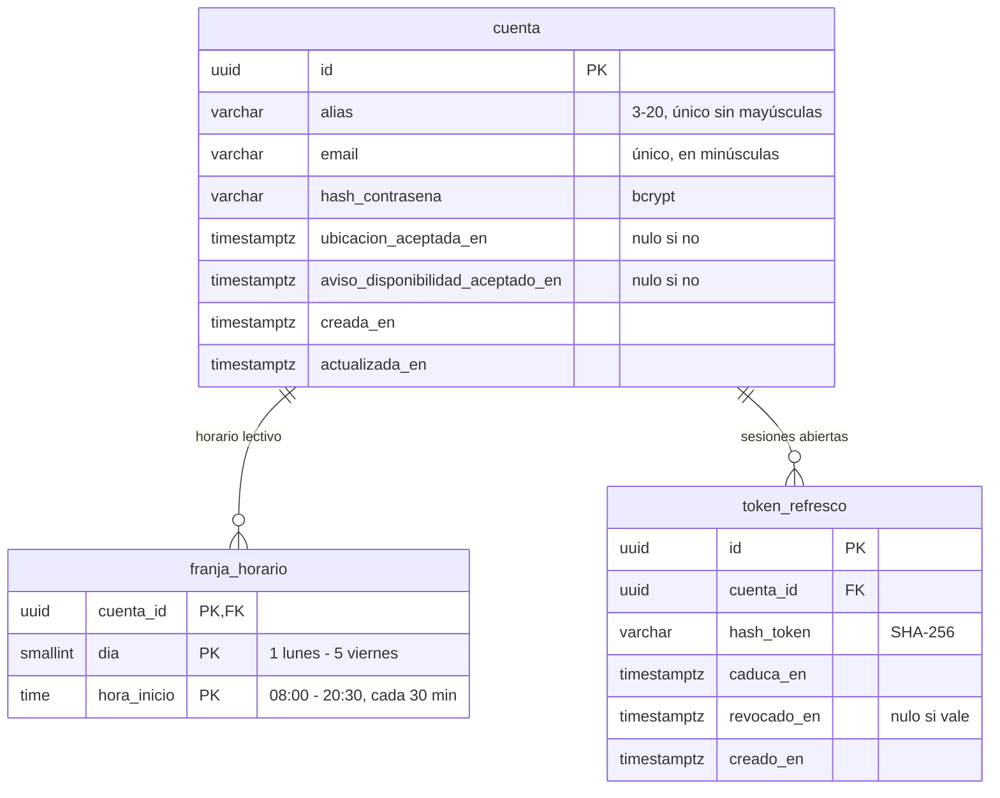
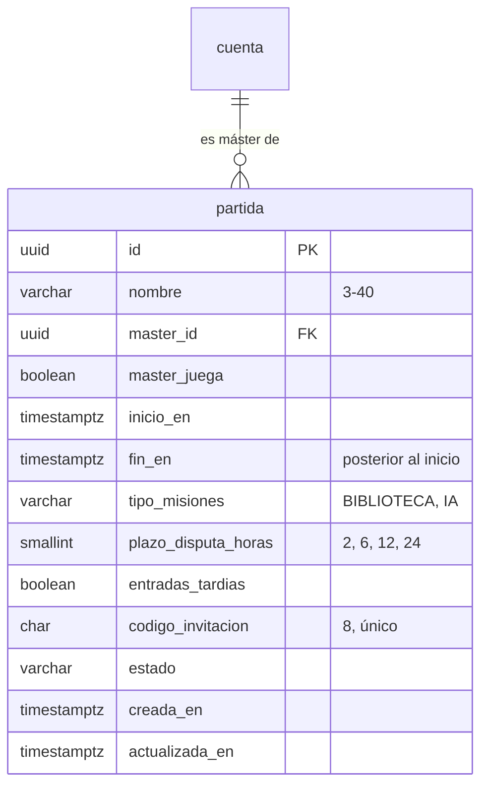
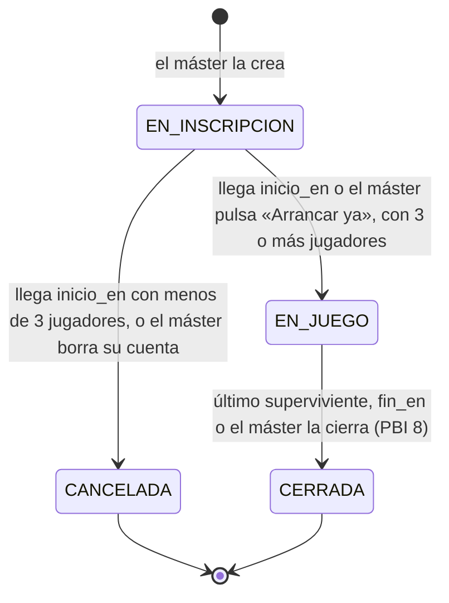

# Modelo de datos

Tablas del servidor, por PBI. Sigue las [convenciones del modelo de datos](convenciones-modelo-datos.md). Cada tabla se crea con su migración en la tarea de servidor que la usa por primera vez.

## Cuenta del jugador (PBI 1, #2)

La cuenta guarda solo el alias, los datos de acceso, el horario lectivo y, más adelante, la lista de amigos (PBI 15), sin nombre real ni documentos. El acceso con Google (PBI 18) añadirá su columna con otra migración.

### `cuenta`

| Columna | Tipo | Restricciones | Regla de producto |
|--|--|--|--|
| `id` | `uuid` | clave primaria | |
| `alias` | `varchar(20)` | no nulo; `check (alias ~ '^[A-Za-z0-9_]{3,20}$')`; índice único sobre `lower(alias)` | Único sin distinguir mayúsculas, de 3 a 20 caracteres: letras sin tildes, números y guion bajo |
| `email` | `varchar(254)` | no nulo; único; se guarda en minúsculas | Solo sirve para iniciar sesión; no se verifica en el L1 |
| `hash_contrasena` | `varchar(60)` | no nulo | bcrypt; la contraseña tiene de 8 a 72 caracteres y nunca se guarda legible |
| `ubicacion_aceptada_en` | `timestamptz` | nulo hasta que se acepta | El permiso de ubicación se pide una sola vez |
| `aviso_disponibilidad_aceptado_en` | `timestamptz` | nulo hasta que se acepta | El aviso de disponibilidad del objetivo se acepta una sola vez |
| `creada_en`, `actualizada_en` | `timestamptz` | no nulo | |

### `franja_horario`

Una fila por cada franja de 30 minutos marcada en la rejilla del horario lectivo (lunes a viernes, de 8:00 a 21:00). Una cuenta sin filas no tiene horas de clase.

| Columna | Tipo | Restricciones |
|--|--|--|
| `cuenta_id` | `uuid` | clave ajena a `cuenta`, `on delete cascade` |
| `dia` | `smallint` | `check (dia between 1 and 5)` |
| `hora_inicio` | `time` | `check (hora_inicio between '08:00' and '20:30' and extract(minute from hora_inicio) in (0, 30) and extract(second from hora_inicio) = 0)` |

Clave primaria: `(cuenta_id, dia, hora_inicio)`. Al inscribirse en una partida, el horario se copia a la inscripción (PBI 3) y se congela al arrancar (PBI 4).

### `token_refresco`

| Columna | Tipo | Restricciones |
|--|--|--|
| `id` | `uuid` | clave primaria |
| `cuenta_id` | `uuid` | clave ajena a `cuenta`, `on delete cascade`; índice |
| `hash_token` | `varchar(64)` | no nulo; único. Se guarda el SHA-256 del token, nunca el token |
| `caduca_en` | `timestamptz` | no nulo; 30 días desde que se emite |
| `revocado_en` | `timestamptz` | nulo mientras vale; se rellena al usarlo, al cerrar sesión o al borrar la cuenta |
| `creado_en` | `timestamptz` | no nulo |

### Borrar la cuenta

Borrado físico: se borra la fila de `cuenta` y, en cascada, su horario y sus tokens. En los eventos de las partidas en curso sus ids pasan a `null` y la app muestra «cuenta eliminada». El alias y el email quedan libres. Si es máster de alguna partida, ver «Partida».

## Partida (PBI 2, #3)

El máster crea la partida y la comparte con un código de invitación. Los pasos de misiones y zonas seguras del asistente llegan con las PBI 6 y 10; el tipo de misiones, el plazo de disputas y las entradas tardías se guardan ya y actúan con otras PBI.

### `partida`

| Columna | Tipo | Restricciones | Regla de producto |
|--|--|--|--|
| `id` | `uuid` | clave primaria | |
| `nombre` | `varchar(40)` | no nulo; `check (char_length(nombre) >= 3)` | De 3 a 40 caracteres, no único |
| `master_id` | `uuid` | clave ajena a `cuenta`, `on delete set null`; índice | Quien crea la partida. Nulo si borró su cuenta |
| `master_juega` | `boolean` | no nulo | «Yo también juego». Si juega, se inscribe como un jugador más (PBI 3) y la app le oculta lo que no le toca |
| `inicio_en` | `timestamptz` | no nulo | Fecha prevista de arranque; al crearla o cambiarla, al menos 15 min en el futuro (lo comprueba la API) |
| `fin_en` | `timestamptz` | no nulo; `check (fin_en > inicio_en)` | Sin duración mínima ni máxima |
| `tipo_misiones` | `varchar(10)` | no nulo; `check (tipo_misiones in ('BIBLIOTECA', 'IA'))` | En el S1 solo actúa `BIBLIOTECA` |
| `plazo_disputa_horas` | `smallint` | no nulo; `check (plazo_disputa_horas in (2, 6, 12, 24))` | Chips del asistente; actúa con la PBI 11 |
| `entradas_tardias` | `boolean` | no nulo | Actúa con la PBI 16 |
| `codigo_invitacion` | `char(8)` | no nulo; único; `check (codigo_invitacion ~ '^[2-9A-HJKMNP-Z]{8}$')` | 8 caracteres sin 0, O, 1, I ni L; el enlace es `ghostmark://unirse/<código>` |
| `estado` | `varchar(20)` | `check (estado in ('EN_INSCRIPCION', 'EN_JUEGO', 'CANCELADA', 'CERRADA'))`; por defecto `EN_INSCRIPCION` | Ver «Estados de la partida» |
| `creada_en`, `actualizada_en` | `timestamptz` | no nulo | |

- **Lo que pasa en la partida se guarda como eventos** (tabla `evento`, tarea 1.1). Crear la partida guarda el evento `PARTIDA_CREADA` (tarea 2.2). La columna `estado` es una copia del estado que se obtiene de los eventos, para poder listar partidas sin reproducirlos; se actualiza en la misma transacción que el evento.
- **Editar:** el máster cambia nombre, fechas y reglas solo en `EN_INSCRIPCION`. `master_id` y `codigo_invitacion` no cambian nunca.
- **Si el máster borra su cuenta**: sus partidas en `EN_INSCRIPCION` pasan a `CANCELADA` en la misma transacción, y las que están `EN_JUEGO` siguen sin máster hasta `fin_en` (las disputas las arbitra un jugador sorteado). La cuenta se puede borrar siempre.

### Estados de la partida

| Estado | Qué se puede hacer | PBI |
|--|--|--|
| `EN_INSCRIPCION` | Inscribirse, revisar el horario propio, editar la configuración (máster), expulsar y arrancar (máster) | 2, 3, 4 |
| `EN_JUEGO` | Jugar; configuración y horarios congelados | 4 en adelante |
| `CANCELADA` | Nada: los inscritos la ven cancelada al abrir la app | 4 |
| `CERRADA` | Ver el Wrapped; los datos individuales y secretos se han borrado | 8, 14 |

El detalle del arranque, del ciclo de objetivos y de los eventos que se guardan va en la tarea 4.1.
