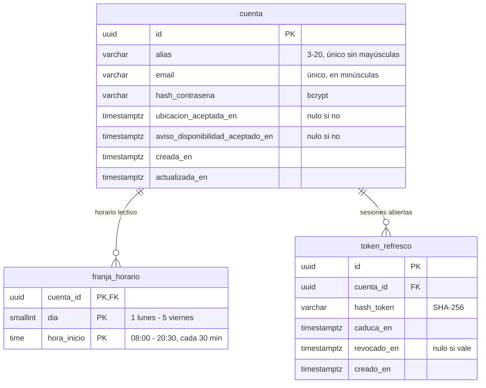

# Modelo de datos

Tablas del servidor, por PBI. Sigue las [convenciones del modelo de datos](convenciones-modelo-datos.md). Cada tabla se crea con su migración en la tarea de servidor que la usa por primera vez.

## Cuenta del jugador (PBI 1, #2)

La cuenta guarda solo el alias, los datos de acceso, el horario lectivo y, más adelante, la lista de amigos (PBI 15), sin nombre real ni documentos. El acceso con Google (PBI 18) añadirá su columna con otra migración.

### `cuenta`

| Columna | Tipo | Restricciones | Regla de producto |
|--|--|--|--|
| `id` | `uuid` | clave primaria | |
| `alias` | `varchar(20)` | no nulo; `check (alias ~ '^[A-Za-z0-9_]{3,20}$')`; índice único sobre `lower(alias)` | Único sin distinguir mayúsculas, de 3 a 20 caracteres: letras sin tildes, números y guion bajo |
| `email` | `varchar(254)` | no nulo; único; se guarda en minúsculas | Solo sirve para iniciar sesión; no se verifica en el L1 |
| `hash_contrasena` | `varchar(60)` | no nulo | bcrypt; la contraseña tiene de 8 a 72 caracteres y nunca se guarda legible |
| `ubicacion_aceptada_en` | `timestamptz` | nulo hasta que se acepta | El permiso de ubicación se pide una sola vez |
| `aviso_disponibilidad_aceptado_en` | `timestamptz` | nulo hasta que se acepta | El aviso de disponibilidad del objetivo se acepta una sola vez |
| `creada_en`, `actualizada_en` | `timestamptz` | no nulo | |

### `franja_horario`

Una fila por cada franja de 30 minutos marcada en la rejilla del horario lectivo (lunes a viernes, de 8:00 a 21:00). Una cuenta sin filas no tiene horas de clase.

| Columna | Tipo | Restricciones |
|--|--|--|
| `cuenta_id` | `uuid` | clave ajena a `cuenta`, `on delete cascade` |
| `dia` | `smallint` | `check (dia between 1 and 5)` |
| `hora_inicio` | `time` | `check (hora_inicio between '08:00' and '20:30' and extract(minute from hora_inicio) in (0, 30) and extract(second from hora_inicio) = 0)` |

Clave primaria: `(cuenta_id, dia, hora_inicio)`. Al inscribirse en una partida, el horario se copia a la inscripción (PBI 3) y se congela al arrancar (PBI 4).

### `token_refresco`

| Columna | Tipo | Restricciones |
|--|--|--|
| `id` | `uuid` | clave primaria |
| `cuenta_id` | `uuid` | clave ajena a `cuenta`, `on delete cascade`; índice |
| `hash_token` | `varchar(64)` | no nulo; único. Se guarda el SHA-256 del token, nunca el token |
| `caduca_en` | `timestamptz` | no nulo; 30 días desde que se emite |
| `revocado_en` | `timestamptz` | nulo mientras vale; se rellena al usarlo, al cerrar sesión o al borrar la cuenta |
| `creado_en` | `timestamptz` | no nulo |

### Borrar la cuenta

Borrado físico: se borra la fila de `cuenta` y, en cascada, su horario y sus tokens. En los eventos de las partidas en curso sus ids pasan a `null` y la app muestra «cuenta eliminada». El alias y el email quedan libres.
