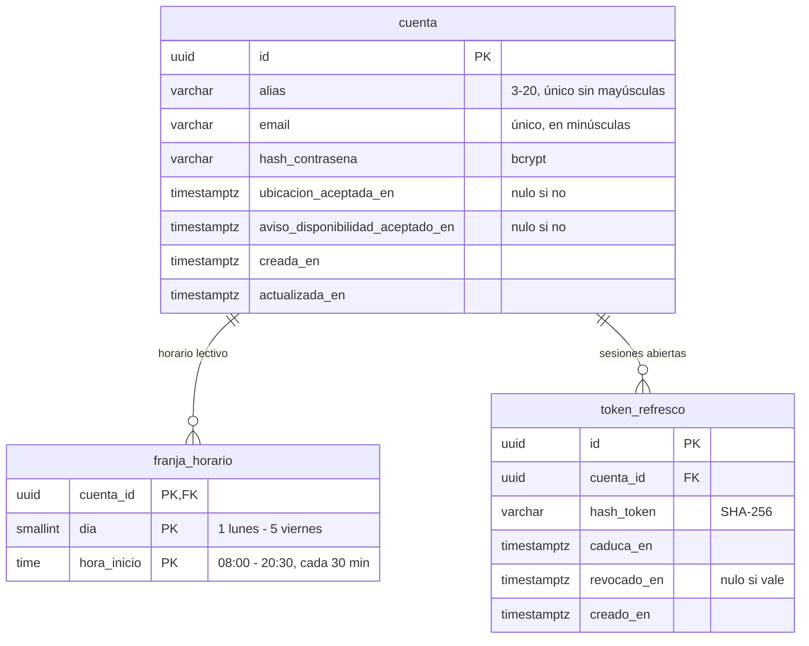
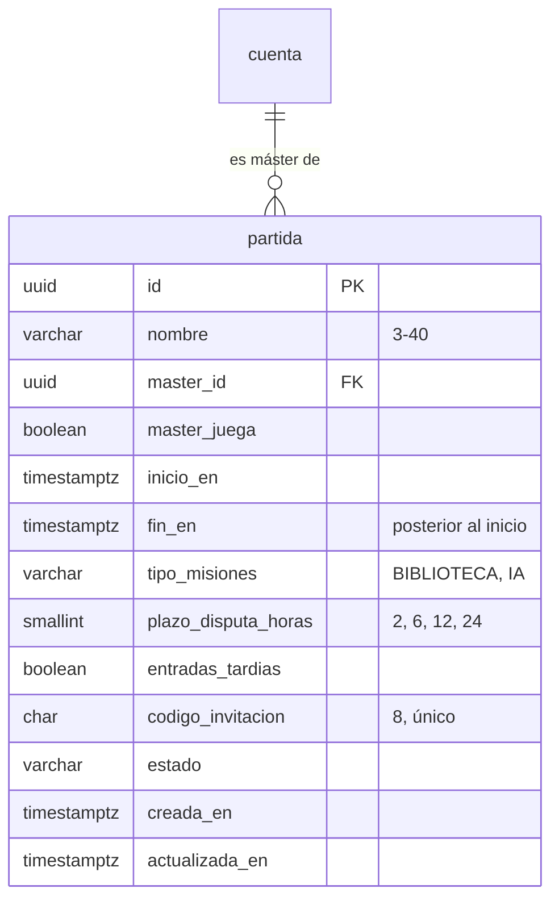
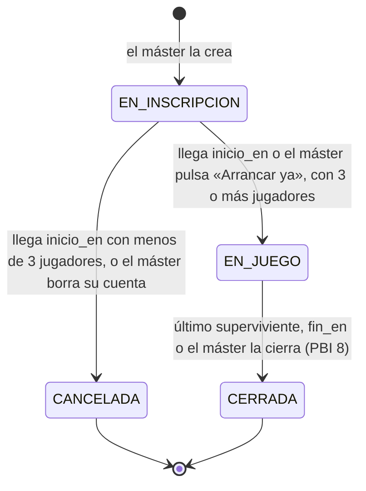
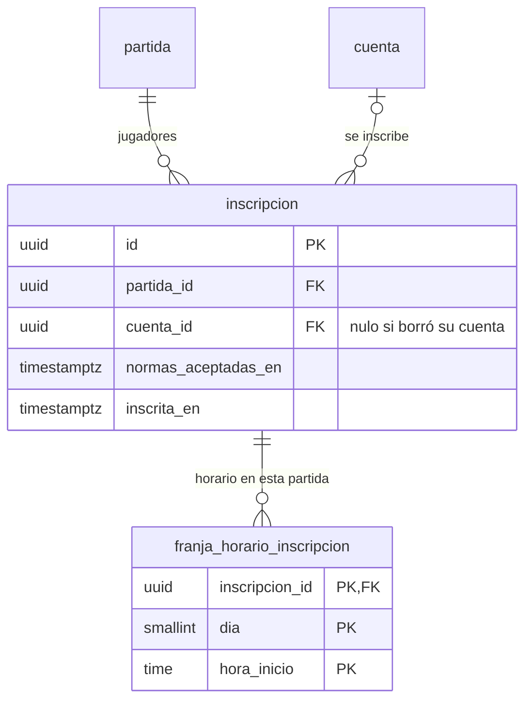

# Modelo de datos

Tablas del servidor, por PBI. Sigue las [convenciones del modelo de datos](convenciones-modelo-datos.md). Cada tabla se crea con su migración en la tarea de servidor que la usa por primera vez.

## Cuenta del jugador (PBI 1, #2)

La cuenta guarda solo el alias, los datos de acceso, el horario lectivo y, más adelante, la lista de amigos (PBI 15), sin nombre real ni documentos. El acceso con Google (PBI 18) añadirá su columna con otra migración.

### `cuenta`

| Columna | Tipo | Restricciones | Regla de producto |
|--|--|--|--|
| `id` | `uuid` | clave primaria | |
| `alias` | `varchar(20)` | no nulo; `check (alias ~ '^[A-Za-z0-9_]{3,20}$')`; índice único sobre `lower(alias)` | Único sin distinguir mayúsculas, de 3 a 20 caracteres: letras sin tildes, números y guion bajo |
| `email` | `varchar(254)` | no nulo; único; se guarda en minúsculas | Solo sirve para iniciar sesión; no se verifica en el L1 |
| `hash_contrasena` | `varchar(60)` | no nulo | bcrypt; la contraseña tiene de 8 a 72 caracteres y nunca se guarda legible |
| `ubicacion_aceptada_en` | `timestamptz` | nulo hasta que se acepta | El permiso de ubicación se pide una sola vez |
| `aviso_disponibilidad_aceptado_en` | `timestamptz` | nulo hasta que se acepta | El aviso de disponibilidad del objetivo se acepta una sola vez |
| `creada_en`, `actualizada_en` | `timestamptz` | no nulo | |

### `franja_horario`

Una fila por cada franja de 30 minutos marcada en la rejilla del horario lectivo (lunes a viernes, de 8:00 a 21:00). Una cuenta sin filas no tiene horas de clase.

| Columna | Tipo | Restricciones |
|--|--|--|
| `cuenta_id` | `uuid` | clave ajena a `cuenta`, `on delete cascade` |
| `dia` | `smallint` | `check (dia between 1 and 5)` |
| `hora_inicio` | `time` | `check (hora_inicio between '08:00' and '20:30' and extract(minute from hora_inicio) in (0, 30) and extract(second from hora_inicio) = 0)` |

Clave primaria: `(cuenta_id, dia, hora_inicio)`. Al inscribirse en una partida, el horario se copia a la inscripción (PBI 3) y se congela al arrancar (PBI 4).

### `token_refresco`

| Columna | Tipo | Restricciones |
|--|--|--|
| `id` | `uuid` | clave primaria |
| `cuenta_id` | `uuid` | clave ajena a `cuenta`, `on delete cascade`; índice |
| `hash_token` | `varchar(64)` | no nulo; único. Se guarda el SHA-256 del token, nunca el token |
| `caduca_en` | `timestamptz` | no nulo; 30 días desde que se emite |
| `revocado_en` | `timestamptz` | nulo mientras vale; se rellena al usarlo, al cerrar sesión o al borrar la cuenta |
| `creado_en` | `timestamptz` | no nulo |

### Borrar la cuenta

Borrado físico: se borra la fila de `cuenta` y, en cascada, su horario y sus tokens. Sus inscripciones en partidas `EN_JUEGO` se quedan con `cuenta_id` a `null` y sin horario, y las de cualquier otro estado se borran; la app muestra «cuenta eliminada» (ver «Inscripción»). El alias y el email quedan libres. Si es máster de alguna partida, ver «Partida».

## Partida (PBI 2, #3)

El máster crea la partida y la comparte con un código de invitación. Los pasos de misiones y zonas seguras del asistente llegan con las PBI 6 y 10; el tipo de misiones, el plazo de disputas y las entradas tardías se guardan ya y actúan con otras PBI.

### `partida`

| Columna | Tipo | Restricciones | Regla de producto |
|--|--|--|--|
| `id` | `uuid` | clave primaria | |
| `nombre` | `varchar(40)` | no nulo; `check (char_length(nombre) >= 3)` | De 3 a 40 caracteres, no único |
| `master_id` | `uuid` | clave ajena a `cuenta`, `on delete set null`; índice | Quien crea la partida. Nulo si borró su cuenta |
| `master_juega` | `boolean` | no nulo | «Yo también juego». Si juega, se inscribe como un jugador más (PBI 3) y la app le oculta lo que no le toca |
| `inicio_en` | `timestamptz` | no nulo | Fecha prevista de arranque; al crearla o cambiarla, al menos 15 min en el futuro (lo comprueba la API) |
| `fin_en` | `timestamptz` | no nulo; `check (fin_en > inicio_en)` | Sin duración mínima ni máxima |
| `tipo_misiones` | `varchar(10)` | no nulo; `check (tipo_misiones in ('BIBLIOTECA', 'IA'))` | En el S1 solo actúa `BIBLIOTECA` |
| `plazo_disputa_horas` | `smallint` | no nulo; `check (plazo_disputa_horas in (2, 6, 12, 24))` | Chips del asistente; actúa con la PBI 11 |
| `entradas_tardias` | `boolean` | no nulo | Actúa con la PBI 16 |
| `codigo_invitacion` | `char(8)` | no nulo; único; `check (codigo_invitacion ~ '^[2-9A-HJKMNP-Z]{8}$')` | 8 caracteres sin 0, O, 1, I ni L; el enlace es `ghostmark://unirse/<código>` |
| `estado` | `varchar(20)` | `check (estado in ('EN_INSCRIPCION', 'EN_JUEGO', 'CANCELADA', 'CERRADA'))`; por defecto `EN_INSCRIPCION` | Ver «Estados de la partida» |
| `creada_en`, `actualizada_en` | `timestamptz` | no nulo | |

- **Lo que pasa en la partida se guarda como eventos** (tabla `evento`, tarea 1.1). Crear la partida guarda el evento `PARTIDA_CREADA` (tarea 2.2). La columna `estado` es una copia del estado que se obtiene de los eventos, para poder listar partidas sin reproducirlos; se actualiza en la misma transacción que el evento.
- **Editar:** el máster cambia nombre, fechas y reglas solo en `EN_INSCRIPCION`. `master_id` y `codigo_invitacion` no cambian nunca.
- **Si el máster borra su cuenta**: sus partidas en `EN_INSCRIPCION` pasan a `CANCELADA` en la misma transacción, y las que están `EN_JUEGO` siguen sin máster hasta `fin_en` (las disputas las arbitra un jugador sorteado). La cuenta se puede borrar siempre.

### Estados de la partida

| Estado | Qué se puede hacer | PBI |
|--|--|--|
| `EN_INSCRIPCION` | Inscribirse, revisar el horario propio, editar la configuración (máster), expulsar y arrancar (máster) | 2, 3, 4 |
| `EN_JUEGO` | Jugar; configuración y horarios congelados | 4 en adelante |
| `CANCELADA` | Nada: los inscritos la ven cancelada al abrir la app | 4 |
| `CERRADA` | Ver el Wrapped; los datos individuales y secretos se han borrado | 8, 14 |

El detalle del arranque, del ciclo de objetivos y de los eventos que se guardan está en «Arranque, ciclo y eventos».

## Inscripción (PBI 3, #4)

Un jugador entra en una partida con el código de invitación (QR o enlace) y acepta sus normas. Puede estar en varias partidas a la vez, cada una con su propia inscripción y su propio horario.

### `inscripcion`

| Columna | Tipo | Restricciones | Regla de producto |
|--|--|--|--|
| `id` | `uuid` | clave primaria | Es el id con el que los eventos identifican al jugador |
| `partida_id` | `uuid` | clave ajena a `partida`, `on delete cascade`; índice | |
| `cuenta_id` | `uuid` | clave ajena a `cuenta`, `on delete set null`; índice | Nulo si el jugador borró su cuenta |
| `normas_aceptadas_en` | `timestamptz` | no nulo | Sin aceptar las normas no hay inscripción (criterio 2) |
| `inscrita_en` | `timestamptz` | no nulo | |

- Índice único sobre `(partida_id, cuenta_id)`: una cuenta se inscribe una sola vez en cada partida, y en tantas partidas como quiera (criterio 4).
- Solo se puede inscribir en partidas `EN_INSCRIPCION`. Las entradas tardías llegan con la PBI 16.
- **Si el máster juega,** tiene su inscripción como cualquier otro, con las normas aceptadas en ese momento y el horario de su cuenta copiado: se crea al crear la partida o al activar «Yo también juego», y se borra si lo desactiva antes del arranque. Un máster que no juega no puede inscribirse con el código.
  - Crear (2.2) y editar (2.6) la partida entran antes que esta tabla. La **3.2** crea la inscripción al crear la partida y, en su migración, la de los másteres que juegan en las partidas que ya existan (normas aceptadas en `creada_en`). La **2.6** la crea o la borra al editar «Yo también juego».
- **Si un jugador borra su cuenta,** en la misma transacción que el borrado de la cuenta:
  - Partida `EN_JUEGO`: se borran sus filas de `franja_horario_inscripcion` y la inscripción se queda con `cuenta_id` a `null`, porque la cadena y los eventos la siguen usando. Qué pasa con su lugar en la cadena se decide con la PBI 12 (abandonar).
  - Partida en cualquier otro estado (`EN_INSCRIPCION`, `CANCELADA`): se borra su inscripción y, en cascada, su horario en la partida. En `CERRADA` los datos individuales ya se han borrado (PBI 8).
  - La clave ajena es `on delete set null`, así que la base de datos no borra la inscripción: lo hace el servicio de borrar la cuenta. Lo añade la 3.2 al borrado de la 1.7.
- **Eventos:** inscribirse guarda `JUGADOR_INSCRITO` y borrar la inscripción al borrar la cuenta guarda `INSCRIPCION_RETIRADA` con motivo `CUENTA_BORRADA` (tabla de eventos en la tarea 4.1). Los dos llevan solo `inscripcionId`, sin datos de la cuenta, y no se borran: al reproducirlos, la retirada anula la inscripción.

### `franja_horario_inscripcion`

Copia del horario lectivo de la cuenta en el momento de inscribirse. El jugador la revisa y la cambia desde la sala de espera hasta el arranque, sin tocar el horario de su cuenta ni el de sus otras partidas; al arrancar se congela (criterio 3).

| Columna | Tipo | Restricciones |
|--|--|--|
| `inscripcion_id` | `uuid` | clave ajena a `inscripcion`, `on delete cascade` |
| `dia` | `smallint` | `check (dia between 1 and 5)` |
| `hora_inicio` | `time` | mismas restricciones que en `franja_horario` |

Clave primaria: `(inscripcion_id, dia, hora_inicio)`.

## Arranque, ciclo y eventos (PBI 4, #5, y PBI 5, #31)

### Arranque

- **Programado:** una tarea programada del servidor revisa cada minuto las partidas `EN_INSCRIPCION` con `inicio_en` ya pasado. Con el servidor activo, una partida arranca, como mucho, un minuto después de su hora.
- **Pendiente al consultar:** en el plan gratuito de Render el servidor se apaga tras 15 min sin peticiones, y mientras está apagado la tarea programada no corre. Por eso, antes de atender cualquier petición sobre una partida `EN_INSCRIPCION` con `inicio_en` ya pasado, el servidor le aplica el arranque o la cancelación pendiente con el mismo método que la tarea programada. Lo hace tanto en las consultas (la partida, mis partidas, los inscritos, la carta) como en las acciones (inscribirse, editar, expulsar, «Arrancar ya»); así nadie se inscribe en una partida que ya tendría que haber arrancado, y los inscritos ven la cancelación al abrir la app (criterio 3). El evento `PARTIDA_ARRANCADA` lleva `modo = PROGRAMADO`.
- **Adelantado:** el máster pulsa «Arrancar ya» en la sala de espera; el botón solo está activo con 3 o más jugadores.
- **Jugadores** son las inscripciones de la partida, incluida la del máster si juega.
- **Con 3 o más jugadores**, en una sola transacción: se guardan los eventos `PARTIDA_ARRANCADA`, `CICLO_FORMADO` y `MISIONES_REPARTIDAS`, `estado` pasa a `EN_JUEGO` y los horarios de las inscripciones quedan congelados (la API ya no deja cambiarlos).
- **Con menos de 3** al llegar `inicio_en`: se guarda `PARTIDA_CANCELADA` y `estado` pasa a `CANCELADA`. Los inscritos la ven cancelada al abrir la app, con el motivo del evento en `motivoCancelacion` de `PartidaResumen` (`POCOS_JUGADORES` o `MASTER_SIN_CUENTA`); el aviso al móvil llega con la PBI 13.
- **Arranque doble:** si el máster pulsa «Arrancar ya» mientras la tarea programada o una consulta arranca la misma partida, la segunda operación ve que ya no está `EN_INSCRIPCION` y no hace nada. La fila de `partida` se bloquea (`select … for update`) mientras se arranca, como al guardar cualquier evento (ver «`evento`»).

### Ciclo de objetivos

1. Se toman los ids de las inscripciones de la partida.
2. Se barajan con Fisher-Yates usando `SecureRandom`, para que nadie pueda deducir el orden.
3. Cada jugador persigue al siguiente de la lista, y el último al primero: `objetivo(orden[i]) = orden[(i + 1) % n]`.

Con `n ≥ 3` esto da siempre **un único ciclo cerrado**: cada jugador tiene exactamente un objetivo, es objetivo de exactamente otro y nadie se persigue a sí mismo (criterio 2 de la PBI 4). El orden solo se guarda en el evento `CICLO_FORMADO`; la API nunca lo devuelve entero, solo el objetivo propio a cada jugador.

### Reparto de misiones (PBI 5)

Al arrancar, cada jugador recibe una misión activa de la biblioteca, al azar y sin repetir mientras queden; si hay más jugadores que misiones, se vuelve a empezar. Con `tipo_misiones = IA` también se usa la biblioteca hasta la PBI 6.

### `mision`

Biblioteca curada (tarea 5.1). Las misiones se cargan con una migración y ya vienen revisadas: ninguna implica contacto físico ni objetos que simulen armas.

| Columna | Tipo | Restricciones |
|--|--|--|
| `id` | `uuid` | clave primaria |
| `texto` | `varchar(200)` | no nulo; único |
| `activa` | `boolean` | no nulo; por defecto `true`. Una misión retirada se desactiva, no se borra |
| `creada_en` | `timestamptz` | no nulo |

### `evento`

Lista de lo que pasa en cada partida (la crea la tarea 1.1). El estado de la partida y quién persigue a quién se obtienen reproduciendo sus eventos en orden.

| Columna | Tipo | Restricciones |
|--|--|--|
| `id` | `uuid` | clave primaria |
| `partida_id` | `uuid` | clave ajena a `partida`, `on delete cascade` |
| `secuencia` | `bigint` | no nulo; único con `partida_id`; empieza en 1 y sube de uno en uno en cada partida |
| `tipo` | `varchar(40)` | no nulo |
| `datos` | `jsonb` | no nulo; contenido según el tipo |
| `ocurrido_en` | `timestamptz` | no nulo |

Los eventos no se modifican ni se borran, salvo al cerrar la partida, cuando se borran todos y queda solo el resumen (PBI 8 y 14). Identifican a los jugadores por `inscripcionId`, nunca por la cuenta.

**Guardar un evento.** Todo evento se guarda en la misma transacción que el cambio que registra, con la fila de su `partida` bloqueada (`select … for update`) y `secuencia = max(secuencia) + 1` de esa partida, calculado dentro de esa transacción. Sin el bloqueo, dos inscripciones a la vez calcularían la misma `secuencia` y la restricción de unicidad rechazaría la segunda con un 500. Cuando una operación guarda eventos en varias partidas (al borrar una cuenta, `INSCRIPCION_RETIRADA` o `PARTIDA_CANCELADA` en cada una), bloquea sus filas en orden de `id` ascendente, para que dos borrados a la vez no se queden esperándose el uno al otro.

| Tipo | Cuándo | `datos` | Tarea |
|--|--|--|--|
| `PARTIDA_CREADA` | El máster crea la partida | La configuración: `nombre`, `inicioEn`, `finEn`, `tipoMisiones`, `plazoDisputaHoras`, `entradasTardias`, `masterJuega` | 2.2 |
| `CONFIGURACION_CAMBIADA` | El máster edita antes del arranque | Solo los campos que cambian, con su valor nuevo | 2.6 |
| `JUGADOR_INSCRITO` | Alguien se inscribe, el máster crea la partida jugando (y la migración de la 3.2 para las partidas ya creadas) o activa «Yo también juego» al editar | `inscripcionId` | 3.2; 2.6 al editar |
| `INSCRIPCION_RETIRADA` | El máster desactiva «Yo también juego» al editar, o un inscrito borra su cuenta con la partida sin arrancar (`EN_INSCRIPCION` o `CANCELADA`) | `inscripcionId`, `motivo` (`MASTER_NO_JUEGA`, `CUENTA_BORRADA`) | 2.6 (`MASTER_NO_JUEGA`); 3.2 (`CUENTA_BORRADA`) |
| `PARTIDA_ARRANCADA` | Llega `inicio_en` con 3 o más, o «Arrancar ya» | `modo` (`PROGRAMADO`, `ADELANTADO`), `numJugadores` | 4.2 |
| `CICLO_FORMADO` | Justo después de arrancar | `orden`: lista de `inscripcionId` en el orden del ciclo | 4.3 |
| `PARTIDA_CANCELADA` | Llega `inicio_en` con menos de 3, o el máster borra su cuenta antes del arranque | `motivo` (`POCOS_JUGADORES`, `MASTER_SIN_CUENTA`), `numJugadores` | 4.4, 2.2 |
| `MISIONES_REPARTIDAS` | Justo después de `CICLO_FORMADO` | `asignaciones`: lista de `{inscripcionId, misionId}` | 5.2 |

**Reconstruir el estado** (test de la tarea 4.6): partiendo de una partida vacía, se aplica cada evento en orden de `secuencia`. El resultado tiene que coincidir con la columna `estado` y con los objetivos y misiones que devuelve la API. Las PBI siguientes añaden sus tipos (eliminación, disputa, abandono…) a esta tabla.
