# Manual de usuario

Se escribe a medida que se terminan PBI: cada *pull request* que cambia lo que ve el usuario actualiza la sección correspondiente (definición de hecho). Una sección por funcionalidad, en el orden de la pila, con capturas de la app real.

## 1. Crear la cuenta e iniciar sesión

### 1.1 Crear la cuenta

1. Abre GhostMark. Sale «Iniciar sesión»; pulsa «¿No tienes cuenta? Crear cuenta».
2. En «Te damos la bienvenida a GhostMark», escribe tu alias: de 3 a 20 caracteres, con letras sin tildes, números y guion bajo. Nadie más puede tener el mismo alias, aunque cambien las mayúsculas.
3. Escribe tu email y una contraseña de al menos 8 caracteres. El email solo sirve para iniciar sesión.
4. Pulsa «Continuar». Si el alias o el email ya están en uso, o algún dato no es válido, la app te dice cuál y no crea la cuenta.

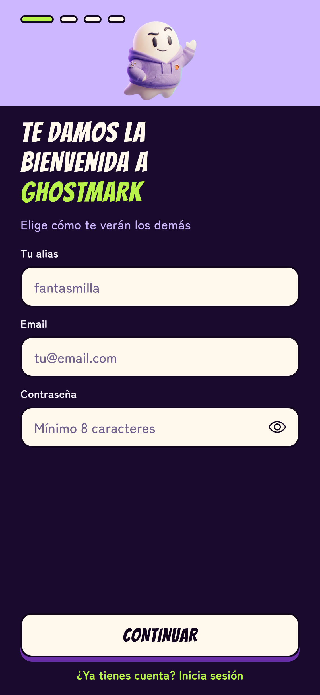

### 1.2 Tu horario lectivo

En las horas en que tienes clase nadie puede cazarte, y tú tampoco puedes cazar.

1. Toca la letra de un día: L, M, X, J o V.
2. Pulsa «+ Añadir franja», ajusta la hora de inicio y la de fin, entre las 08:00 y las 21:00 y en tramos de media hora, y pulsa «Guardar día».
3. Cuando tengas todos los días, pulsa «Siguiente». Si entras desde Perfil, el botón se llama «Confirmar horario».

Puedes cambiarlo más tarde en Perfil, «Mi horario lectivo».

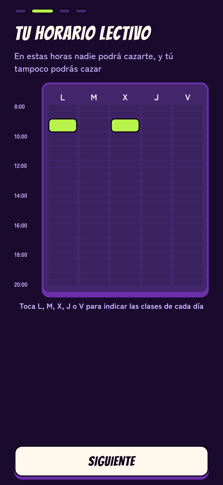

### 1.3 Ubicación y disponibilidad

Se piden una sola vez, al crear la cuenta. Si cierras la app antes de aceptarlos, te los pide al volver a iniciar sesión.

- **Tu ubicación, a salvo.** Pulsa «Dar permiso» y acepta el permiso que te pide el móvil. Sin él no se puede seguir, porque las zonas seguras dependen de la ubicación. La app solo comprueba si estás en una zona segura en el momento de eliminar, y nunca guarda ni envía dónde estás.
- **Tu disponibilidad.** Pulsa «Acepto». Mientras estás en clase, tu cazador ve una cuenta atrás hasta que vuelvas a estar disponible, pero nunca tu horario ni tu ubicación.

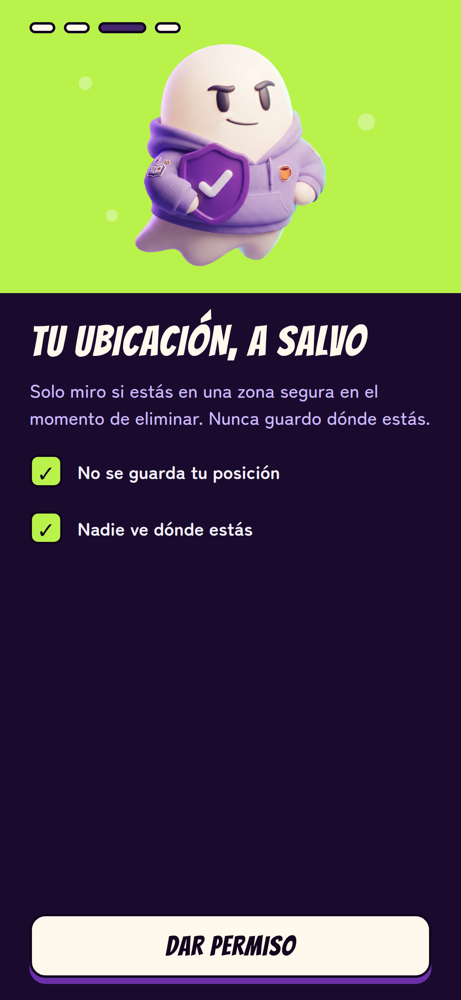

### 1.4 Iniciar sesión

1. Al abrir GhostMark, escribe tu email y tu contraseña en «Iniciar sesión».
2. Pulsa «Iniciar sesión». Si alguno no es correcto, la app muestra «Email o contraseña incorrectos» y no entra.

La sesión sigue abierta en el móvil mientras uses la app al menos una vez cada 30 días. Para cerrarla, entra en Perfil y pulsa «Cerrar sesión».

### 1.5 Borrar la cuenta

1. Entra en Perfil y pulsa «Borrar mi cuenta».
2. Confirma con «Borrar cuenta».

Se borran tu alias, tus datos de acceso y tu horario, y no se puede deshacer. Después ya no podrás iniciar sesión con ese email y tu alias queda libre para otra persona.

## 2. Crear una partida

En Inicio, pulsa «Crear partida». El asistente tiene cuatro pasos: nombre y fechas, reglas, misiones y, con la partida ya creada, compartirla.

### 2.1 Nombre y fechas

1. Escribe el nombre de la partida, de 3 a 40 caracteres.
2. Toca «Empieza» y ajusta el día y la hora con «−» y «+» (la hora va en tramos de media hora); pulsa «Listo». Haz lo mismo con «Termina».
3. Pulsa «Siguiente».

La partida tiene que empezar al menos 15 minutos después de crearla y terminar después de empezar; si no, la app te dice qué corregir y no avanza.

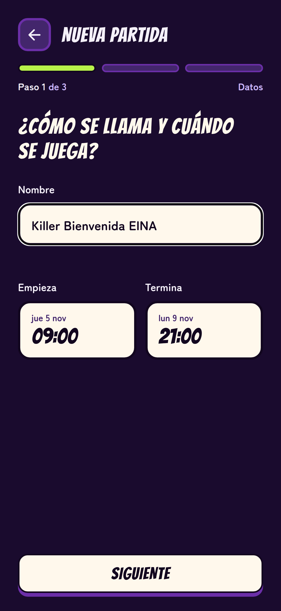

### 2.2 Reglas

- **Yo también juego.** Activado, juegas como uno más y la app no te enseña nada que no te toque como jugador; desactivado, solo diriges la partida.
- **Permitir entradas tardías.** Queda guardado con la partida; por ahora nadie puede unirse una vez empezada.
- **Plazo para resolver disputas.** 2, 6, 12 o 24 horas; por defecto, 12.

Pulsa «Siguiente».

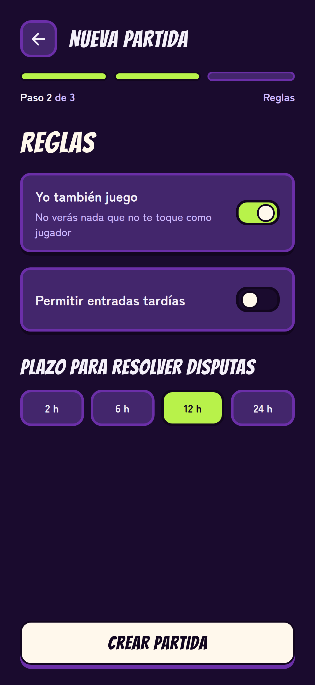

### 2.3 Misiones

Elige de dónde salen las misiones de la partida:

- **Biblioteca.** Se usan las misiones revisadas de GhostMark. Pulsa «Crear partida».
- **Generar con IA.** Elige un contexto («Campus», «Fiesta de bienvenida», «Semana de exámenes» u «Otro…», donde lo escribes tú, de 3 a 40 caracteres) y pulsa «Generar misiones». La partida se crea en ese momento y la IA propone una tanda de hasta 8 misiones pensadas para ese contexto.

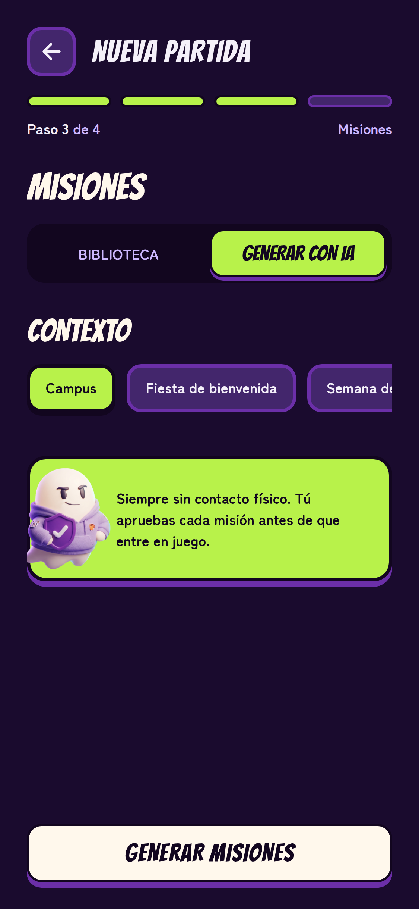

Ninguna misión de la IA entra en la partida si no la apruebas tú. La app te las enseña de una en una, con el contador arriba («1 de 8»):

1. Lee la misión y desliza la carta a la derecha para aprobarla o a la izquierda para rechazarla. También puedes pulsar «Aprobar» o «Rechazar».
2. La decisión es definitiva: una misión rechazada no vuelve a salir y una aprobada no se puede quitar.
3. Al revisar la última, la app muestra «Tanda revisada» y cuántas has aprobado.

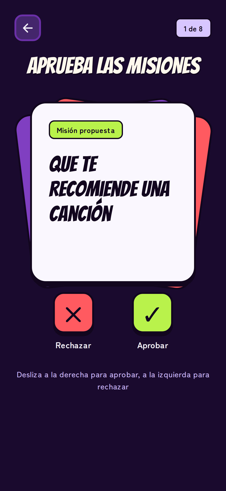 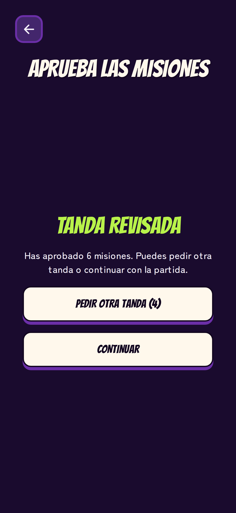

Desde ahí, «Pedir otra tanda» trae hasta ocho más con el mismo contexto; el número entre paréntesis son las tandas que te quedan, hasta 5 por partida. «Continuar» lleva a la pantalla para compartirla.

Antes de enseñártelas, GhostMark descarta las que no tienen el formato de una misión y las que tocan algo prohibido, como el contacto físico o los objetos que simulen armas. Por eso una tanda puede traer menos de 8.

**Si la IA no responde.** La IA puede fallar, tardar más de 15 segundos o haber agotado su cuota gratuita. Si pasa al pulsar «Generar misiones», la app vuelve a «Biblioteca» y avisa: «La IA no responde: se usarán misiones de la biblioteca». Pulsa «Crear partida» y sigues con la misma partida, ya con misiones de la biblioteca, o vuelve a «Generar con IA» para intentarlo otra vez. Si falla al pedir otra tanda, el aviso sale debajo de «Tanda revisada»: las misiones que ya aprobaste se mantienen y, si no llegan para todos, el resto sale de la biblioteca («La IA no responde: el resto de misiones saldrán de la biblioteca»). Una tanda que falla no cuenta entre las 5. La partida nunca se queda sin misiones: al arrancar, las que falten salen de la biblioteca.

Al arrancar, cada jugador recibe una de las que aprobaste; si hay menos aprobadas que jugadores, el resto sale de la biblioteca. Las misiones de la IA solo se piden en este paso: si sales con la flecha, la partida se queda con las que hayas aprobado.

### 2.4 Compartirla

La app muestra «¡Partida creada!» con el nombre, el código de invitación, un QR y el enlace de la partida.

- Enséñale el QR a quien quieras invitar, o pulsa «Copiar enlace» y envíaselo. Si el móvil no deja copiarlo, mantén pulsado el enlace para seleccionarlo.
- «Ir a la partida» muestra su nombre, estado, máster, fechas y número de inscritos.

Quien abre el enlace con GhostMark instalado ve esa misma partida; si tiene que iniciar sesión o aceptar los permisos, la invitación se conserva hasta terminar. La partida aparece también en tu Inicio.

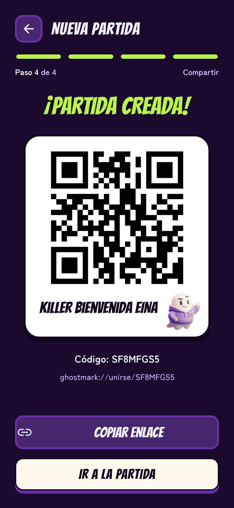

## 3. Unirse a una partida

### 3.1 Entrar por QR o por enlace

- **Con el QR.** En Inicio, pulsa «Unirse». La app pide permiso para usar la cámara la primera vez; acéptalo y apunta al código QR que te enseña el máster. Si el QR no es de una partida de GhostMark, la app avisa y sigue leyendo. Si bloqueaste la cámara, «Abrir ajustes» te lleva a los ajustes del móvil para activarla.
- **Con el enlace.** Abre el enlace que te ha pasado el máster con GhostMark instalado. Si tienes que iniciar sesión o aceptar los permisos de la cuenta, hazlo primero: la invitación se conserva hasta terminar.

Las dos formas llevan a la misma pantalla: el nombre de la partida, su estado, el máster, las fechas y cuántos inscritos tiene. Si el código no existe, la app lo dice. Mirarla no te inscribe.

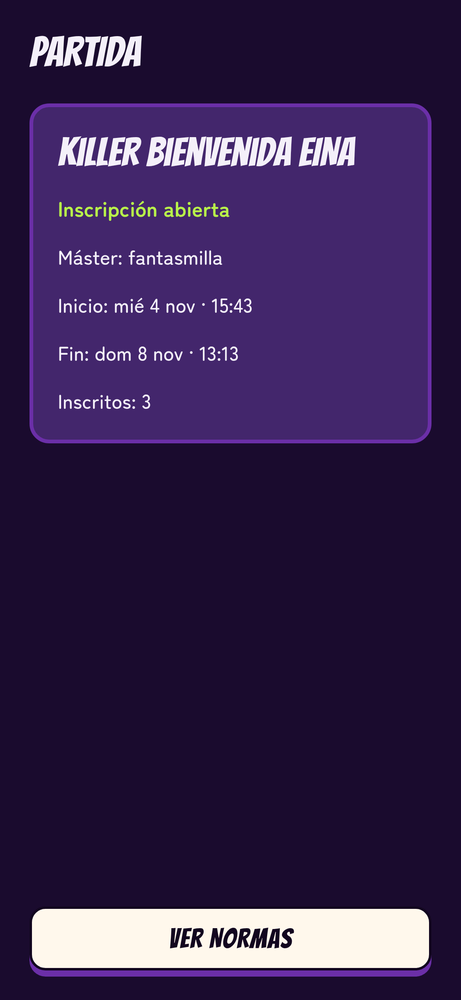

### 3.2 Aceptar las normas

1. Pulsa «Ver normas».
2. Lee las cuatro normas de la partida: sin contacto físico, sin objetos que simulen armas, zonas y horarios seguros, y puedes abandonar cuando quieras.
3. Pulsa «Acepto y me uno». Solo entonces quedas inscrito; si vuelves atrás sin pulsarlo, no te apuntas.

Si ya estabas inscrito, la app te lo dice y te ofrece «Ir a mis partidas». Si la partida ya ha empezado o se ha cancelado, no te deja unirte.

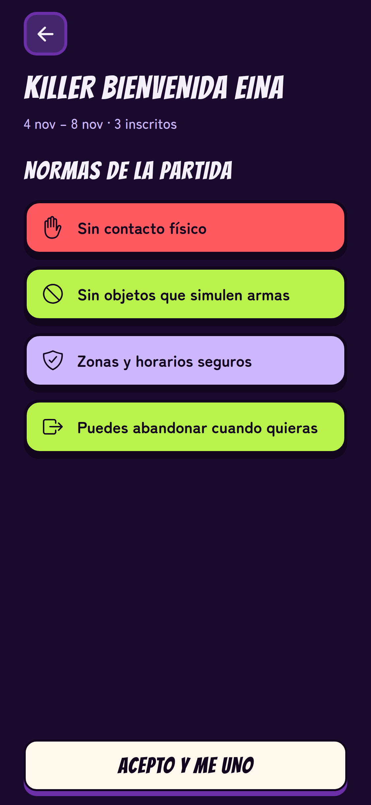

### 3.3 La sala de espera

Al unirte entras en la sala de espera: la cuenta atrás hasta el inicio y los inscritos, cada uno con su fantasma y su alias, tú también. Si alguien ha borrado su cuenta, aparece como «Cuenta eliminada».

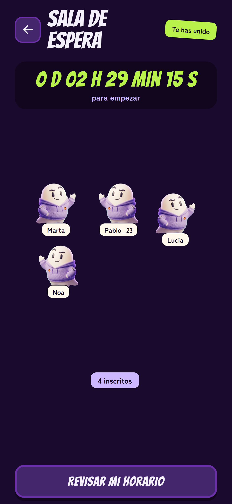

### 3.4 Tu horario en esta partida

Al unirte, la partida copia tu horario lectivo de la cuenta. En la sala, «Revisar mi horario» abre el horario de esta partida: los cambios que hagas ahí solo valen para ella, no para tu cuenta ni para tus otras partidas. Se puede cambiar hasta la hora de inicio; desde entonces queda fijo para toda la partida. Si eres el máster y no juegas, la sala no muestra «Revisar mi horario», porque no tienes horario en la partida.

### 3.5 Varias partidas a la vez

Puedes estar en varias partidas a la vez, aunque coincidan en fechas. Cada una aparece en Inicio con su estado y tiene su propia inscripción y su propio horario.

## 4. Arranque y cancelación

### 4.1 Arrancar antes de la hora

Si eres el máster, pulsa la partida en Inicio para abrir su sala de espera: verás «Eres el máster», la cuenta atrás y los inscritos. La sala se actualiza sola cada pocos segundos. «Arrancar ya» empieza la partida en ese momento, sin esperar a la hora de inicio, y solo se activa cuando hay al menos 3 inscritos. Desde entonces, la hora de inicio de la partida es la del arranque.

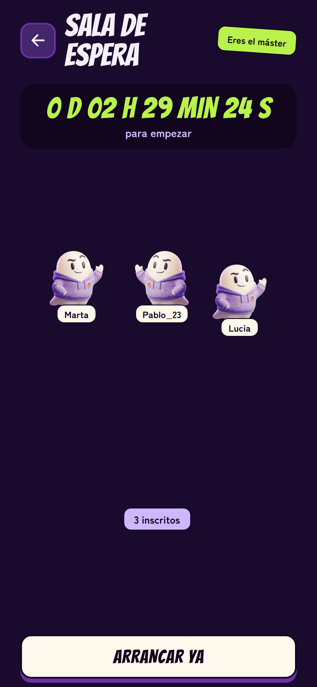

### 4.2 La partida empieza

Al llegar la hora de inicio, la partida arranca sola si tiene al menos 3 inscritos. Cada jugador recibe como objetivo a otro jugador, y entre todos forman una única cadena cerrada: nadie se persigue a sí mismo y todos son el objetivo de alguien. Desde ese momento tu horario en esta partida queda fijo.

Si estás en la sala, pasas a «¡La partida ha empezado!»; con el botón atrás vuelves a Inicio. En Inicio, la partida aparece «En juego» y, al pulsarla, se abre directamente tu carta. Si eres el máster y no juegas, se abre «¡La partida ha empezado!» con «Volver a mis partidas», porque no tienes carta.

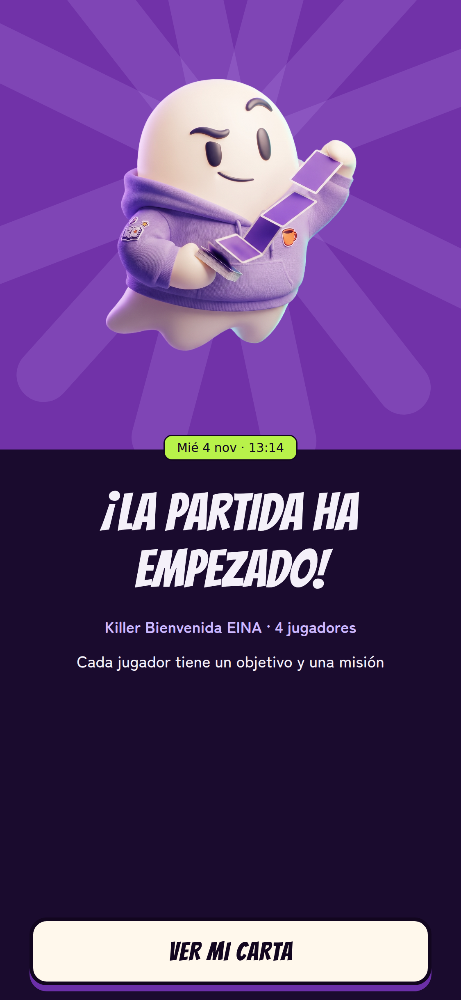

### 4.3 La partida se cancela

Si a la hora de inicio hay menos de 3 inscritos, la partida no empieza: se cancela. En Inicio aparece como «Cancelada» y, al pulsarla, la pantalla dice «No hay jugadores suficientes», con los inscritos que había y los 3 que hacían falta. Una partida también se cancela si el máster borra su cuenta antes de que empiece, y en ese caso la pantalla lo indica.

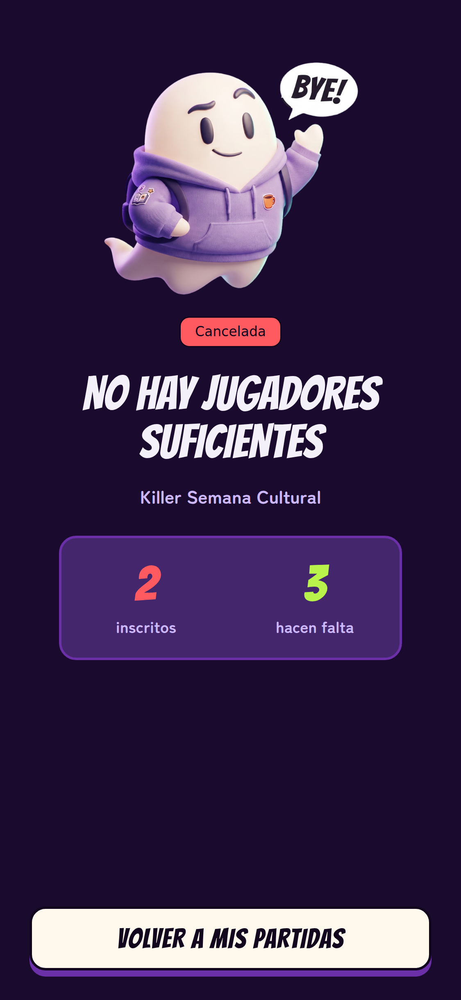

## 5. Tu objetivo y tu misión

### 5.1 Ver tu carta

Cuando la partida empieza, pulsa «Ver mi carta» en «¡La partida ha empezado!» o pulsa la partida en Inicio. La carta sale boca abajo para que nadie la vea por encima de tu hombro: mantenla pulsada para leer tu objetivo, el alias del jugador al que tienes que eliminar, y tu misión. Al soltarla se vuelve a tapar.

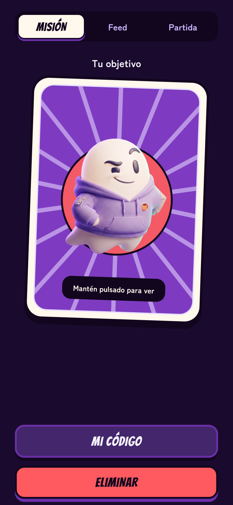 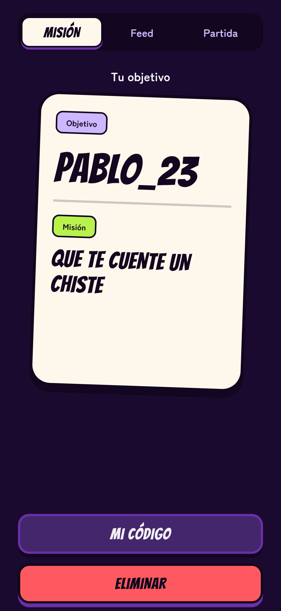

Si tu objetivo ha borrado su cuenta, en su lugar pone «Cuenta eliminada».

### 5.2 Solo tú la ves

Tu objetivo y tu misión solo los ves tú. Nadie más puede verlos, tampoco el máster, aunque juegue. Si el máster no juega, no tiene carta.

### 5.3 Las misiones

Si el máster eligió generar las misiones con IA, la tuya es una de las que aprobó. Si no, o si no llegan para todos, sale de una biblioteca de misiones revisadas, y en una misma partida no se repite hasta que se acaban. Ninguna implica contacto físico ni objetos que simulen armas: son cosas como conseguir que tu objetivo te diga la hora o que te recomiende una canción.

## 6. Código de vida y eliminación

Bajo tu carta tienes dos botones: «Mi código» y «Eliminar».

### 6.1 Tu código de vida

Cada jugador vivo tiene un código de 6 dígitos que cambia cada 60 segundos. Pulsa «Mi código» para verlo: el círculo y el contador marcan los segundos que le quedan, y al llegar a 0 sale el siguiente. Solo lo ves tú, ni siquiera el máster.

Si tu cazador cumple su misión contigo, gira el móvil hacia él para que vea tu código. Con la «×» vuelves a tu carta.

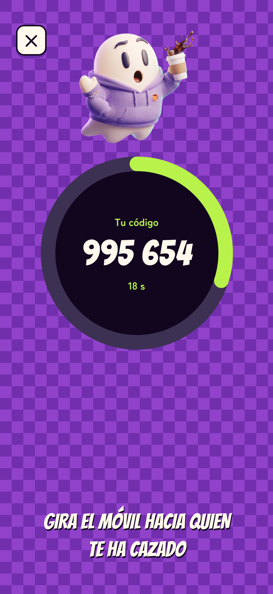

### 6.2 Eliminar a tu objetivo

1. Cumple tu misión con tu objetivo y pídele que te enseñe su código.
2. Pulsa «Eliminar». La pantalla dice de quién es el código que tienes que escribir.
3. Escribe los 6 dígitos con el teclado; con «⌫» borras el último. Al escribir el sexto, la app lo comprueba sola.

Si el código no es el de tu objetivo, o ya ha caducado, la app lo dice, lo borra y puedes volver a escribirlo. Si el código acaba de cambiar, el anterior todavía vale durante 15 segundos.

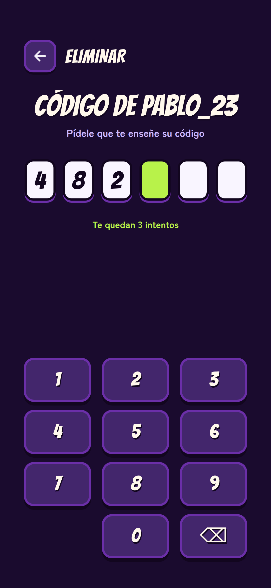 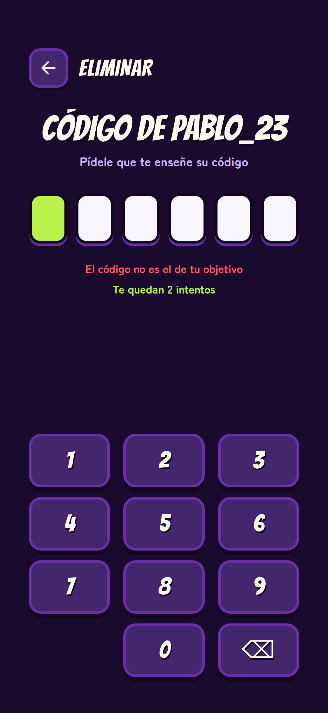

### 6.3 Intentos y bloqueo

Tienes 3 intentos seguidos para escribir el código de tu objetivo. Debajo de las casillas, la app dice cuántos te quedan. Cuenta como fallo cualquier código que no valga:

- uno de tu objetivo que ya ha caducado («El código ha caducado»);
- el de otro jugador, o el de alguien que ya está eliminado («El código no es el de tu objetivo»).

Al tercer fallo seguido salen «Intentos bloqueados» y una cuenta atrás: no puedes escribir hasta que cambie el código, como mucho 60 segundos. Después vuelves a tener 3 intentos, y cuando eliminas a tu objetivo también se reinician. Los intentos que te quedan y el bloqueo se mantienen aunque salgas de «Eliminar» y vuelvas a entrar.

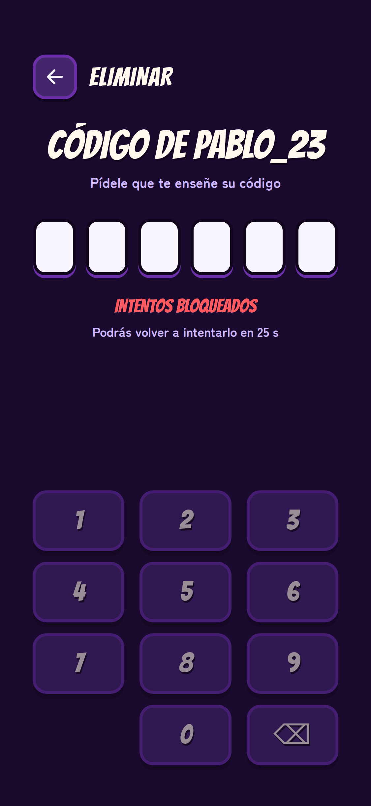

Si dos eliminaciones de la misma cadena llegan a la vez, por ejemplo tú eliminas a tu objetivo justo cuando tu cazador te elimina a ti, vale la que GhostMark registra primero. Si es la de tu cazador, la tuya no cuenta: la app dice «El jugador está eliminado» y, al volver a tu carta, sale «Te han cazado». Si es la tuya, valen las dos: heredas el objetivo de tu víctima y después tu cazador te elimina.

### 6.4 Heredas su objetivo y su misión

Con el código correcto sale «¡Eliminado!»: tu objetivo queda fuera de la partida y se te suma una eliminación. Heredas su objetivo y su misión, así que la cadena sigue cerrada: cuando solo quedan dos jugadores, cada uno es el objetivo del otro.

Pulsa «Ver mi nueva carta». La carta se gira sola una vez para enseñarte tu nuevo objetivo y tu nueva misión, y vuelve a taparse. Si no queda nadie más en juego, la carta dice «Ya no tienes objetivo: eres la última persona en juego».

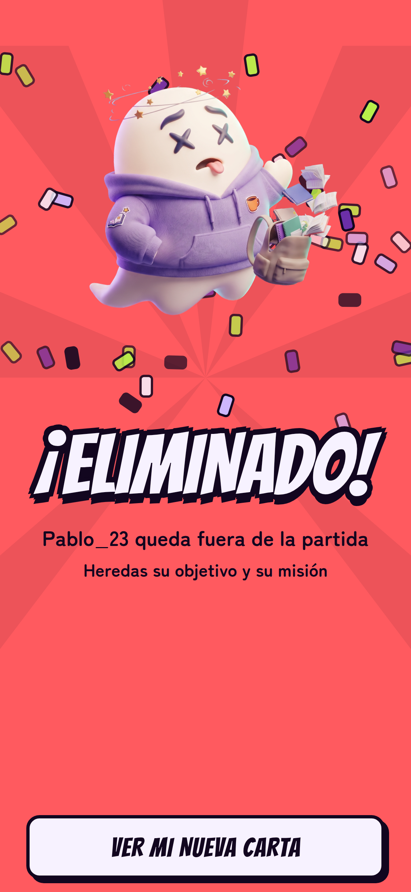 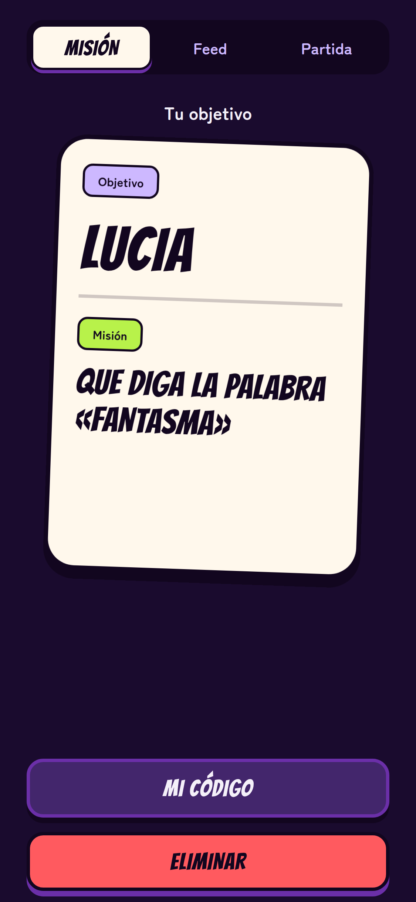

### 6.5 Te han cazado

Si te eliminan, la primera vez que abres tu carta sale «Te han cazado». Pulsa «Cerrar». Desde entonces eres espectador: tu carta queda en gris, sin objetivo ni misión, y ya no tienes código ni puedes eliminar. Puedes seguir la partida en Feed y en Partida hasta el final.

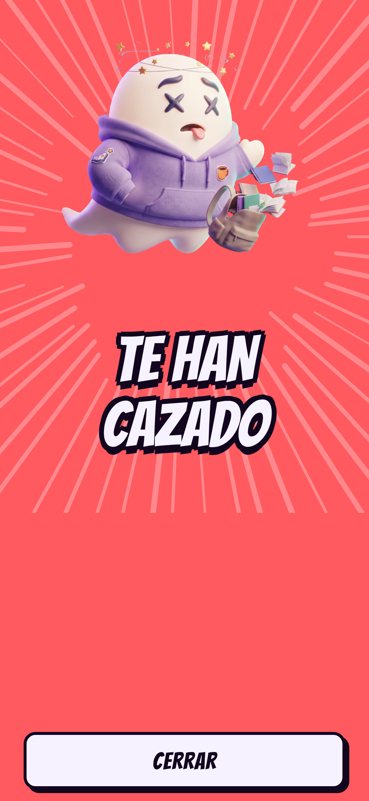 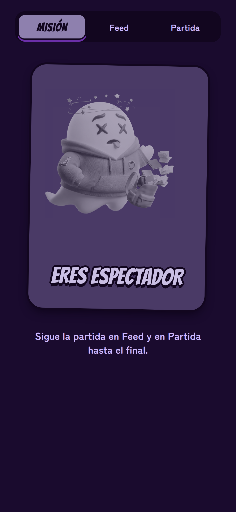

### 6.6 El feed

La pestaña Feed, en la carta y en Partida, lista las eliminaciones de la partida, de la más reciente a la más antigua, con su hora: «Pablo_23 fue eliminado». Nunca dice quién eliminó a quién. Si el eliminado borró su cuenta, pone «Una cuenta eliminada fue eliminada». Lo ven todos los jugadores, vivos o eliminados, y el máster, aunque no juegue.

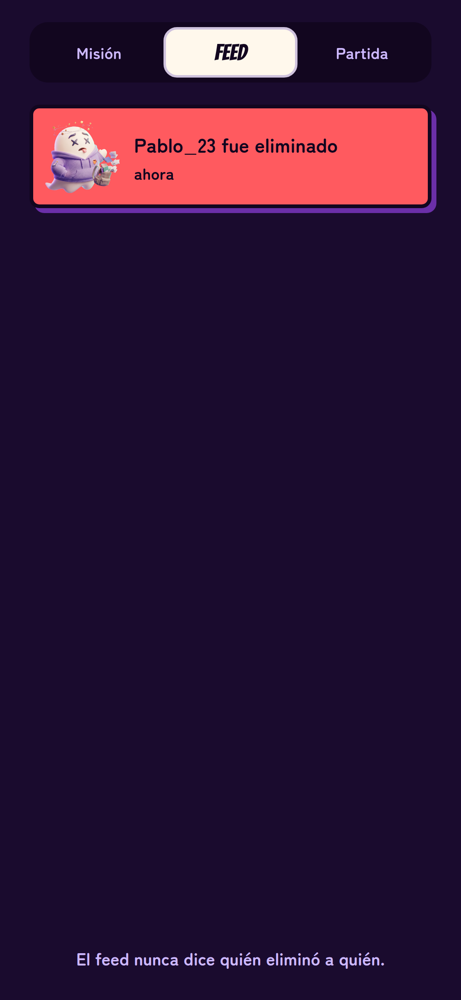

## 7. El cierre de la partida

### 7.1 Cuándo termina

Una partida termina de tres formas:

- **Queda un solo jugador vivo.** Al eliminar a su último rival, la partida se cierra en ese momento.
- **Llega la fecha de fin** que puso el máster al crearla.
- **El máster la cierra** antes de tiempo, juegue o no.

Cuando termina, ya no se puede ver la carta, ni el código de vida, ni eliminar. El feed se sigue viendo.

### 7.2 Cerrar la partida (máster)

En la pestaña Partida, el máster ve la lista de jugadores con su estado y, abajo, el botón «Cerrar partida». La app pregunta «¿Cerrar la partida?» y avisa de que termina para todos y no se puede deshacer; con «Cerrar» se cierra y con «Cancelar» sigue en juego.

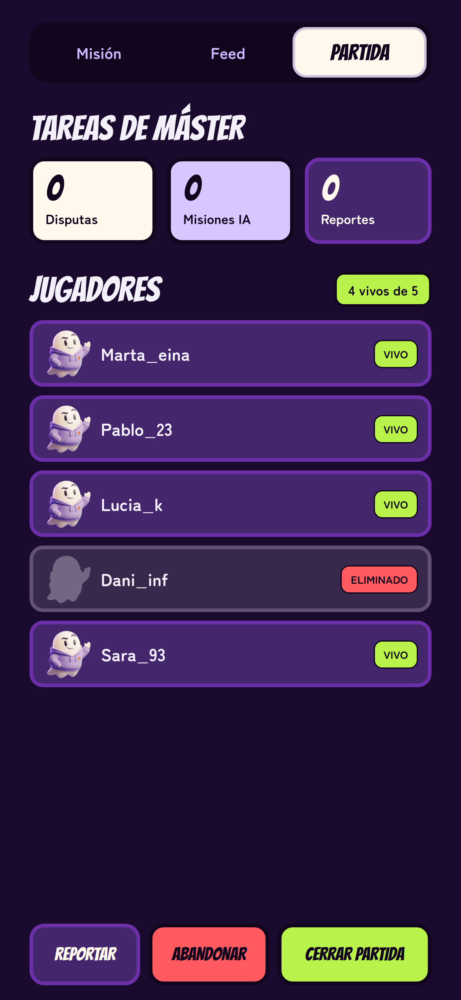

### 7.3 Quién gana

Solo cuentan los jugadores que siguen vivos al cerrar:

- Si queda uno, gana él: «Marta_eina, último superviviente».
- Si quedan varios, gana el que más eliminaciones tiene: «Gana Marta_eina con 1 eliminación». Pasa igual si la partida termina por la fecha de fin o porque la cierra el máster.
- Si varios empatan con el máximo de eliminaciones, la partida acaba en empate: «Empate entre Pablo_23 y Lucia_k».

Las eliminaciones de quien ya está eliminado no cuentan para ganar.

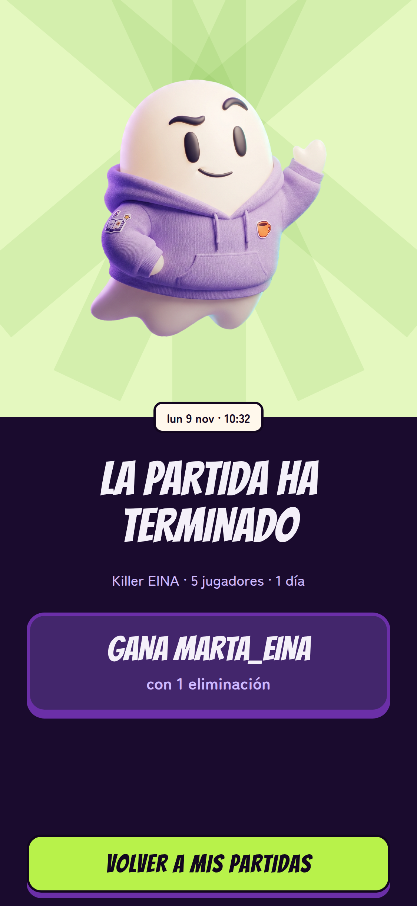  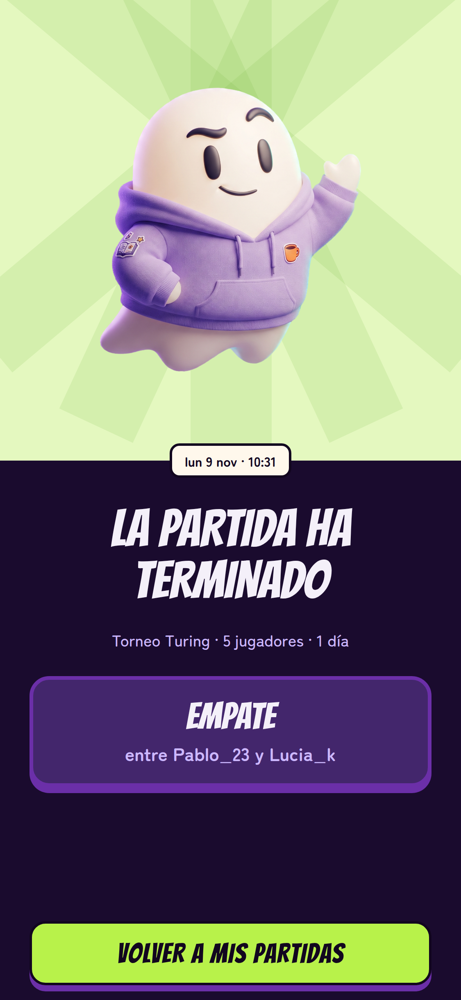

### 7.4 La pantalla de fin

Todos, jugadores y máster, ven «La partida ha terminado» con el resultado. Encima va la fecha y la hora en que se cerró, y debajo, el nombre de la partida, cuántos jugadores tuvo y cuántos días duró, desde el arranque hasta el cierre. Si duró menos de un día, pone «1 día». Con «Volver a mis partidas» vuelves a Inicio.

### 7.5 La partida cerrada en Inicio

En la lista de tus partidas, una cerrada sale con su resultado: «Cerrada · Gana Sara_93 con 1 eliminación». Solo ocupa la tarjeta grande de arriba si no tienes ninguna en juego ni en inscripción; entonces pone «Cerrada el» y la fecha del cierre. Al pulsarla vuelves a su pantalla de fin.

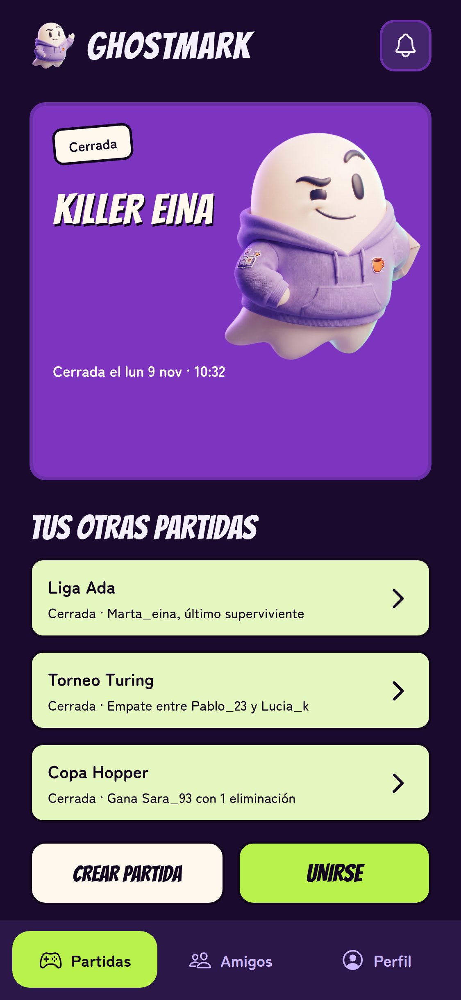
