# Manual de usuario

Se escribe a medida que se terminan PBI: cada *pull request* que cambia lo que ve el usuario actualiza la sección correspondiente (definición de hecho). Una sección por funcionalidad, en el orden de la pila, con capturas de la app real.

## 1. Crear la cuenta e iniciar sesión

### 1.1 Crear la cuenta

1. Abre GhostMark. Sale «Iniciar sesión»; pulsa «¿No tienes cuenta? Crear cuenta».
2. En «Te damos la bienvenida a GhostMark», escribe tu alias: de 3 a 20 caracteres, con letras sin tildes, números y guion bajo. Nadie más puede tener el mismo alias, aunque cambien las mayúsculas.
3. Escribe tu email y una contraseña de al menos 8 caracteres. El email solo sirve para iniciar sesión.
4. Pulsa «Continuar». Si el alias o el email ya están en uso, o algún dato no es válido, la app te dice cuál y no crea la cuenta.

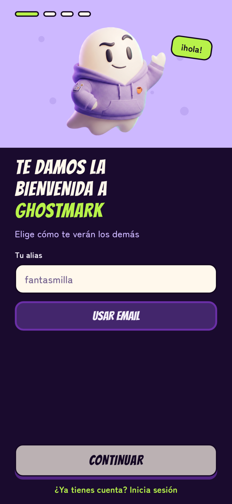

### 1.2 Tu horario lectivo

En las horas en que tienes clase nadie puede cazarte, y tú tampoco puedes cazar.

1. Toca la letra de un día: L, M, X, J o V.
2. Pulsa «+ Añadir franja», ajusta la hora de inicio y la de fin, entre las 08:00 y las 21:00 y en tramos de media hora, y pulsa «Guardar día».
3. Cuando tengas todos los días, pulsa «Siguiente». Si entras desde Perfil, el botón se llama «Confirmar horario».

Puedes cambiarlo más tarde en Perfil, «Mi horario lectivo».

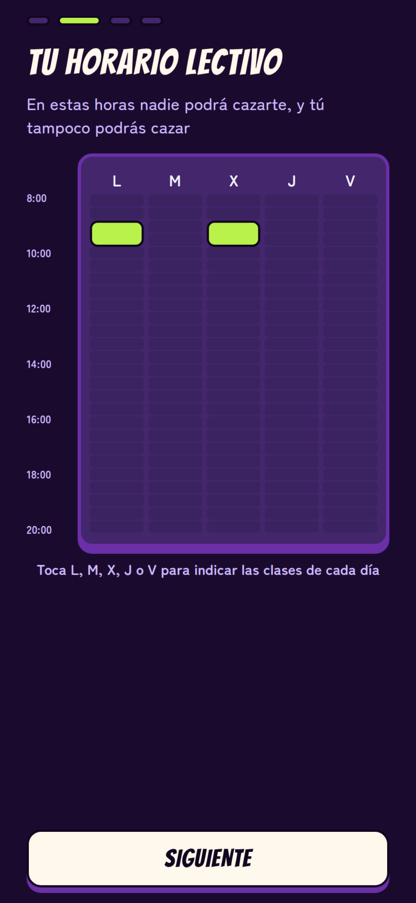

### 1.3 Ubicación y disponibilidad

Se piden una sola vez, al crear la cuenta. Si cierras la app antes de aceptarlos, te los pide al volver a iniciar sesión.

- **Tu ubicación, a salvo.** Pulsa «Dar permiso» y acepta el permiso que te pide el móvil. Sin él no se puede seguir, porque las zonas seguras dependen de la ubicación. La app solo comprueba si estás en una zona segura en el momento de eliminar, y nunca guarda ni envía dónde estás.
- **Tu disponibilidad.** Pulsa «Acepto». Mientras estás en clase, tu cazador ve una cuenta atrás hasta que vuelvas a estar disponible, pero nunca tu horario ni tu ubicación.

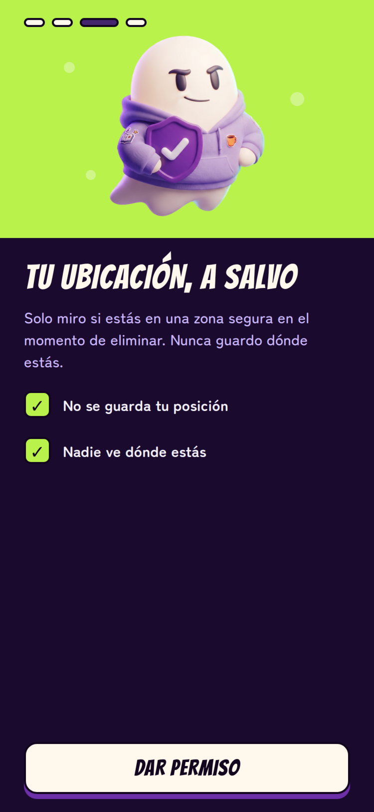

### 1.4 Iniciar sesión

1. Al abrir GhostMark, escribe tu email y tu contraseña en «Iniciar sesión».
2. Pulsa «Iniciar sesión». Si alguno no es correcto, la app muestra «Email o contraseña incorrectos» y no entra.

La sesión sigue abierta en el móvil mientras uses la app al menos una vez cada 30 días. Para cerrarla, entra en Perfil y pulsa «Cerrar sesión».

### 1.5 Borrar la cuenta

1. Entra en Perfil y pulsa «Borrar mi cuenta».
2. Confirma con «Borrar cuenta».

Se borran tu alias, tus datos de acceso y tu horario, y no se puede deshacer. Después ya no podrás iniciar sesión con ese email y tu alias queda libre para otra persona.

## 2. Crear una partida

En Inicio, pulsa «Crear partida». El asistente te pide el nombre y las fechas, después las reglas, y termina en la pantalla para compartirla.

### 2.1 Nombre y fechas

1. Escribe el nombre de la partida, de 3 a 40 caracteres.
2. Toca «Empieza» y ajusta el día y la hora con «−» y «+» (la hora va en tramos de media hora); pulsa «Listo». Haz lo mismo con «Termina».
3. Pulsa «Siguiente».

La partida tiene que empezar al menos 15 minutos después de crearla y terminar después de empezar; si no, la app te dice qué corregir y no avanza.

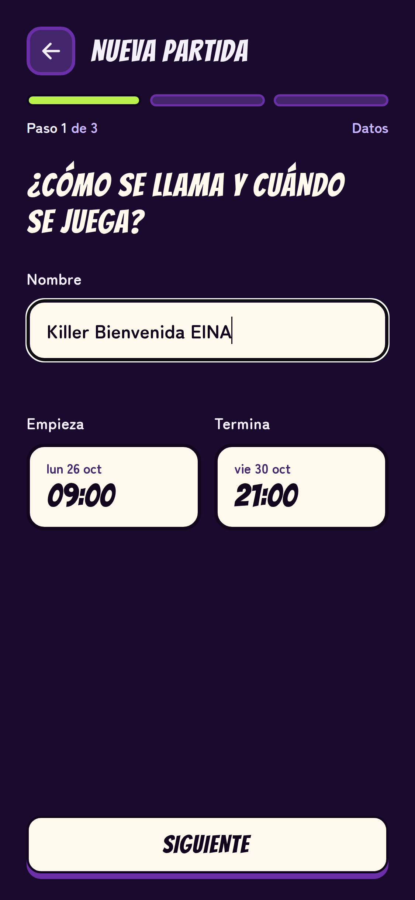

### 2.2 Reglas

- **Yo también juego.** Activado, juegas como uno más y la app no te enseña nada que no te toque como jugador; desactivado, solo diriges la partida.
- **Permitir entradas tardías.** Queda guardado con la partida; por ahora nadie puede unirse una vez empezada.
- **Plazo para resolver disputas.** 2, 6, 12 o 24 horas; por defecto, 12.

Las misiones salen de la biblioteca de GhostMark. Pulsa «Crear partida».

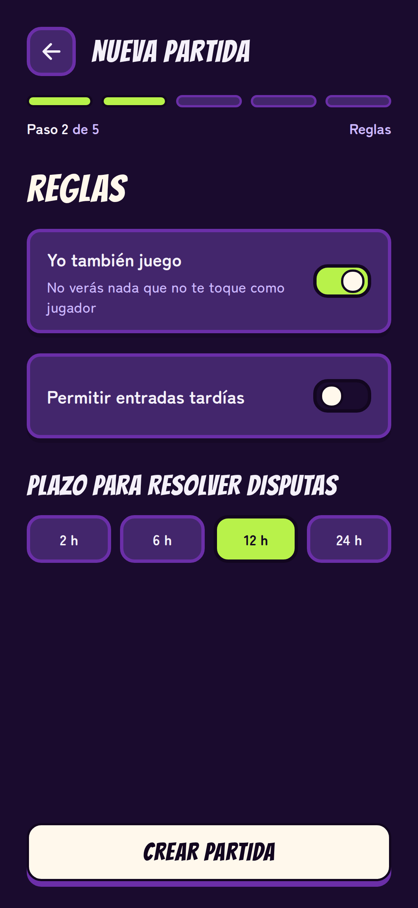

### 2.3 Compartirla

La app muestra «¡Partida creada!» con el nombre, el código de invitación, un QR y el enlace de la partida.

- Enséñale el QR a quien quieras invitar, o pulsa «Copiar enlace» y envíaselo. Si el móvil no deja copiarlo, mantén pulsado el enlace para seleccionarlo.
- «Ir a la partida» muestra su nombre, estado, máster, fechas y número de inscritos.

Quien abre el enlace con GhostMark instalado ve esa misma partida; si tiene que iniciar sesión o aceptar los permisos, la invitación se conserva hasta terminar. La partida aparece también en tu Inicio.

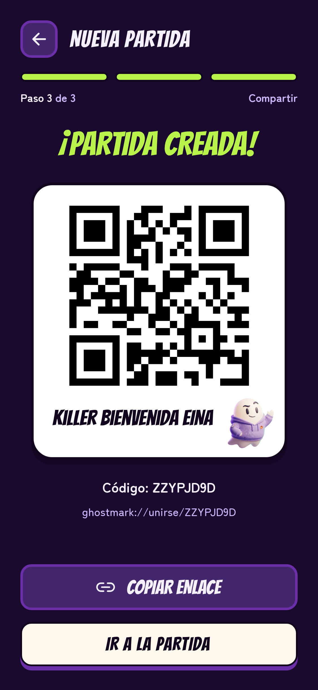

## 3. Unirse a una partida

### 3.1 Entrar por QR o por enlace

- **Con el QR.** En Inicio, pulsa «Unirse». La app pide permiso para usar la cámara la primera vez; acéptalo y apunta al código QR que te enseña el máster. Si el QR no es de una partida de GhostMark, la app avisa y sigue leyendo. Si bloqueaste la cámara, «Abrir ajustes» te lleva a los ajustes del móvil para activarla.
- **Con el enlace.** Abre el enlace que te ha pasado el máster con GhostMark instalado. Si tienes que iniciar sesión o aceptar los permisos de la cuenta, hazlo primero: la invitación se conserva hasta terminar.

Las dos formas llevan a la misma pantalla: el nombre de la partida, su estado, el máster, las fechas y cuántos inscritos tiene. Si el código no existe, la app lo dice. Mirarla no te inscribe.

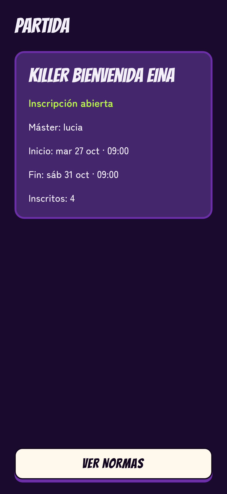

### 3.2 Aceptar las normas

1. Pulsa «Ver normas».
2. Lee las cuatro normas de la partida: sin contacto físico, sin objetos que simulen armas, zonas y horarios seguros, y puedes abandonar cuando quieras.
3. Pulsa «Acepto y me uno». Solo entonces quedas inscrito; si vuelves atrás sin pulsarlo, no te apuntas.

Si ya estabas inscrito, la app te lo dice y te ofrece «Ir a mis partidas». Si la partida ya ha empezado o se ha cancelado, no te deja unirte.

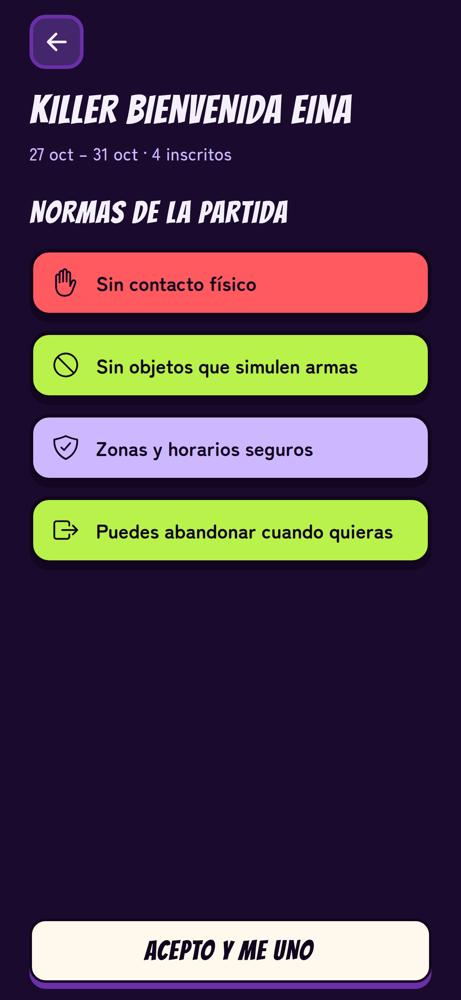

### 3.3 La sala de espera

Al unirte entras en la sala de espera: la cuenta atrás hasta el inicio y los inscritos, cada uno con su fantasma y su alias, tú también. Si alguien ha borrado su cuenta, aparece como «Cuenta eliminada».

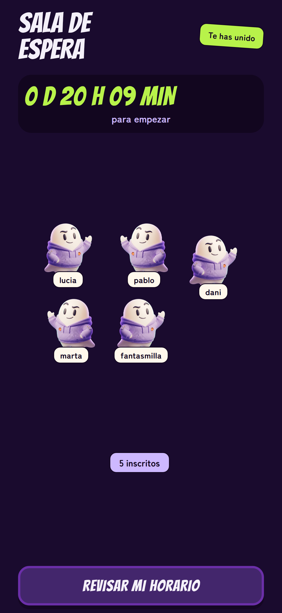

### 3.4 Tu horario en esta partida

Al unirte, la partida copia tu horario lectivo de la cuenta. En la sala, «Revisar mi horario» abre el horario de esta partida: los cambios que hagas ahí solo valen para ella, no para tu cuenta ni para tus otras partidas. Se puede cambiar hasta la hora de inicio; desde entonces queda fijo para toda la partida.

### 3.5 Varias partidas a la vez

Puedes estar en varias partidas a la vez, aunque coincidan en fechas. Cada una aparece en Inicio con su estado y tiene su propia inscripción y su propio horario.

## 4. Arranque y cancelación

### 4.1 Arrancar antes de la hora

Si eres el máster, pulsa la partida en Inicio para abrir su sala de espera: verás «Eres el máster», la cuenta atrás y los inscritos. La sala se actualiza sola cada pocos segundos. «Arrancar ya» empieza la partida en ese momento, sin esperar a la hora de inicio, y solo se activa cuando hay al menos 3 inscritos.

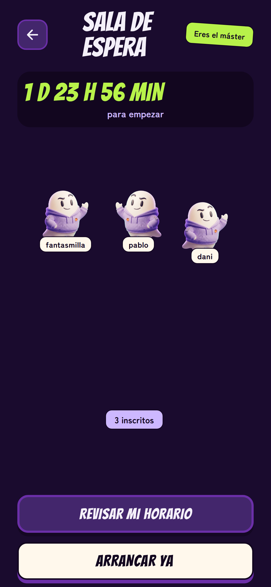

### 4.2 La partida empieza

Al llegar la hora de inicio, la partida arranca sola si tiene al menos 3 inscritos. Cada jugador recibe como objetivo a otro jugador, y entre todos forman una única cadena cerrada: nadie se persigue a sí mismo y todos son el objetivo de alguien. Desde ese momento tu horario en esta partida queda fijo.

Si estás en la sala, pasas a «¡La partida ha empezado!». En Inicio, la partida aparece «En juego» y, al pulsarla, se abre esa misma pantalla.

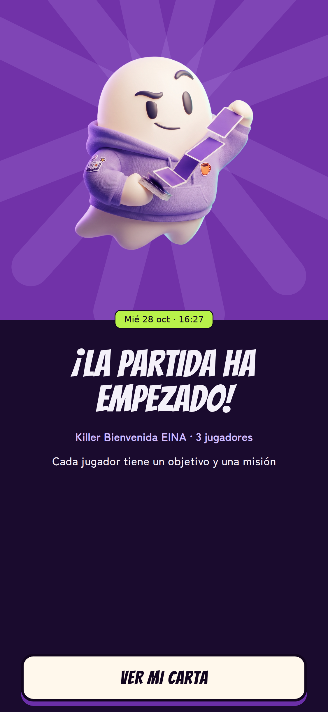

### 4.3 La partida se cancela

Si a la hora de inicio hay menos de 3 inscritos, la partida no empieza: se cancela. En Inicio aparece como «Cancelada» y, al pulsarla, la pantalla dice «No hay jugadores suficientes», con los inscritos que había y los 3 que hacían falta. Una partida también se cancela si el máster borra su cuenta antes de que empiece, y en ese caso la pantalla lo indica.

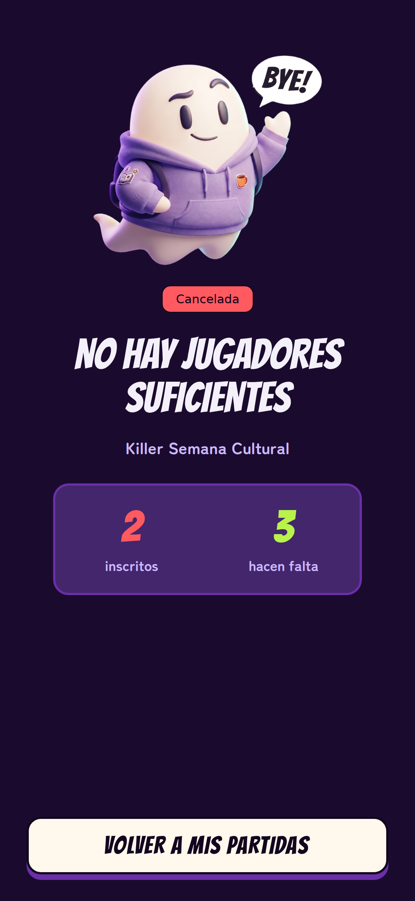
