<!-- Instantánea congelada: no se edita. -->
> **Instantánea S1 · Pila del producto al cerrar la especificación inicial**, exportada de los issues de GitHub y de los campos «Prioridad» y milestone del Project el 12 de octubre de 2026, todavía dentro del plazo de planificación del sprint 1. Sustituye a la exportada el 3 de octubre, que queda en el historial de git: incorpora la revisión de la fase previa (criterios en tabla, «No incluye» en lugar de descripción y detalle que baja con la distancia: ficha completa en el sprint 1, todos los criterios en el 2, dos en el 3 y uno en el resto). Las PBI 1-5 llevan el milestone `S1` y sus tareas son los issues #34-#71. Es la pila de partida del capítulo 2.1 de la memoria; los cambios posteriores se explican en la planificación del sprint 2.

# Pila del producto al cerrar la especificación inicial

## Prioridad y tallas

| Prioridad | Issue | Funcionalidad | Talla | Lanzamiento | Sprint |
|--|--|--------------------------------|--|--|--|
| 1 | #2 | Cuenta del jugador (crear cuenta e inicio de sesión) | M | L1 | S1 |
| 2 | #3 | Crear y configurar una partida | M | L1 | S1 |
| 3 | #4 | Inscribirse en una partida | M | L1 | S1 |
| 4 | #5 | Arrancar la partida y formar la cadena de objetivos | M | L1 | S1 |
| 5 | #31 | Ver mi objetivo y mi misión | S | L1 | S1 |
| 6 | #6 | Misiones: biblioteca, IA y aprobación del máster | L | L1 | — |
| 7 | #7 | Código de vida y eliminación | XL | L1 | — |
| 8 | #8 | Cierre de partida, ganador y empate | M | L1 | — |
| 9 | #9 | Horarios seguros | M | L1 | — |
| 10 | #10 | Zonas seguras | L | L1 | — |
| 11 | #11 | Disputas y anulación | XL | L1 | — |
| 12 | #12 | Abandonar, expulsar y reportar | M | L1 | — |
| 13 | #13 | Avisos al móvil | M | L1 | — |
| 14 | #14 | Ghostmark Wrapped y borrado de datos al cerrar | M | L1 | — |
| 15 | #15 | Amigos e invitaciones directas | M | L1 | — |
| 16 | #16 | Entradas tardías | S | L1 | — |
| 17 | #17 | Importar el horario lectivo desde el calendario | S | L1 | — |
| 18 | #32 | Acceso con Google | S | L1 | — |
| 19 | #18 | Modo por equipos | XXL | L2 | — |
| 20 | #19 | Purga final | XXL | L2 | — |
| 21 | #20 | Partida relámpago | XXL | L2 | — |
| 22 | #21 | Co-másters | XXL | L2 | — |
| 23 | #22 | Perfiles de organización | XXL | L3 | — |
| 24 | #23 | Plantillas de partida | XXL | L3 | — |
| 25 | #24 | Panel de estadísticas | XXL | L3 | — |
| 26 | #25 | Eventos de varias partidas | XXL | L3 | — |
| 27 | #26 | Validación reforzada | XXL | L3 | — |
| 28 | #27 | Premios | XXL | L3 | — |

## Fichas

### 1. Cuenta del jugador (crear cuenta e inicio de sesión) (#2)

**Talla:** M  
**Lanzamiento:** L1  
**Prioridad inicial:** 1 de 28

#### Criterios de satisfacción

| N.º | Estará cumplido cuando… |
|--|--|
| 1 | Se pueda crear la cuenta (alias, email y contraseña) e iniciar sesión, y se verifique que con datos incorrectos no entra |
| 2 | Se pueda configurar el horario lectivo y aceptar el permiso de ubicación y el aviso de disponibilidad, y se verifique que se piden una sola vez y que la cuenta solo guarda alias, datos de acceso, horario y amigos |
| 3 | Se pueda borrar la cuenta y todos sus datos en cualquier momento, y se verifique que ya no se puede iniciar sesión y el alias desaparece |

#### No incluye

El acceso con una cuenta de Google (PBI 18) ni importar el horario desde un calendario (PBI 17).

#### Pantallas del prototipo

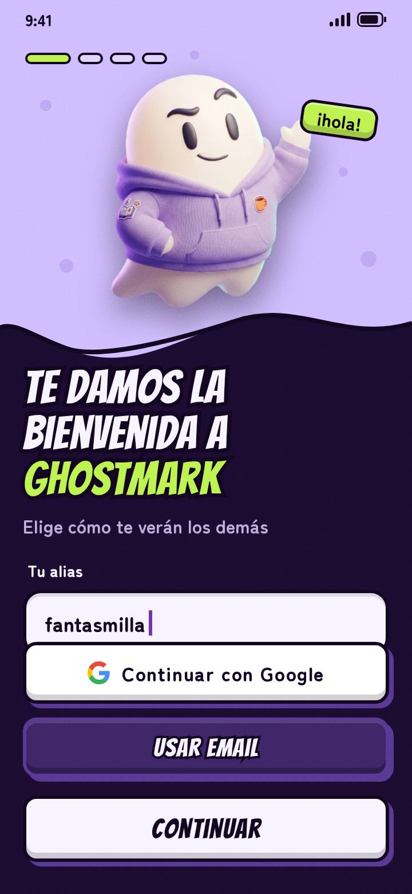 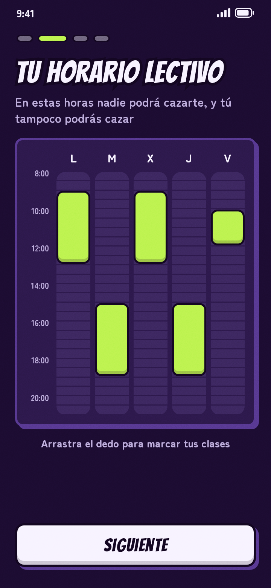 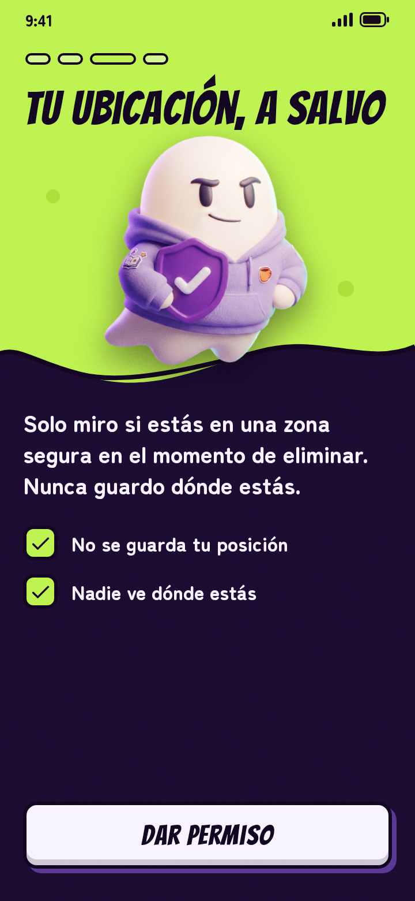

#### Tareas

Se crean en la planificación del sprint: cada tarea es un issue que menciona esta PBI.

### 2. Crear y configurar una partida (#3)

**Talla:** M  
**Lanzamiento:** L1  
**Prioridad inicial:** 2 de 28

#### Criterios de satisfacción

| N.º | Estará cumplido cuando… |
|--|--|
| 1 | El máster pueda crear una partida (nombre, fechas, tipo de misiones, plazo de disputas, entradas tardías, si juega), y se verifique que se guarda con esos valores y que se rechaza un fin anterior al inicio |
| 2 | Obtenga un QR y un enlace para compartirla, y se verifique que el enlace abre esa partida |

#### No incluye

Los pasos del asistente de misiones (PBI 6) y de zonas seguras (PBI 10) ni la invitación directa a amigos (PBI 15).

#### Pantallas del prototipo

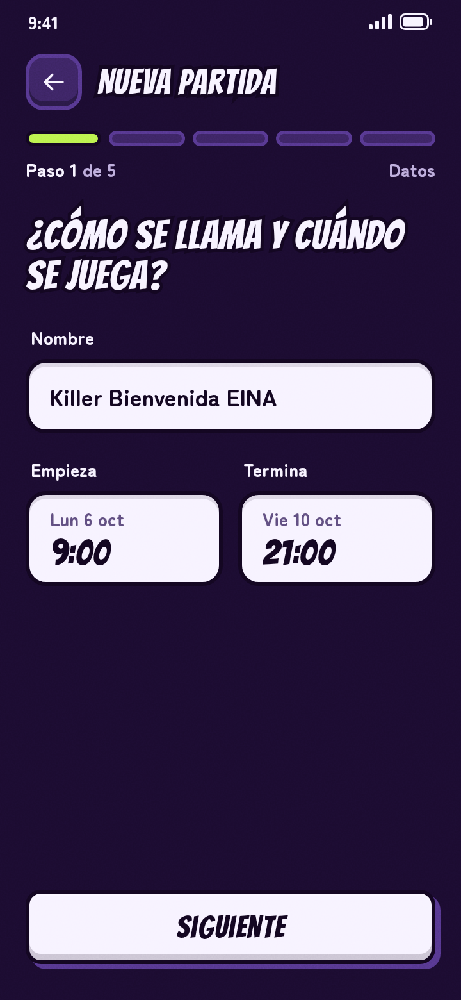 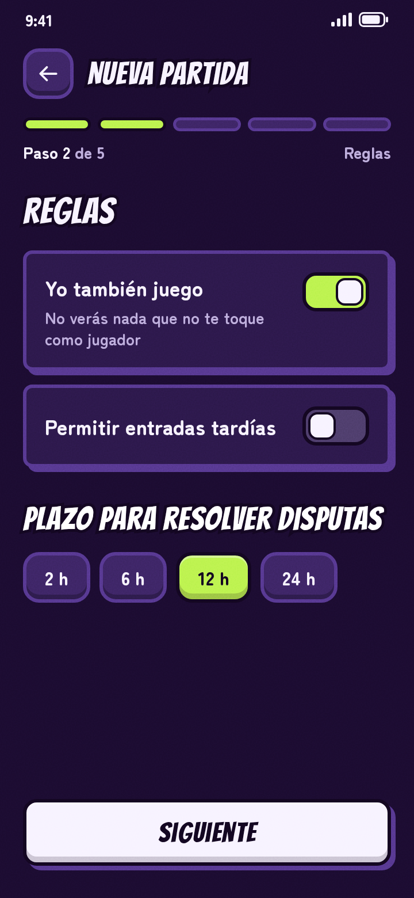 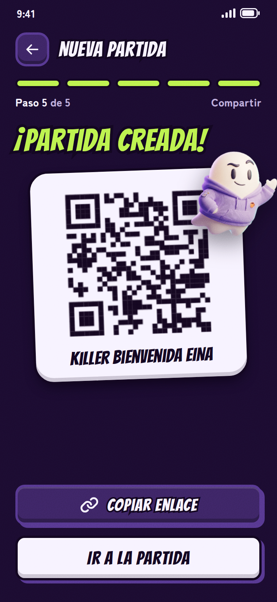

#### Tareas

Se crean en la planificación del sprint: cada tarea es un issue que menciona esta PBI.

### 3. Inscribirse en una partida (#4)

**Talla:** M  
**Lanzamiento:** L1  
**Prioridad inicial:** 3 de 28

#### Criterios de satisfacción

| N.º | Estará cumplido cuando… |
|--|--|
| 1 | Un jugador pueda entrar por QR o enlace, y se verifique que aparece en la lista de inscritos del máster |
| 2 | Acepte las normas de la partida (misiones sin contacto físico, sin objetos que simulen armas, zonas y horarios seguros y libertad para abandonar), y se verifique que sin aceptarlas no queda inscrito |
| 3 | Pueda revisar su horario lectivo hasta que arranque el juego, y se verifique que después no cambia en esa partida |
| 4 | Pueda estar en varias partidas a la vez, y se verifique que cada una es independiente |

#### No incluye

Unirse a una partida ya empezada (PBI 16).

#### Pantallas del prototipo

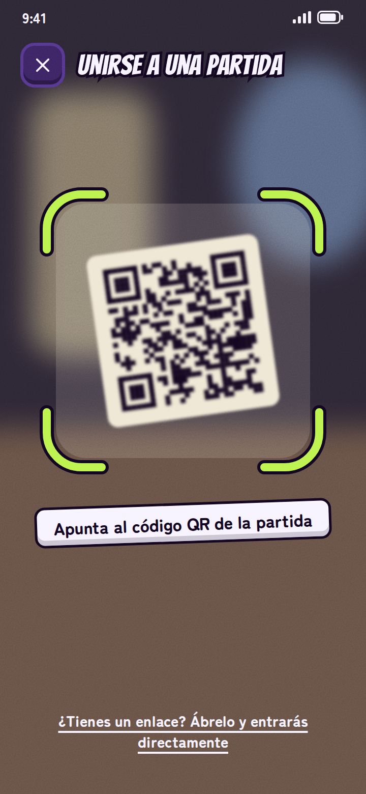 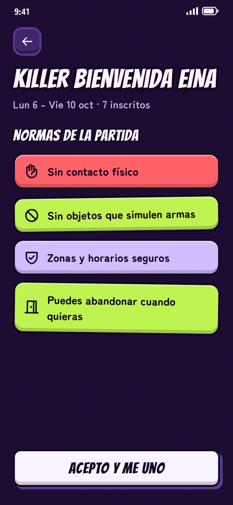 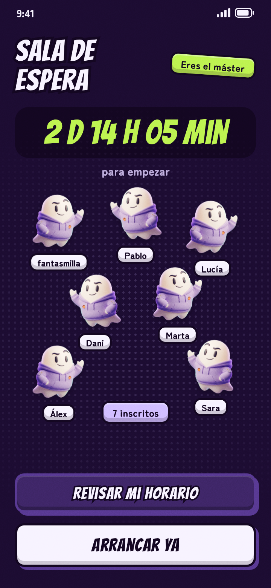

#### Tareas

Se crean en la planificación del sprint: cada tarea es un issue que menciona esta PBI.

### 4. Arrancar la partida y formar la cadena de objetivos (#5)

**Talla:** M  
**Lanzamiento:** L1  
**Prioridad inicial:** 4 de 28

#### Criterios de satisfacción

| N.º | Estará cumplido cuando… |
|--|--|
| 1 | La partida arranque sola en la fecha de inicio o antes si el máster la adelanta, y se verifique que pasa a estar en juego |
| 2 | Con al menos 3 jugadores se forme un único ciclo cerrado, y se verifique con 3, 4 y 10 jugadores que cada uno tiene un objetivo, es objetivo de otro y no se persigue a sí mismo |
| 3 | Con menos de 3 inscritos la partida se cancele, y se verifique que no llega a arrancar y que los inscritos lo ven al abrir la aplicación |

#### No incluye

El aviso al móvil de arranque o de cancelación (PBI 13).

#### Pantallas del prototipo

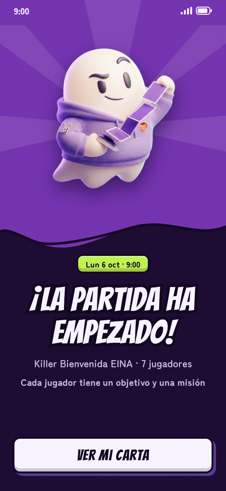 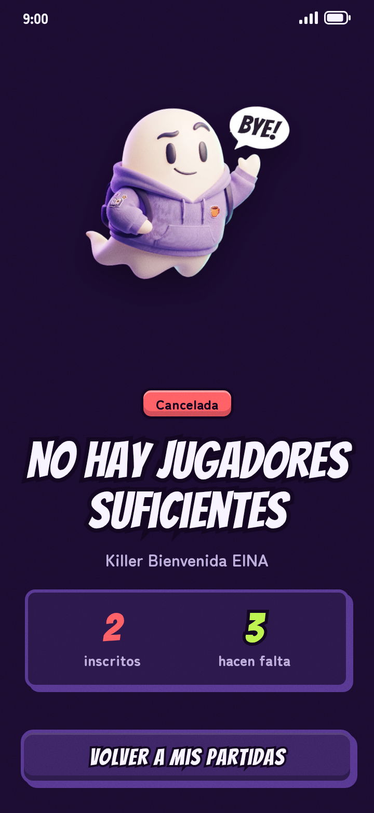

#### Tareas

Se crean en la planificación del sprint: cada tarea es un issue que menciona esta PBI.

### 5. Ver mi objetivo y mi misión (#31)

**Talla:** S  
**Lanzamiento:** L1  
**Prioridad inicial:** 5 de 28

#### Criterios de satisfacción

| N.º | Estará cumplido cuando… |
|--|--|
| 1 | Cada jugador vea solo su objetivo y su misión, y se verifique que nadie ve los ajenos, tampoco el máster si juega |
| 2 | Cada jugador reciba al arrancar una misión de la biblioteca curada, y se verifique que ninguna implica contacto físico ni objetos que simulen armas |

#### No incluye

Las misiones generadas con IA ni la aprobación del máster (PBI 6).

#### Pantallas del prototipo

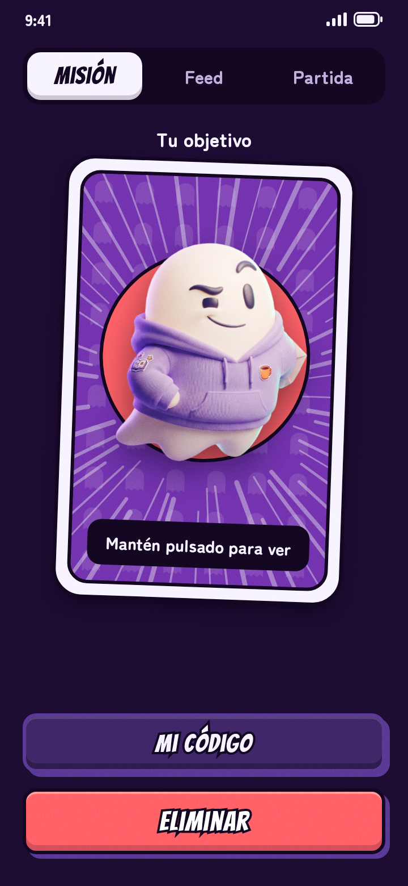 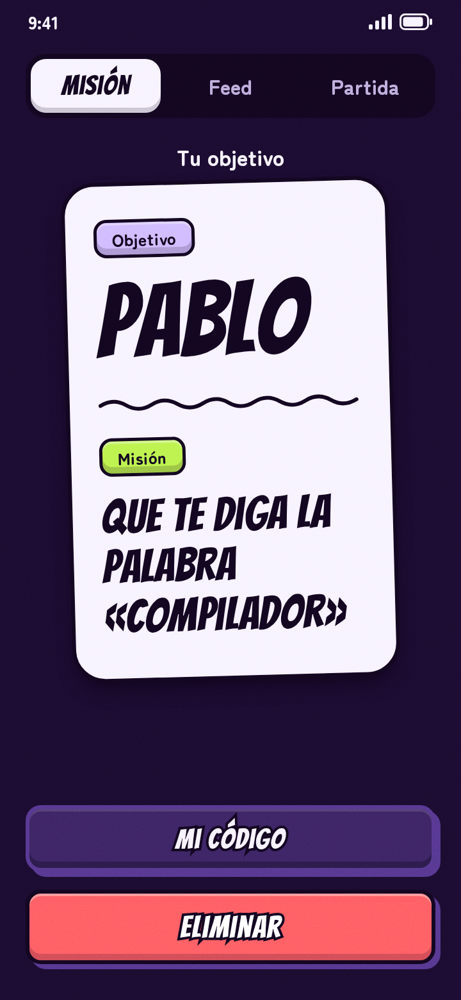

#### Tareas

Se crean en la planificación del sprint: cada tarea es un issue que menciona esta PBI.

### 6. Misiones: biblioteca, IA y aprobación del máster (#6)

**Talla:** L  
**Lanzamiento:** L1  
**Prioridad inicial:** 6 de 28

#### Criterios de satisfacción

| N.º | Estará cumplido cuando… |
|--|--|
| 1 | El máster pida misiones a la IA con un contexto (por ejemplo, «campus») y las apruebe o rechace una a una, y se verifique que ninguna entra en juego sin su aprobación |
| 2 | Se verifique que una misión de la IA con formato inválido o de una categoría prohibida no llega al máster |
| 3 | Si la IA falla o no responde, la partida siga con misiones de la biblioteca curada, y se verifique con el servicio simulado caído que no se bloquea |

#### No incluye

El reparto inicial desde la biblioteca (PBI 5) ni reportar una misión (PBI 12).

#### Tareas

Se crean en la planificación del sprint: cada tarea es un issue que menciona esta PBI.

### 7. Código de vida y eliminación (#7)

**Talla:** XL  
**Lanzamiento:** L1  
**Prioridad inicial:** 7 de 28

#### Criterios de satisfacción

| N.º | Estará cumplido cuando… |
|--|--|
| 1 | Cada jugador vivo vea en su móvil un código de 6 dígitos que cambia cada 60 s mientras tiene abierta su pantalla, y se verifique que solo lo ve él |
| 2 | El cazador introduzca el código de su víctima, y se verifique que ella pasa a eliminada, aparece en el feed como «X fue eliminado» sin decir quién y al cazador se le suma la eliminación |
| 3 | El cazador herede objetivo y misión, y se verifique que el ciclo sigue siendo único y cerrado y que con dos vivos cada uno es objetivo del otro |
| 4 | Se verifique que se rechaza un código caducado, ajeno o de una víctima ya eliminada, y que tras 3 fallos seguidos se bloquean los intentos hasta que el código rote |
| 5 | Se verifique que, si dos eliminaciones coinciden en la cadena, solo vale la que el sistema registra primero |

#### No incluye

Los horarios seguros (PBI 9), las zonas seguras y el permiso de ubicación (PBI 10), las disputas (PBI 11) ni los avisos al móvil (PBI 13).

#### Tareas

Se crean en la planificación del sprint: cada tarea es un issue que menciona esta PBI.

### 8. Cierre de partida, ganador y empate (#8)

**Talla:** M  
**Lanzamiento:** L1  
**Prioridad inicial:** 8 de 28

#### Criterios de satisfacción

| N.º | Estará cumplido cuando… |
|--|--|
| 1 | La partida termine al quedar un único superviviente, al llegar la fecha de fin o cuando la cierre el máster, y se verifique con los tres casos |
| 2 | Se verifique que en la fecha de fin gana quien más eliminaciones tiene y que un empate en cabeza es empate de partida |

#### No incluye

Las disputas (PBI 11), el Wrapped y el borrado de datos (PBI 14) ni el aviso de cierre (PBI 13).

#### Tareas

Se crean en la planificación del sprint: cada tarea es un issue que menciona esta PBI.

### 9. Horarios seguros (#9)

**Talla:** M  
**Lanzamiento:** L1  
**Prioridad inicial:** 9 de 28

#### Criterios de satisfacción

| N.º | Estará cumplido cuando… |
|--|--|
| 1 | Un intento de eliminación se rechace si el cazador o la víctima están en su horario lectivo, y se verifique que se acepta fuera de él |
| 2 | El cazador vea cuándo su objetivo pasa a no disponible (con cuenta atrás) y cuándo vuelve a estarlo, y se verifique que lo ve en el momento del cambio |

<!-- Nivel del tercer sprint: solo los dos criterios principales. Se detalla al acercarse su planificación. -->

#### Tareas

Se crean en la planificación del sprint: cada tarea es un issue que menciona esta PBI.

### 10. Zonas seguras (#10)

**Talla:** L  
**Lanzamiento:** L1  
**Prioridad inicial:** 10 de 28

#### Criterios de satisfacción

| N.º | Estará cumplido cuando… |
|--|--|
| 1 | El máster dibuje, modifique y borre zonas seguras en el mapa, y se verifique que se guardan y valen para toda la partida |
| 2 | Al introducir un código, el móvil compruebe si el cazador está en una zona segura, y se verifique que solo se guarda «dentro», «fuera» o «no concluyente», nunca su posición, y que sin permiso de ubicación no se puede introducir el código |

<!-- Nivel del tercer sprint: solo los dos criterios principales. Se detalla al acercarse su planificación. -->

#### Tareas

Se crean en la planificación del sprint: cada tarea es un issue que menciona esta PBI.

### 11. Disputas y anulación (#11)

**Talla:** XL  
**Lanzamiento:** L1  
**Prioridad inicial:** 11 de 28

#### Criterios de satisfacción

| N.º | Estará cumplido cuando… |
|--|--|
| 1 | La víctima abra una disputa en los 10 minutos siguientes a su eliminación y el cazador responda, y se verifique que pasado ese plazo ya no se puede |
| 2 | Se anule una eliminación, y se verifique que la víctima revive, el marcador se recalcula y se rehace un único ciclo cerrado |

<!-- Nivel del tercer sprint: solo los dos criterios principales. Se detalla al acercarse su planificación. -->

#### Tareas

Se crean en la planificación del sprint: cada tarea es un issue que menciona esta PBI.

### 12. Abandonar, expulsar y reportar (#12)

**Talla:** M  
**Lanzamiento:** L1  
**Prioridad inicial:** 12 de 28

#### Criterios de satisfacción

| N.º | Estará cumplido cuando… |
|--|--|
| 1 | Un jugador pueda abandonar o reportar y el máster expulsar, y se verifique que, si alguien sale, su cazador hereda su objetivo y su misión |

<!-- Nivel mínimo: un criterio. Se detalla al acercarse su planificación. -->

#### Tareas

Se crean en la planificación del sprint: cada tarea es un issue que menciona esta PBI.

### 13. Avisos al móvil (#13)

**Talla:** M  
**Lanzamiento:** L1  
**Prioridad inicial:** 13 de 28

#### Criterios de satisfacción

| N.º | Estará cumplido cuando… |
|--|--|
| 1 | Cambie algo en la partida, y se verifique que el aviso llega al momento y solo a quien toca |

<!-- Nivel mínimo: un criterio. Se detalla al acercarse su planificación. -->

#### Tareas

Se crean en la planificación del sprint: cada tarea es un issue que menciona esta PBI.

### 14. Ghostmark Wrapped y borrado de datos al cerrar (#14)

**Talla:** M  
**Lanzamiento:** L1  
**Prioridad inicial:** 14 de 28

#### Criterios de satisfacción

| N.º | Estará cumplido cuando… |
|--|--|
| 1 | Al cerrar la partida cada jugador vea y pueda compartir su Wrapped, y se verifique que de la partida solo queda el resumen agregado |

<!-- Nivel mínimo: un criterio. Se detalla al acercarse su planificación. -->

#### Tareas

Se crean en la planificación del sprint: cada tarea es un issue que menciona esta PBI.

### 15. Amigos e invitaciones directas (#15)

**Talla:** M  
**Lanzamiento:** L1  
**Prioridad inicial:** 15 de 28

#### Criterios de satisfacción

| N.º | Estará cumplido cuando… |
|--|--|
| 1 | Un jugador añada amigos por su alias y el máster los invite a una partida, y se verifique que la invitación les llega en la aplicación |

<!-- Nivel mínimo: un criterio. Se detalla al acercarse su planificación. -->

#### Tareas

Se crean en la planificación del sprint: cada tarea es un issue que menciona esta PBI.

### 16. Entradas tardías (#16)

**Talla:** S  
**Lanzamiento:** L1  
**Prioridad inicial:** 16 de 28

#### Criterios de satisfacción

| N.º | Estará cumplido cuando… |
|--|--|
| 1 | Un jugador entre tarde si el máster lo permite, y se verifique que la cadena sigue cerrada |

<!-- Nivel mínimo: un criterio. Se detalla al acercarse su planificación. -->

#### Tareas

Se crean en la planificación del sprint: cada tarea es un issue que menciona esta PBI.

### 17. Importar el horario lectivo desde el calendario (#17)

**Talla:** S  
**Lanzamiento:** L1  
**Prioridad inicial:** 17 de 28

#### Criterios de satisfacción

| N.º | Estará cumplido cuando… |
|--|--|
| 1 | Un jugador importe su horario desde un fichero .ics, y se verifique que sus clases aparecen en la rejilla y puede corregirlas |

<!-- Nivel mínimo: un criterio. Se detalla al acercarse su planificación. -->

#### Tareas

Se crean en la planificación del sprint: cada tarea es un issue que menciona esta PBI.

### 18. Acceso con Google (#32)

**Talla:** S  
**Lanzamiento:** L1  
**Prioridad inicial:** 18 de 28

#### Criterios de satisfacción

| N.º | Estará cumplido cuando… |
|--|--|
| 1 | Un jugador cree su cuenta o inicie sesión con su cuenta de Google, y se verifique que no se le pide contraseña y que la cuenta guarda los mismos datos |

<!-- Nivel mínimo: un criterio. Se detalla al acercarse su planificación. -->

#### Tareas

Se crean en la planificación del sprint: cada tarea es un issue que menciona esta PBI.

### 19. Modo por equipos (#18)

**Talla:** XXL  
**Lanzamiento:** L2  
**Prioridad inicial:** 19 de 28

#### Criterios de satisfacción

| N.º | Estará cumplido cuando… |
|--|--|
| 1 | Se pueda jugar una partida por equipos |

*Funcionalidad del lanzamiento L2. Todavía sin desglosar: se partirá en PBI más pequeñas cuando se acerque su lanzamiento.*

#### Tareas

Ninguna hasta que se desglose.

### 20. Purga final (#19)

**Talla:** XXL  
**Lanzamiento:** L2  
**Prioridad inicial:** 20 de 28

#### Criterios de satisfacción

| N.º | Estará cumplido cuando… |
|--|--|
| 1 | Una partida con fecha límite pueda terminar con un ganador gracias a una purga final |

*Funcionalidad del lanzamiento L2. Todavía sin desglosar: se partirá en PBI más pequeñas cuando se acerque su lanzamiento.*

#### Tareas

Ninguna hasta que se desglose.

### 21. Partida relámpago (#20)

**Talla:** XXL  
**Lanzamiento:** L2  
**Prioridad inicial:** 21 de 28

#### Criterios de satisfacción

| N.º | Estará cumplido cuando… |
|--|--|
| 1 | Se pueda jugar una partida corta, pensada para una sola tarde |

*Funcionalidad del lanzamiento L2. Todavía sin desglosar: se partirá en PBI más pequeñas cuando se acerque su lanzamiento.*

#### Tareas

Ninguna hasta que se desglose.

### 22. Co-másters (#21)

**Talla:** XXL  
**Lanzamiento:** L2  
**Prioridad inicial:** 22 de 28

#### Criterios de satisfacción

| N.º | Estará cumplido cuando… |
|--|--|
| 1 | Varios másters puedan repartirse la gestión de una partida grande |

*Funcionalidad del lanzamiento L2. Todavía sin desglosar: se partirá en PBI más pequeñas cuando se acerque su lanzamiento.*

#### Tareas

Ninguna hasta que se desglose.

### 23. Perfiles de organización (#22)

**Talla:** XXL  
**Lanzamiento:** L3  
**Prioridad inicial:** 23 de 28

#### Criterios de satisfacción

| N.º | Estará cumplido cuando… |
|--|--|
| 1 | Una organización pueda gestionar sus partidas desde un perfil propio |

*Funcionalidad del lanzamiento L3. Todavía sin desglosar: se partirá en PBI más pequeñas cuando se acerque su lanzamiento.*

#### Tareas

Ninguna hasta que se desglose.

### 24. Plantillas de partida (#23)

**Talla:** XXL  
**Lanzamiento:** L3  
**Prioridad inicial:** 24 de 28

#### Criterios de satisfacción

| N.º | Estará cumplido cuando… |
|--|--|
| 1 | Una organización pueda reutilizar la configuración de sus partidas |

*Funcionalidad del lanzamiento L3. Todavía sin desglosar: se partirá en PBI más pequeñas cuando se acerque su lanzamiento.*

#### Tareas

Ninguna hasta que se desglose.

### 25. Panel de estadísticas (#24)

**Talla:** XXL  
**Lanzamiento:** L3  
**Prioridad inicial:** 25 de 28

#### Criterios de satisfacción

| N.º | Estará cumplido cuando… |
|--|--|
| 1 | Una organización pueda consultar estadísticas agregadas de sus partidas |

*Funcionalidad del lanzamiento L3. Todavía sin desglosar: se partirá en PBI más pequeñas cuando se acerque su lanzamiento.*

#### Tareas

Ninguna hasta que se desglose.

### 26. Eventos de varias partidas (#25)

**Talla:** XXL  
**Lanzamiento:** L3  
**Prioridad inicial:** 26 de 28

#### Criterios de satisfacción

| N.º | Estará cumplido cuando… |
|--|--|
| 1 | Una organización pueda agrupar varias partidas en un mismo evento |

*Funcionalidad del lanzamiento L3. Todavía sin desglosar: se partirá en PBI más pequeñas cuando se acerque su lanzamiento.*

#### Tareas

Ninguna hasta que se desglose.

### 27. Validación reforzada (#26)

**Talla:** XXL  
**Lanzamiento:** L3  
**Prioridad inicial:** 27 de 28

#### Criterios de satisfacción

| N.º | Estará cumplido cuando… |
|--|--|
| 1 | Las eliminaciones se validen con más garantías frente a las trampas |

*Funcionalidad del lanzamiento L3. Todavía sin desglosar: se partirá en PBI más pequeñas cuando se acerque su lanzamiento.*

#### Tareas

Ninguna hasta que se desglose.

### 28. Premios (#27)

**Talla:** XXL  
**Lanzamiento:** L3  
**Prioridad inicial:** 28 de 28

#### Criterios de satisfacción

| N.º | Estará cumplido cuando… |
|--|--|
| 1 | Una organización pueda ofrecer premios con reglas definidas de antemano |

*Funcionalidad del lanzamiento L3. Todavía sin desglosar: se partirá en PBI más pequeñas cuando se acerque su lanzamiento.*

#### Tareas

Ninguna hasta que se desglose.
