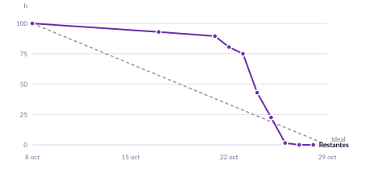
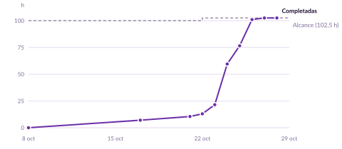

# Sprint 1 (8-29 oct 2026)

**Objetivo:** un grupo puede crear su cuenta, montar una partida, inscribirse y arrancarla: cada jugador ve su objetivo y su misión.
**Planificado:** 5 PBI (#2, #3, #4, #5, #31), 38 tareas (#34-#71), 100 h (capacidad para PBI: 103 h).
**Cambio durante el sprint (22 oct):** la 2.2 (#47) pasa a 4 h y la 2.6 (#51) a 4,5 h; el sprint queda en 102,5 h.

## Diario

Una fila por reunión diaria. *Restantes* es la suma de «Restantes (h)» de las tareas del sprint en el Project (la vista «Sprint S1» la muestra por columna): con ella se dibuja el burndown. *Completadas* es la suma de horas estimadas de las tareas cerradas y, con las PBI hechas, da el burnup.

| Fecha | Restantes (h) | Completadas (h) | PBI hechas | Qué se hizo / bloqueos |
|--|--|--|--|--|
| 2026-10-08 | 100 | 0 | 0 | Planificación del sprint |
| 2026-10-17 | 93 \* | 7 | 0 | Cerradas la 1.1 (#34) y la 1.2 (#35) |
| 2026-10-21 | 89,5 | 10,5 | 0 | Cerrada la 1.5 (#38). Valor del Project apuntado ese día |
| 2026-10-22 | 80,5 | 13 | 0 | Cerrada la 1.3 (#36). La 2.2 y la 2.6 suben 2,5 h en total. Valor del Project; con solo las fechas de cierre saldría 89,5: la diferencia es el avance parcial apuntado en las tareas abiertas |
| 2026-10-23 | 75 | 21,5 | 0 | Cerradas la 1.6 (#39) y la 1.8 (#41); la 2.1 (#46) se cerró el 22 oct después de apuntar esa fila. Valor del Project. Bloqueo: la fila de revisiones va lenta (7 de 38 tareas en clase a 6 días del cierre) |
| 2026-10-24 | 43 | 59,5 | 0 | Cerradas 13 tareas: 1.4, 1.7, 1.9, 1.10, 1.11 y 1.12 (todas las de la PBI 1), 2.2, 2.3, 2.4 y 2.5, 3.1, 4.1 y 5.1. Valor del Project. La PBI 1 sigue abierta: falta el defecto #97 (PR #98) y la prueba en el móvil. |
| 2026-10-25 | 22,5 | 76,5 | 1 | Cerradas la 3.4 (#56, PR #118, fusionada por Imad a las 12:55; aprobada por Alejo e Imad), la 3.2 (#54, PR #116, fusionada por Diego a las 15:11) y la 3.5 (#57, PR #119, fusionada por Imad a las 15:35). Fusionadas también, por Imad, las PR de interfaz de Alejo #113 (#107), #115 (#101), #111 (#104) y #114 (#100), con el ruleset de `main` desactivado (decisión de Imad). **PBI 1 (#2) cerrada y aceptada**: fusionada la #98 (defecto #97) y probada en el móvil (Xiaomi 15, APK 0.2.0) y en web contra producción. Valor del Project: la 4.2 (Diego) tiene 0 h restantes sin estar fusionada (se deja así, decisión de Imad), por eso baja de 43 a 39,5; con la 3.4, 37. Abierta la PR #116 (3.2), aprobada por Imad, falta Diego. Once issues de interfaz (#99-#109) y #117, de Alejo; fusionadas la #110 (#99) y la #112 (#105); la #111, #113, #114 y #115, a la espera de que Alejo rehaga sus ramas. **Tarde:** cerrada la 2.6 (#51, PR #120, fusionada por Diego a las 17:31); fusionadas por Imad la #121 (#117) y la #122 (#109), revisadas con capturas de la app web. Abiertas la #123 (3.3, Sergio; revisa Diego) y la #124 (2.7, Imad, con la comprobación en producción de los dos criterios de la PBI 2 por API y app web; revisa Sergio). Cerrada la 3.3 (#55, PR #123, fusionada por Diego a las 18:35). Cerrada la 2.7 (#52, PR #124, fusionada por Sergio a las 18:45): todas las tareas de la PBI 2 en clase; la PBI sigue abierta hasta probar el enlace y el QR en el móvil (APK 0.3.0). Fusionadas por Imad la #125 (#108) y la #126 (#106); fusionadas por Imad la #127 (#102, a las 19:47, tras un «Request changes») y la #128 (#103, a las 19:59): **cerrados todos los defectos de la PBI 1**. Noche: #130 (#129, alias largo) fusionada; APK 0.3.0 de Diego y ronda en el móvil (Android 16) con las casillas 10 de 16 PR marcadas; **PBI 2 (#3) cerrada y aceptada**; nuevos defectos #131 y #132 (Alejo): #133 (#131) y #134 (#132) fusionadas; abierta la #135 (3.6, Sergio), en revisión. Valor del Project: 22,5 (la #51, la #52 y la #55 tenían 4,5, 1,5 y 1,5 h restantes estando cerradas; corregido) |
| 2026-10-26 | 1,5 \* | 101 | 3 | Cerradas 11 tareas: 3.6 y 3.7 (la PBI 3 completa), 4.2, 4.3, 4.4, 4.5, 4.6 y 4.7, 5.2, 5.3 y 5.4. **PBI 3 (#4) cerrada y aceptada** (prueba en el móvil). En clase 37 de 38: solo falta la 5.5 (PR #151) |
| 2026-10-27 | 0 \* | 102,5 | 3 | Cerrada la 5.5 (#71, PR #151): 38 de 38 tareas en clase. Revisión entera de la PBI 4 y ronda 1 de Android: defectos y mejoras #152-#161 (R10-21 a R10-26). Fusionados los arreglos #162-#165 y #167-#170; la PBI 4 sigue abierta hasta que entren todos |
| 2026-10-28 | 0 \* | 102,5 | 3 | Sin tareas. Fusionadas la #166 y la #171 (últimos arreglos de la PBI 4) y la #176 (manual); ronda 2 de Android y revisión entera de la PBI 5: defectos #158 (reabierto) y #172-#175, con sus PR #177-#181, fusionadas esa tarde, y la #182 (instantánea de la pila). La ronda corta de Android deja un último defecto, #183 |
| 2026-10-29 | 0 \* | 102,5 | 5 | Fusionada la #184 (defecto #183). Casillas de todas las PR de las PBI 4 y 5. **PBI 4 (#5) y PBI 5 (#31) cerradas y aceptadas.** Fin del sprint: 5 PBI y 38 tareas hechas |

\* Reconstruido (el 22 oct las filas anteriores; el 30 oct las del 26 al 29 oct) a partir de las fechas de cierre de las tareas en GitHub: horas planificadas menos las estimadas de las tareas cerradas hasta ese día. No se apuntaron los valores diarios del Project y GitHub no guarda su historial. Los días que no aparecen no tuvieron tareas cerradas.

## Gráficas

Las dos gráficas se quedan casi planas hasta el 23 de octubre y caen del 24 al 26. Era lo previsto: las Fiestas del Pilar (10-18 de octubre) constaban en la capacidad como días de disponibilidad reducida y se sabía que buena parte del trabajo se haría en la última semana.

## Revisión (29 oct)

Se hicieron las cinco PBI planificadas, con sus 38 tareas cerradas y los 14 criterios con test de aceptación automático, repetidos a mano en producción. Al revisar cada PBI entera salieron 21 defectos y 12 mejoras no planificados, y se cerraron todos dentro del sprint.

En la demostración, el profesor, en el papel de cliente, usó la app a su manera contra producción mientras el equipo le explicaba el estado del proyecto: creó una cuenta, entró en su perfil, creó una partida, el resto se unió a ella, la arrancó y vio su carta.

| Quién | Comentario | Qué hacemos |
|--|--|--|
| Profesor | Al añadir una franja del horario dentro de otra que ya existe, la app no dice nada y no se sabe qué ha pasado | Mejora del sprint 2 (#185): el modal del día responde a cada acción con un mensaje de una línea |
| Profesor | En Android, el título «¡La partida ha empezado!» se corta y «EMPEZADO!» no se ve | Defecto del sprint 2 (#186): el título se ve entero, también con la letra del sistema al máximo |

No hubo más comentarios.

## Retrospectiva (29 oct)

El sprint salió como se planificó y las horas reales coincidieron con las estimadas. Lo que costó más fueron las *pull requests*: tareas muy pequeñas (de 1,5 a 6,5 h), esperas de uno o dos días a la revisión y cadenas de dependencias entre tareas. Aun así, el equipo considera útil revisar cada PR: en 17 de las 80 se pidieron cambios antes de fusionar. Imad hizo 67 de las 117 revisiones (57 %), lo esperado con `CODEOWNERS`.

**Votación.** Cada persona puntuó cada tema de 0 a 3 según cuánto se beneficiaría de mejorar; la tabla recoge la media que consensuó el equipo.

| Tema | Media (0-3) |
|--|--|
| Tareas demasiado pequeñas | 3 |
| Esperas en las revisiones | 3 |
| Sesiones de trabajo cortas y sin coordinar | 2 |
| Revisiones concentradas en una persona | 1,5 |
| Dependencias entre tareas | 1 |
| Prueba en Android al final | 0 |
| Horas restantes sin apuntar a diario | 0 |
| Documentación de diseño desfasada (ya tiene su issue, #188) | 0 |

**Acciones para el sprint 2.** Se mantiene la forma de trabajo: revisión de cada PR, integración continua obligatoria y prueba en Android con cada PBI.

| Acción | Cómo se mide | Responsable |
|--|--|--|
| Tareas menos desglosadas, cada una de una sola capa (app, servidor o documentación) y de una sola persona. Aplicado al planificar: 25 tareas de 3,3 h de media, frente a 38 de 2,7 h | Media de horas por tarea y PR que tocan más de una capa al cerrar el sprint 2 | Equipo |
| Cuidar las dependencias: calendario con el día de cada tarea y las que requiere, y el contrato de la API el primer día | Tareas fusionadas en su día del calendario | Alejo |
| Toda PR recibe su primera revisión en menos de 24 h laborables | Hora de apertura y de primera revisión; objetivo: el 80 % de las PR | Cada revisor; Alejo lo comprueba |
| Repartir la obligación de revisar para que nadie pase del 35 % (previsto en el sprint 2: Imad, 7 de 30) | Revisiones por persona al cerrar el sprint 2 | Alejo |
| El test de HTTPS de la integración continua no falla cuando el servidor de Render está dormido (hubo que relanzarlo tres veces entre el 30 oct y el 1 nov) | Ejecuciones de `ci-backend` relanzadas por `HttpsTest` | Sergio |
