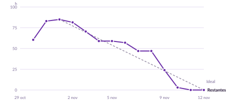
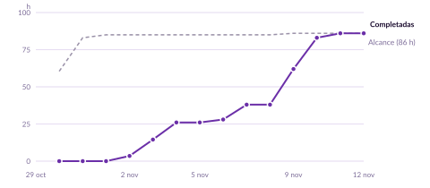

# Sprint 2 (29 oct-12 nov 2026)

**Objetivo:** se puede jugar una partida de principio a fin, con misiones de la biblioteca o generadas con IA y aprobadas por el máster: cada jugador elimina con el código de vida, hereda objetivo y misión, y la partida se cierra con un ganador.
**Planificado:** 5 PBI (7a #7, 8 #8, 7b #189, 6a #6 y 6b #190), 25 tareas (#192-#204 y #206-#217, 73,5 h) y los cuatro arreglos del sprint 1 (#185-#188, 9,5 h): 83 h de una capacidad de 91 h (las 8 h restantes, para el informe del 15 nov).
**Cambios durante el sprint:** entran el #218 (base de datos a Neon, 2 h, 1 nov) y el #237 (error al borrar la cuenta con una partida cerrada, 1 h, 9 nov); el sprint queda en 86 h.

## Diario

Una fila por día. *Restantes* es la suma de «Restantes (h)» de las tareas del sprint y de los issues #185-#188 en el Project: con ella se dibuja el burndown. *Completadas* es la suma de horas estimadas de lo cerrado y, con las PBI hechas, da el burnup.

| Fecha | Restantes (h) | Completadas (h) | PBI hechas | Qué se hizo / bloqueos |
|--|--|--|--|--|
| 2026-10-30 | 60,5 | 0 | 0 | Planificación: la PBI 6 se parte en 6a y 6b y la 7 en 7a y 7b; tareas #192-#204 y estimación de #185-#188 |
| 2026-10-31 | 83 | 0 | 0 | Entran la 6a y la 6b, con las tareas #206-#211 (22,5 h) |
| 2026-11-01 | 85 | 0 | 0 | Tareas de una sola capa y una persona: 25 tareas (nuevas #212-#217) con las mismas 83 h; criterio 2 de la 6b. El equipo confirma horas y reparto. Entra el #218 (2 h) |
| 2026-11-02 | 81,5 | 3,5 | 0 | Fusionadas #220 (#185) y #221 (#186); abierta #222 (#187) |
| 2026-11-03 | 70,5 | 14,5 | 0 | Fusionadas #223 (7a.1), #222 (#187), #225 (8.1), #224 (7a.2) y #226 (#218, base de datos en Neon) |
| 2026-11-04 | 59 | 26 | 0 | Fusionadas #227 (7a.4) y #229 (7a.3); abierta #228 (6a.1) |
| 2026-11-05 | 59 | 26 | 0 | Sin fusiones; abierta #230 (8.3) |
| 2026-11-06 | 57 | 28 | 0 | Fusionada #228 (6a.1); abiertas #231 (8.2) y #232 (6a.3). La eliminación (7a.3) se comprueba en producción |
| 2026-11-07 | 47 | 38 | 0 | Fusionadas #232 (6a.3) y #230 (8.3). Al probar la 8.2 con la app se decide enseñar la fecha del cierre real (R11-31) y se piden cambios en #231 y #230; abierta #233 (arreglos del diseño de la 7a.1) |
| 2026-11-08 | 47 | 38 | 0 | Domingo. Fusionada #233; abiertas #234 (6b.2) y #235 (7a.6) |
| 2026-11-09 | 24 | 62 | 0 | Fusionadas #231 (8.2), #235 (7a.6), #234 (6b.2), #236 (7a.5), #240 (7b.1), #239 (6a.2) y #238, del defecto nuevo #237 (1 h); abiertas #241 (7b.2) y #242 (#188) |
| 2026-11-10 | 3 | 83 | 0 | Fusionadas #241 (7b.2), #242 (#188), #247 (6b.1), #244 (8.4), #246 (6a.4), #245 (7b.3), #243 (7a.7), #250 (8.5), #251 (7b.4) y #249 (6b.3). Gemini responde en producción. Issue #248 (`HttpsTest`) para el sprint 3 |
| 2026-11-11 | 0 | 86 | 5 | Fusionadas #252 (6a.5) y #253 (6b.4): tablero a 0 h. Ronda de Android 16: defectos #254-#267 y mejora #268, todos al sprint 3. **PBI 7a, 8, 7b, 6a y 6b cerradas y aceptadas** |
| 2026-11-12 | 0 | 86 | 5 | Revisión del sprint en clase |

## Gráficas

El alcance sube del 30 de octubre al 1 de noviembre porque la 6a y la 6b entraron después de la primera planificación. A mitad del sprint, el 5 de noviembre, se habían completado 26 de 85 h (31 %), frente al 7 % del sprint 1; el resto llegó del 9 al 11 de noviembre, cuando se fusionaron las tareas de tests y manual de cada PBI.

## Revisión (12 nov)

Se hicieron las cinco PBI planificadas, con sus 25 tareas y sus 11 criterios con test de aceptación automático, y los seis issues de fuera de las PBI (#185-#188, #218 y #237). Velocidad: 5 PBI (tres M y dos S), 11 criterios y 86 h. Al revisar cada PBI entera en Android salieron 14 defectos de interfaz y una mejora (#254-#268); ninguno impide un criterio y pasan al sprint 3.

En la demostración, el Dueño del Producto llevó la app real contra producción, proyectada desde su móvil: código de vida, un código equivocado con sus intentos, la eliminación con la herencia, el feed, el cierre de una partida con ganador, partidas ya cerradas con empate y con último superviviente, y las misiones con IA. La eliminación vista por la víctima no se enseñó por falta de tiempo. Gemini dio un 503 al primer intento y salió el aviso de la biblioteca; al reintentar, respondió y se aprobaron y rechazaron misiones en directo.

| Quién | Comentario | Qué hacemos |
|--|--|--|
| Profesor | Problemas de interfaz vistos en la demo | Ya estaban en los issues del sprint 3 (#254-#268); no hay issues nuevos |

No hubo más comentarios.

## Retrospectiva

Participaron los cuatro miembros del equipo. Se empezó por examinar las acciones de la retrospectiva del sprint 1 con datos de GitHub: PR fusionadas del 29 de octubre al 12 de noviembre (35), sus revisiones (aprobaciones y peticiones de cambios de alguien distinto del autor, 48), el calendario de subidas y las ejecuciones de la integración continua.

| N.º | Acción del sprint 1 | Objetivo | Resultado en el sprint 2 | ¿Logrado? |
|--|--|--|--|--|
| 1 | Tareas de una sola capa y un responsable | Ninguna PR con app y servidor; media por tarea mayor de 2,7 h | Ninguna de las 35 PR toca a la vez `mobile/` y `backend/`; media de 2,9 h | Sí, aunque la media apenas sube |
| 2 | Abrir la PR pronto y revisarla en menos de 24 h laborables | El 30 % de las horas hechas a mitad del sprint; el 80 % de las PR revisadas en menos de 24 h | 31 % a mitad del sprint; 34 de 35 PR (97 %) revisadas en menos de 24 h, con una mediana de 3 h | Sí |
| 3 | Calendario con el día de cada tarea | El 80 % de las tareas en su día o antes | 22 de 30 (73 %); 8 con 1 a 4 días de retraso | No |
| 4 | Repartir las revisiones | Nadie por encima del 35 % | Imad 35,4 %, Diego 31,3 %, Sergio 25 % y Alejo 8,3 % | Casi: del 56 % al 35,4 % |
| 5 | Estimar los cuatro arreglos del sprint 1 | Los cuatro, fusionados | #185-#188, fusionados | Sí |
| 6 | Documentación de diseño al día | #188 fusionado en el sprint 2 | Fusionado el 10 de noviembre (#242) | Sí |
| 7 | Arreglar el test de HTTPS | Ninguna ejecución relanzada por ese test | 30 relanzamientos de `ci-backend`, todos por `HttpsTest`; pasa al #248 | No |

Después, cada uno escribió lo que le gustó, lo que aprendió, lo que faltó y lo que le habría gustado tener (las cuatro «L»), y se votaron los temas, de 0 a 4 según cuántos de los cuatro los ven importantes.

| Tema | Puntuación (0-4) |
|--|--|
| Los defectos de Android salen al final (14 el último día) | 3 |
| El test de HTTPS sigue sin arreglar | 3 |
| Retrasos en cadena del calendario | 2 |
| Las casillas de la definición de hecho no se marcan al fusionar (13 de 25 PR) | 2 |
| Trabajo al final del sprint (20 de 35 PR en los últimos cinco días) | 2 |
| Revisiones aún concentradas | 1 |
| La IA en producción falla a ratos (ya en el #268) | 1 |

**Acciones para el sprint 3.** Se mantiene lo que funcionó: tareas de una capa y una persona, revisión en menos de 24 h, el calendario, el reparto de revisiones según `CODEOWNERS` y estimar los defectos antes de repartir. Son compromisos del equipo; la definición de hecho no cambia.

| N.º | Problema en el sprint 2 | Qué se hace en el sprint 3 | Objetivo | Responsable |
|--|--|--|--|--|
| 1 | 14 defectos de interfaz salieron el último día | Quien revisa una PR con pantalla nueva o cambiada la prueba en un Android antes de aprobarla y lo anota en la revisión | Como mucho 5 defectos de interfaz en la ronda final de Android | Revisores de la app (Imad); lo comprueba Alejo |
| 2 | `HttpsTest` provocó 30 relanzamientos | El #248 se planifica con horas y en los primeros días del calendario | Ningún relanzamiento por `HttpsTest` desde su fusión | Sergio |
| 3 | El 73 % de las tareas en su día | El ScrumMaster repasa el calendario cada día laborable y recoloca lo que se retrasa; las tareas que dependen de otras empiezan con el contrato cerrado | El 80 % de las tareas en su día o antes | Alejo |
| 4 | 13 de 25 PR fusionadas sin las casillas | Quien aprueba marca las casillas antes de aprobar | Ninguna PR de tarea fusionada con casillas sin marcar | Cada revisor; lo comprueba Alejo |
| 5 | 20 de 35 PR en los últimos cinco días | Los tests de aceptación empiezan en cuanto está el diseño de su PBI | Como mucho el 40 % de las PR en los últimos cinco días | Equipo; los tests, Sergio |
