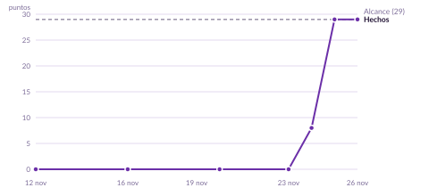
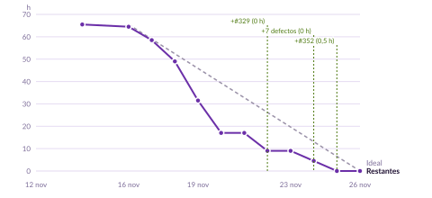

# Sprint 3 (12-26 nov 2026)

**Objetivo:** la partida respeta la vida académica y se puede reclamar: nadie elimina ni es eliminado en su horario lectivo, el máster marca zonas seguras que se comprueban al eliminar sin guardar la posición, y una eliminación injusta se disputa y se anula.
**Planificado:** 5 PBI (9 #9, 10a #10, 10b #272, 11a #11 y 11b #273), 29 puntos de historia, 26 tareas (#275-#300, 62 h) y 19 defectos y mejoras del sprint 2 (#248, #254-#268 y #301-#303, 3,5 h): 65,5 h. Las PBI se re-estimaron en puntos el 28 de noviembre, con la 10b como referencia de 3 puntos: 9 = 5, 10a = 5, 10b = 3, 11a = 8 y 11b = 8.
**Cambios durante el sprint:** El 19 de noviembre el equipo decidió por unanimidad adelantar las tareas: entraron en `main` antes de lo que marcaba el calendario, a propósito y con el sprint ya planificado, para terminar el trabajo el martes 24 y dejar hueco al proyecto de Ingeniería Web, que sabíamos que nos iba a quitar tiempo esos días. Entran nueve issues: el #329 el 22 de noviembre, siete defectos de las rondas de Android el 24 (#336-#340, #343 y #344) y el #352 el 25; todos con 0 h salvo el #352 (0,5 h). El sprint queda en 66 h.

## Diario

Una fila por día con trabajo. *Restantes* es la suma de «Restantes (h)» de las tareas y los issues del milestone `S3` en el Project: con ella se dibuja el burndown. *Completadas* es la suma de horas estimadas de lo cerrado. El burnup se dibuja con los puntos de las PBI hechas y aceptadas.

| Fecha | Restantes (h) | Completadas (h) | PBI hechas | Qué se hizo / bloqueos |
|--|--|--|--|--|
| 2026-11-14 | 65,5 | 0 | 0 | Planificación: la 10 se parte en 10a y 10b y la 11 en 11a y 11b; tareas #275-#300 y defectos #301-#303 con su estimación. Abiertas #269-#271, #274 y #304 (documentación) |
| 2026-11-16 | 64,5 | 1 | 0 | Arranque. Fusionadas #269-#271, #274 y #304 (documentación), #305 (9.1) y #306 (10a.1); abiertas #308 (defectos de la app de Alejo), #309 (11a.1) y #310 (#268 y #303) |
| 2026-11-17 | 58,5 | 7 | 0 | Fusionadas #308 y #311 (9.2); abiertas #312 (defectos de la app de Imad), #313 (#248) y #314 (10a.2) |
| 2026-11-18 | 49 | 16,5 | 0 | Fusionadas #309 (11a.1), #310, #312, #313 (#248) y #315 (9.3); abiertas #316 (10b.1) y #317 (10a.3) |
| 2026-11-19 | 31,5 | 34 | 0 | El equipo decide por unanimidad adelantar las tareas en `main` para acabar el martes 24 y dejar hueco al proyecto de Ingeniería Web, que sabíamos que nos iba a quitar tiempo. Fusionadas #316 (10b.1), #317 (10a.3), #318 (10b.2), #321 (11b.3) y #322 (11a.2) |
| 2026-11-20 | 17 | 48,5 | 0 | Fusionadas #314 (10a.2), #319 (9.4), #320 (11a.4), #324 (11a.3) y #325 (11b.2); abierta #323 (10b.3) |
| 2026-11-21 | 17 | 48,5 | 0 | Fusionada #326 (9.5); su comprobación en producción y en Android queda para el lunes 23 |
| 2026-11-22 | 9 | 56,5 | 0 | Fusionadas #323 (10b.3), #327 (11b.1), #328 (#261), #330 (#301) y #331 (#329, defecto nuevo de la 11b) |
| 2026-11-23 | 9 | 56,5 | 0 | Ronda de Android de la 9. Abiertas #332 (11a.5) y #333 (10a.5) |
| 2026-11-24 | 4,5 | 61 | 2 | Fusionadas #332, #333, #334 (10a.4), #335 (test del criterio 3 de la 11a), #341 (10b.4), #342 (11b.4), #345 (#259 y #336-#340), #346 (#257) y #348 (#343). Rondas de Android de la 9, la 10b y la 11: defectos #336-#340, #343 y #344, arreglados el mismo día salvo el #344. **PBI 9 y 10b cerradas y aceptadas** |
| 2026-11-25 | 0 | 66 | 5 | Fusionadas #347 (#344), #349 (11a.6), #350 (11b.5), #351 (10a.6) y #358 (#352, test del borrado de cuenta con disputas): tablero a 0 h. Ronda de Android de otro miembro del equipo: todo bien, y cinco defectos de la app para el sprint 4 (#353-#357). **PBI 10a, 11a y 11b cerradas y aceptadas** |
| 2026-11-26 | 0 | 66 | 5 | Revisión del sprint en clase |

## Gráficas

El burnup cuenta los puntos de las PBI hechas y aceptadas: las cinco se aceptaron al revisar cada una entera, la 9 y la 10b el 24 de noviembre y las otras tres el 25. El burndown cuenta las horas restantes con el alcance real; las líneas verdes marcan los issues que entraron con el sprint empezado. La línea ideal va del arranque, el 16 de noviembre, al último día del sprint, y la real llega a 0 el 25 porque las tareas se adelantaron a propósito.

## Revisión (26 nov)

Se hicieron las cinco PBI planificadas, con sus 26 tareas y sus 13 criterios con test de aceptación automático, y los 19 defectos y mejoras del sprint 2. Velocidad: 29 puntos de historia (cinco PBI), 13 criterios y 66 h. Los defectos que salieron al revisar cada PBI en Android se arreglaron dentro del sprint (#336-#340, #343, #344 y #352); el #257 y el #259, del sprint 2, se reabrieron y se cerraron con la #346 y la #345.

La demostración la hicieron los miembros del equipo que fueron a la sesión, con sus móviles y su propio guion, y salió bien.

| Comentario | Qué hacemos | Issue |
|--|--|--|
| Al consultar el código de vida, a veces desaparecen las tres últimas cifras | Las seis cifras se ven siempre en una línea dentro del círculo de «Mi código» | #359 |
| En la lista de disputas el título solo dice «MIS» | Se lee «MIS DISPUTAS» entero | #360 |
| En el mapa de zonas a pantalla completa, la tarjeta «No se elimina dentro de una zona…» no deja que el mapa llegue hasta abajo | Se quita la tarjeta de ese mapa; el aviso se queda en la pestaña Partida | #361 |

Los tres van al sprint 4. Para la presentación final, que será la revisión del sprint 4, se pidió explicar la aplicación con vídeos de demostración, orientarla a conseguir financiación de inversores y contar qué se haría en los siguientes lanzamientos con ese dinero.

## Retrospectiva

Participaron los cuatro miembros del equipo. Se empezó por examinar las acciones de la retrospectiva del sprint 2 con datos de GitHub: PR fusionadas del 12 al 26 de noviembre (44), sus revisiones (aprobaciones y peticiones de cambios de alguien distinto del autor), el calendario de subidas y las ejecuciones de la integración continua.

| N.º | Acción del sprint 2 | Objetivo | Resultado en el sprint 3 | ¿Logrado? |
|--|--|--|--|--|
| 1 | Probar en Android cada pantalla nueva antes de aprobar su PR | Como mucho 5 defectos de interfaz en la ronda final de Android | 6 defectos nuevos de la app (#336-#340 y #344) y 2 reabiertos (#257 y #259) | No: 8 frente a 5 |
| 2 | El #248 con horas y al principio del calendario | Ningún relanzamiento por `HttpsTest` desde su fusión | Fusionado el 18 de noviembre (#313); desde entonces, ningún relanzamiento por `HttpsTest` | Sí |
| 3 | Repasar el calendario a diario y recolocar lo que se retrasa | El 80 % de las tareas en su día o antes | 22 de 46 (48 %) | No |
| 4 | Marcar las casillas de la definición de hecho antes de aprobar | Ninguna PR de tarea fusionada con casillas sin marcar | 28 de 29 con alguna sin marcar; en 6 solo faltaba la de producción | No |
| 5 | Empezar los tests de aceptación con el diseño de su PBI | Como mucho el 40 % de las PR en los últimos cinco días | 19 de 44 (43,2 %) | No, por poco |

Otros datos: 57 revisiones (Imad 31,6 %, Diego, Sergio y Alejo el resto); cambios pedidos en 7 de 44 PR (16 %); primera revisión con una mediana de 5,3 h laborables; ninguna PR con app y servidor a la vez; 348 tests en el servidor (96,3 % de cobertura de líneas) y 237 en la app. Horas dedicadas, según la hoja de esfuerzos: 56 h en tareas (62 estimadas), 3,5 h en defectos y 19,9 h de Scrum y gestión.

Después, cada uno escribió lo que le gustó, lo que aprendió, lo que faltó y lo que le habría gustado tener (las cuatro «L»), y se votaron los temas, de 0 a 4 según cuántos de los cuatro los ven importantes.

| Tema | Puntuación (0-4) |
|--|--|
| El calendario no se cumple (48 % de las tareas en su día) | 3 |
| La ronda de Android depende de una persona y del horario de clase | 3 |
| Las pantallas se siguen probando en Android al final (8 defectos) | 2 |
| PR que entran sin la revisión de quien conoce el cambio (#332 y #348) | 2 |
| Decisiones de producto durante la ronda | 1 |
| Las casillas de la definición de hecho se marcan al cerrar la PBI (se resuelve en la definición de hecho) | 0 |

**Acciones para el sprint 4.** Se mantiene lo que funcionó: tareas de una capa y una persona, ninguna PR con app y servidor a la vez y la revisión en menos de 24 h. Son compromisos del equipo:

| N.º | Problema en el sprint 3 | Qué se hace en el sprint 4 | Objetivo | Responsable |
|--|--|--|--|--|
| 1 | El 48 % de las tareas en su día | La última tarea de cada PBI entra como muy tarde el 8 de diciembre y el 9 y el 10 quedan libres para la presentación; el calendario se repasa cada día laborable y se avisa de la tarea con un día de retraso | El 80 % de las tareas en su día o antes | Alejo |
| 2 | La ronda de Android llega al final y depende de una persona | La ronda de cada PBI empieza el día que entra su última tarea de app y la hace alguien distinto de quien hizo la app, con un guion; el APK nuevo se pide al planificar la tarea que lo necesita | Ninguna PBI con su ronda más de 2 días laborables después de su última PR de app | Imad, los guiones; Diego, el APK |
| 3 | PR integradas sin la aprobación de quien conoce el cambio | Una PR que cambia el modelo de datos, `openapi.yaml` o un test de aceptación ya revisado espera la aprobación del Dueño del Producto | Ninguna PR de ese tipo integrada sin su aprobación | Cada autor; lo comprueba Alejo |

**Definición de hecho, versión 2** (en `.github/pull_request_template.md`, en esta misma PR). Entran dos prácticas de las retrospectivas: la PR se abre en cuanto la tarea está terminada y recibe la primera revisión en 24 horas laborables (antes, dos días laborables), y quien aprueba marca la lista antes de aprobar, salvo el punto de producción, que se marca al cerrar la PBI. Salen tres criterios que no valen para cualquier PBI: el borrado de los datos nuevos del jugador con su cuenta y la posición que no se guarda pasan a criterios de aceptación de las PBI que les toquen, y el *hash* de las contraseñas y el HTTPS, cumplidos en el sprint 1, siguen comprobados por sus tests en la integración continua.
